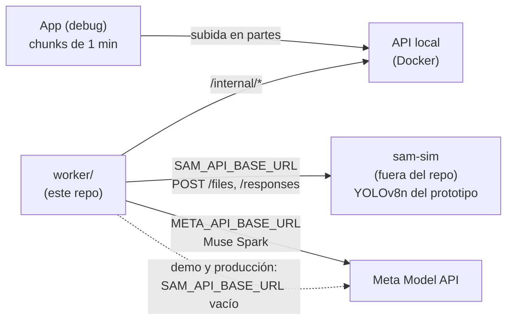

# Entorno de desarrollo: simulador de SAM 3.1

Para no gastar los $150 de créditos (ni depender de la key) mientras se construye, el worker se desarrolla contra un **simulador local de la API de SAM 3.1**. Es un servidor HTTP que responde como SAM, pero por dentro usa el **segmentador local del prototipo previo** (YOLOv8n con su tracker IoU y la asignación de equipo por color). El demo y la producción usan SAM 3.1 de verdad.

## Los dos entornos

| | Desarrollo | Demo y producción |
|---|---|---|
| Chunks | 1 min con 2 s de traslape (perfil `dev`, [12](12-videos-largos-chunks.md)) | 5 min con 3 s (de 2 a 5 s) (perfil `demo`) |
| API | Node o PHP en Docker local | PHP en https://ppcoachtracker.pepemxl.com |
| Segmentación | **Simulador de SAM** en Docker local (`SAM_API_BASE_URL=http://sam-sim:8090/v1`) | SAM 3.1 por la Meta Model API |
| Insights | Muse Spark real si hay `MODEL_API_KEY` (una llamada barata por clip); sin key, la respuesta fija del simulador: `SIM_MUSE=1`, `META_API_BASE_URL` también al simulador y `MODEL_API_KEY=sim-local` (el worker sigue sin arrancar con la key vacía) | Muse Spark real |
| `backends` en el resultado | `segmenter: "sam_simulator"` (y `analyst: "muse_spark_simulator"` si aplica) | `segmenter: "meta_sam"`, `analyst: "muse_spark"` |
| Créditos | No gasta en SAM | Gasta: medir antes ([12](12-videos-largos-chunks.md#costo)) |



## Por qué no rompe "sin respaldo"

La regla del proyecto es que el worker no tiene detector local ni respaldo ([prompts/00-contexto.md](prompts/00-contexto.md)). El simulador la respeta así:

1. **El worker de este repo no cambia:** solo habla HTTP con una URL de configuración. No tiene código de YOLO, ni modelos, ni una escalera de respaldo. Si `SAM_API_BASE_URL` apunta a Meta y Meta falla, el trabajo falla.
2. **El simulador vive fuera del repo**, en la carpeta del prototipo previo, cuya ruta va en `PP_DEV_SAM_SIM_DIR` del `.env` (que no se versiona). Nada de su código se copia aquí.
3. **Nunca se mezcla con SAM real:**
   - el simulador manda la cabecera `X-PP-Simulator: 1` en cada respuesta, y el worker marca `segmenter: "sam_simulator"` si la ve **o** si `SAM_API_BASE_URL` no es la de Meta;
   - la llave de la caché de Meta incluye la URL base, así que una respuesta del simulador nunca sale de la caché en una corrida real;
   - la app muestra un aviso en el análisis ("Análisis de desarrollo: simulador, no SAM 3.1");
   - la API de producción tiene `PP_COACH_TRACKER_REQUIRE_META=1` y rechaza (422) un resultado cuyo `segmenter` no sea `meta_sam`.
4. **Nunca se despliega:** el simulador escucha solo en la máquina de desarrollo. No va a Modal, ni a un VPS, ni a Cloud Provider.

## Licencias

YOLOv8n de Ultralytics es **AGPL-3.0**. El simulador lo usa solo en la máquina de desarrollo: no se distribuye ni se ofrece como servicio a nadie, y no entra al repo, al APK ni a ningún servidor. Por eso no aparece en `THIRD_PARTY.md` y la verificación `git grep -i -E "yolo|ultralytics|onnx"` sigue sin encontrar nada fuera de `docs/`. Si alguna vez hiciera falta desplegarlo, primero se revisa la licencia. Esto no es asesoría legal.

## Qué simula (contrato HTTP)

Solo la parte de la Meta Model API que usa `worker/ppcoachtracker_worker/sam.py` ([etapa 8](prompts/08-worker.md)), con las mismas rutas bajo `/v1`:

| Ruta | Qué hace el simulador |
|---|---|
| `POST /v1/files` (multipart, `purpose=user_data`) | Guarda el MP4, calcula su `sha256` y devuelve `{id: "file-<sha256 corto>", …}` |
| `POST /v1/responses` con `model: "sam-3.1"`, el `file_id` y el concepto en texto, `stream: true` | Corre el segmentador local sobre el chunk (una vez por archivo; lo demás sale de su caché) y devuelve un stream con el formato de SAM: una marca `<Nf>` por cuadro y, por objeto, su ordinal (el id del track) y `<\|box;x1=..;y1=..;x2=..;y2=..;c=..\|>` normalizadas |
| `POST /v1/responses` con `model: "muse-spark-…"` | Solo con `SIM_MUSE=1`: una respuesta fija que cumple el `json_schema` pedido (resumen y un hallazgo que dice que es simulado). Si no, 404 `model not served by simulator` |
| `GET /health` | `{ok, simulator: "sam", version}` |

Cómo responde a cada concepto:

| Concepto | Respuesta |
|---|---|
| `player in <color> jersey` | Los tracks de persona con pies en la cancha cuyo color de torso es el más cercano a ese `JerseyColor` (los mismos RGB de la app) |
| `soccer ball` | La trayectoria del balón |
| `soccer player` | Todas las personas con pies en la cancha |
| Cualquier otro | Un stream vacío (como SAM cuando no encuentra nada) |

Para probar errores del worker:

- sin `Authorization: Bearer …` → 401 (cualquier valor sirve, para no usar la key real);
- `SIM_FAIL_RATE` (0 a 1): esa fracción de llamadas responde 429 con `Retry-After: 1` o 500;
- `SIM_CUT_STREAM=1`: corta el stream a la mitad una de cada cinco veces.

**El formato es el que documenta la etapa 8, no el verificado.** En cuanto haya key, se captura el stream real de un clip propio corto, se ajustan el parser del worker y el simulador a ese formato, y se guardan esos streams como fixtures de las pruebas. Hasta entonces, que el worker funcione con el simulador no prueba que funcione con SAM.

## Cómo se corre

El simulador lo construye la [etapa 8a](prompts/08a-simulador-sam.md), en la carpeta del prototipo. Los dos `docker-compose` comparten la red externa `ppcoachtracker-dev`:

```bash
wsl -e docker network create ppcoachtracker-dev        # una vez

# En PP_DEV_SAM_SIM_DIR (fuera de este repo):
wsl -e docker compose up -d sam-sim                     # 127.0.0.1:8090 y sam-sim:8090 en la red
curl http://127.0.0.1:8090/health

# En api/ de este repo, con SAM_API_BASE_URL=http://sam-sim:8090/v1 en el .env:
npm run php:up
npm run worker:up
```

Con `SIM_YOLO_TILES=1` (sin mosaicos) el simulador procesa un chunk de 1 min en un par de minutos de CPU; con mosaicos encuentra más jugadores lejanos pero tarda unas 3 veces la duración del video. Por eso en desarrollo los chunks son de 1 min y los clips cortos.

## Pasar del simulador a SAM 3.1

1. Reclamar los créditos y poner `MODEL_API_KEY` en `.env`.
2. Correr `analyze` con un clip propio de 1 min contra Meta (`SAM_API_BASE_URL` vacío) y guardar los streams crudos.
3. Ajustar el parser del worker y el simulador al formato real; las pruebas usan esos streams.
4. Medir el costo de ese minuto y anotarlo en `worker/README.md`.
5. Cambiar la app al perfil `demo` (chunks de 5 min, 3 s) y analizar el clip del demo ([guion](guion-demo.md)).
6. En producción: `SAM_API_BASE_URL` vacío en el worker desplegado y `PP_COACH_TRACKER_REQUIRE_META=1` en la API.

## Qué se declara en la entrega

El texto de [prompts/](prompts/README.md#texto-para-la-entrega-callout) lo dice: durante el desarrollo se usó un simulador local de la API de SAM, construido sobre el tracker del prototipo previo, que no forma parte del repo ni de la entrega; todos los análisis del demo y de producción son de SAM 3.1 y Muse Spark.
