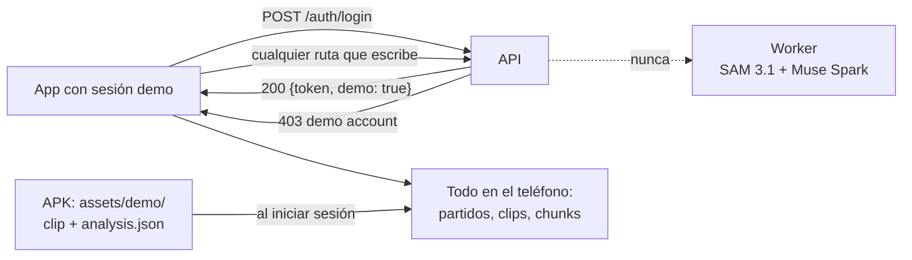

# Modo demo: compartir la app sin gastar crédito de Meta

Una **cuenta demo** deja instalar y usar la app completa sin que nada llegue al worker: no se sube video, no se llama a SAM 3.1 ni a Muse Spark y no se gasta crédito. Para que se vea cómo luce un análisis, la app trae un clip de prueba con su análisis ya hecho por el worker real.

Sirve para dar la APK a jueces, a otros entrenadores o a quien quiera probarla, sin repartir una cuenta que gaste.

> **No confundir** con el **perfil de chunks `demo`** (5 min con 3 s de traslape, [12](12-videos-largos-chunks.md)). Ese es el tamaño de los cortes del video del release; este documento trata de las cuentas que no suben.

## Cómo funciona



La protección está en **la API**, no en la app. Aunque alguien modifique la APK, el servidor rechaza cada escritura de una cuenta demo, y sin clips registrados el worker no tiene nada que tomar.

## La cuenta en la API

- **Base:** `users.demo TINYINT(1)`. La agrega `Schema::migrate` (PHP) y está en `api/db/schema.sql` (Node).
- **Token:** el login responde `{token, email, name, demo}`. El JWT de una cuenta demo lleva además `"demo": true`. Una cuenta no cambia de tipo, así que todos sus tokens lo dicen.
- **Rutas:** puede leer (`GET /consent`, `GET /clips/:id`). Toda ruta que escribe responde `403 {error: "demo account", demo: true}`:
  - `POST /clips`
  - la calibración
  - las imágenes de referencia
  - las partes y el cierre de los chunks
  - `complete`
  - `POST /consent`
- **Código:** `App::writer()` en PHP y el middleware `writerAuth` en Node.
- **Crear una cuenta:**

```bash
# PHP (local en Docker; en producción, el instalador de abajo)
docker compose exec -T -e PP_COACH_TRACKER_PASSWORD='…' php php bin/user.php add-demo demo@example.com "Demo"
# Node
npm run user:add -- --demo demo@example.com "Demo" 'contraseña-larga'
```

`bin/user.php list` muestra si cada cuenta es `demo` o `coach`. El detalle está en [api/README.md](../api/README.md#cuentas-demo).

## La app con una sesión demo

La app lee `demo` del login (`Session.demo`) y lo guarda en la sesión (`Settings.demo`). Con eso:

| Qué | Con una cuenta normal | Con una cuenta demo |
|---|---|---|
| Botón del clip | "Enviar a análisis" | **"Preparar la copia"**: hace los chunks en el teléfono y deja compartirlos, como sin servidor |
| Subida (`UploadWorker`) | Sube los chunks | No sube: falla con `ERR_LOGIN` si alguien la lanza |
| Consentimiento | Se reporta a la API | Se guarda en el teléfono y no se reporta |
| Ajustes | Servidor y sesión | Además, "Cuenta demo" con su nota, y "Agregar el clip de prueba" si falta |
| Partidos, grabar, importar, zona de juego, puntos de la cancha, plantel, estadísticas, dorsales | Igual | Igual |

**El clip de prueba** (`data/DemoContent.kt` y `CoachViewModel.seedDemo()`):

1. Al iniciar sesión con una cuenta demo, la app crea un partido con los equipos y colores del análisis.
2. Le agrega el clip "Jugada de prueba" / "Sample play", ya en estado **Listo**.
3. Escribe el análisis en `files/analyses/clip_N_0.json`, el mismo lugar que la copia local de un análisis descargado, así que se ve sin red.
4. Si el entrenador borra el partido, Ajustes ofrece agregarlo otra vez. Si la APK no trae el clip, la app lo dice.

El detalle está en [android_native/README.md](../android_native/README.md#modo-demo).

## Preparar el clip de prueba

El clip y su análisis van dentro de la APK, en `android_native/app/demo-assets/demo/`:

- `demo_clip.mp4`
- `analysis.json`

`build.gradle.kts` agrega esa carpeta a los assets. **No se versiona:** los términos del video de stock no permiten redistribuir el archivo tal cual ([08](08-uso-de-video.md#video-de-stock-mixkit-y-similares)). Sin la carpeta, la app compila igual, pero no trae el clip de prueba.

Para generarlos, se corre **una vez** el worker real sobre el clip, con los mismos chunks que haría la app:

1. Copiar el clip a `LOCAL_DATA/demo/demo_clip.mp4`. Puede ser propio o de stock con licencia comercial.
2. Correr un script que corte el clip con `worker/tools/make_chunks.py` (720p, 10 fps) y llame a `analyze()` del worker. El script vive en `LOCAL_DATA/demo/run_demo.py`, que no se versiona. Recibe el partido (equipos y colores), `pitch_mode` y `camera`, y escribe `analysis.json`. Corre con la imagen del worker y la `MODEL_API_KEY` del `.env`:

   ```bash
   wsl -e docker run --rm --env-file .env \
     -v "$PWD/LOCAL_DATA:/d" -v "$PWD/worker:/worker" \
     --entrypoint python ppcoachtracker-worker:latest /d/demo/run_demo.py
   ```

   El script guarda las respuestas en `LOCAL_DATA/demo/cache/`, así que repetirlo no cuesta. La primera corrida de 5 s costó unos **US$0.03** (159 cuadros de SAM 3.1 más una llamada a Muse Spark).
3. Copiar `demo_clip.mp4` y `analysis.json` a `android_native/app/demo-assets/demo/`.
4. Compilar la APK release (siguiente sección).

### El clip actual

| | |
|---|---|
| Video | [Mixkit 43481](https://mixkit.co/free-stock-video/play-between-two-teams-in-a-soccer-match-43481/), Stock Video Free License, 1280×720, 5.2 s |
| Partido | "Rojos" (rojo) contra "Celestes" (azul claro), zona de juego apagada, cámara en movimiento |
| Análisis | SAM 3.1 + Muse Spark reales |

**Limitación:** la toma es cerrada. El worker toma 43 de 53 cuadros como acercamientos (jugadores más altos que un tercio de la imagen), así que solo cuenta 1 s y avisa que hay pocos jugadores a la vista. Para la entrega conviene cambiarlo por un clip con toma abierta de la cancha y repetir los pasos de arriba.

## Producción

- **Instalar la cuenta:** el instalador del hosting crea la cuenta de `user.env` si no existe. Con `DEMO=1` en ese archivo, la crea como demo. Así queda el paquete:

  ```bash
  USER_ENV=<user.env> bash api/php/tools/package.sh
  ```

  `user.env` lleva `EMAIL`, `NAME`, `PASSWORD` y `DEMO=1`, se genera sin imprimir la contraseña y se borra después de instalar. El flujo de despliegue está en [arquitectura/05-despliegue.md](arquitectura/05-despliegue.md#producción-etapa-9).
- **La cuenta de producción** existe desde el 1 de noviembre de 2026. Su correo y su contraseña están solo en el `.env` de la raíz (`PROD_DEMO_EMAIL` y `PROD_DEMO_PASSWORD`), no en el repo.
- **Verificación:**
  - inicia sesión con `demo: true`;
  - `POST /clips` y `POST /consent` dan 403 y `GET /consent` da 200;
  - la cuenta de entrenador sigue con `demo: false`.
- **APK para compartir:** el release firmado, compilado con `demo-assets/`. Queda en `android_native/dist/`, que no se versiona. Con el QR de configuración de la cuenta demo, quien la instala solo escanea y entra.

## Pruebas

| Dónde | Qué cubre |
|---|---|
| `api/tests/api.test.js` (Node) y `api/tests/php/contract.test.js` (PHP) | Login con `demo: true` en la respuesta y en el token; 403 en cada ruta que escribe; las lecturas responden; ningún clip en la base; un token firmado por Node se rechaza igual en PHP; una cuenta normal no es demo |
| `DemoContentTest.kt` | El partido sale del análisis (equipos, colores, valores por omisión) |
| `ApiClientTest.kt` | La app lee `demo` del login |

Probado en el emulador contra la API PHP local:

- el login demo agrega el partido y su análisis se ve sin red;
- un video importado se prepara en el teléfono;
- la API solo recibió el login.
