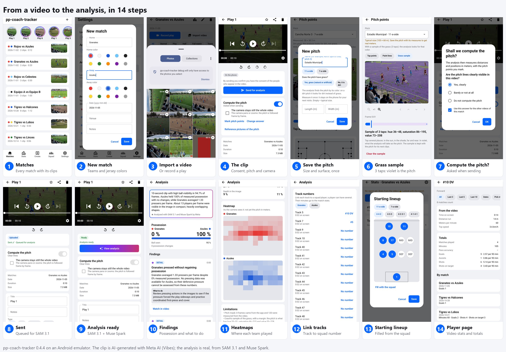

# El flujo completo de la app, de un video al análisis

**Fecha:** 5 de noviembre de 2026.
**Qué se probó:** la app 0.4.4 de punta a punta en un emulador Android (Medium Phone, API 36), contra la API local y el worker local con SAM 3.1 y Muse Spark reales.

- **El video:** `granates_azules_1.mp4`, 10 s de la escena del grupo 1 (granates contra azules desde la grada), **generado con IA con Meta AI (Vibes)** a partir de una imagen de Meta muse-image-1.0 ([assets/grupo_01/](assets/grupo_01/README.md)). No es un partido real: sirve para mostrar el flujo, no para medir la precisión, que se mide con video real ([results/](results/README.md)).
- **Costo:** 5 llamadas a la Meta Model API y 360 cuadros-concepto, unos centavos de dólar. El worker tardó 48 s.

## Los pasos

| # | Pantalla | Qué hace el entrenador |
|---|---|---|
| 1 | Matches | Ve sus partidos, cada uno con sus clips y los colores de sus equipos |
| 2 | New match | Crea "Granates vs Azules" con el color de la camiseta de cada equipo; de ahí salen los conceptos de SAM (`player in red jersey`, `player in blue jersey`) |
| 3 | Import video | Elige el clip de la galería (o graba una jugada) |
| 4 | El clip | Ve el consentimiento de uso de video, si la cámara se queda fija y las opciones de la cancha |
| 5 | Save the pitch | Guarda la cancha una vez, con su tamaño (vacío = medidas típicas) y su superficie: pasto o tierra |
| 6 | Grass sample | Toca el pasto en 3 lugares; en violeta, lo que el análisis tomará como cancha |
| 7 | Compute the pitch? | Al enviar, la app pregunta si las líneas se ven claras |
| 8 | Sent | La app prepara la copia de 10 fps, la sube en partes y queda en la cola |
| 9 | Analysis ready | El worker la analiza con SAM 3.1 y Muse Spark |
| 10 | Findings | El resumen y los hallazgos de Muse Spark, cada uno con "qué hacer" y el enlace al momento del video |
| 11 | Heatmaps | Dónde jugó cada equipo, en la imagen (sin puntos de la cancha no hay metros) |
| 12 | Link tracks | Liga cada track de SAM a un número del plantel; sus minutos van a las estadísticas |
| 13 | Starting lineup | La alineación del partido, llenada desde el plantel |
| 14 | Player page | Lo que sale del video (tiempo en pantalla, distancia, metros por minuto, velocidad máxima) y los totales con lo que anota el entrenador |

## Qué dio el análisis

- **Posesión:** Azules 100 %, sin cambios, con el balón visto en el 95 % de los cuadros.
- **Jugadores:** unos 13 por cuadro en la imagen (7.2 granates y 6.1 azules).
- **76 cuadros cuentan;** 44 se descartaron porque al final la cámara se va a la grada. La app lo dice en las limitaciones.
- **56 tracks de unos 2 s.** SAM no sigue a cada jugador mucho tiempo en este clip. **Probable, sin verificar:** el video de IA cambia a los jugadores de un cuadro a otro. Con video real los tracks duran minutos ([results/07](results/07-partido-completo-dos-tiempos.md)).
- **Sin metros:** no se marcaron puntos de la cancha. Las líneas de esta escena inventada no encajan como las de una cancha real. La calibración se muestra con capturas reales en [results/04](results/04-hito-cancha-sin-lineas.md).

## Lo que se encontró en la app

- **La muestra de pasto mueve la imagen.** Al primer toque aparece un texto arriba de la imagen que la empuja unos 100 px hacia abajo, así que el siguiente toque puede caer fuera. En la prueba, 2 de 5 toques se perdieron. Se arregla reservando el espacio del texto desde el principio.

## Cómo repetirlo

1. Levantar la base de datos y la API local ([README](../README.md#running-it-locally)) y el emulador, con la app de debug apuntando a `http://10.0.2.2:8097/pp-coach-tracker`.
2. Seguir los pasos de arriba con un clip de la galería del emulador.
3. Desde `api/`, correr el worker una vez: `wsl -e docker compose --profile worker run --rm worker once`. Toma el job de la cola, llama a Meta y guarda la corrida en `worker/.local/runs/`.
4. Volver a abrir el clip en la app: queda en "Analysis ready".
