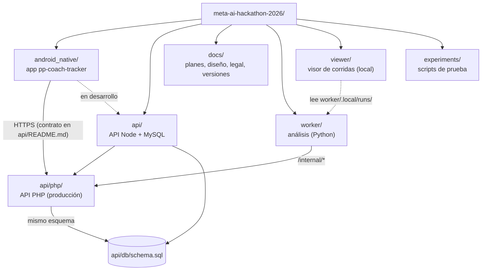

# Estructura del repositorio



## Raíz

| Ruta | Qué es |
|---|---|
| `.env.example` | Variables del proyecto: Meta API, la API local y los valores de producción (`PROD_*`, `Cloud Provider_*`). El `.env` real no se versiona |
| `.gitignore` | Excluye `.env`, videos, `api/php/dist/`, builds y llaves |
| `experiments/smoke_test.py` | Prueba de conexión con la Meta Model API (Muse Spark y SAM 3.1), solo con la biblioteca estándar |
| `experiments/check_chunks.py` | Revisa una carpeta de chunks sacada del teléfono: YAML legible por PyYAML y OpenCV, mapas de frames y traslapes |

## `android_native/`: la app

```
android_native/
├── app/
│   ├── build.gradle.kts            versión (versionName/versionCode), dependencias, firma
│   ├── src/main/
│   │   ├── AndroidManifest.xml     permisos (cámara, micrófono, red)
│   │   ├── java/com/ppcoach/tracker/
│   │   │   ├── MainActivity.kt     entrada; monta AppRoot
│   │   │   ├── analysis/           trabajos en segundo plano (WorkManager)
│   │   │   │   ├── ChunkWorker.kt      genera la versión de 10 fps en chunks + YAML
│   │   │   │   ├── PitchSampler.kt     decodifica cada chunk y mide la cancha por cuadro
│   │   │   │   ├── UploadWorker.kt     sube los chunks (registro, puntos de la cancha, PUT por chunk, complete)
│   │   │   │   └── ConsentWorker.kt    avisa aceptaciones y retiros a POST /consent
│   │   │   ├── data/               modelos y lógica sin UI (casi todo Kotlin puro)
│   │   │   │   ├── Models.kt           Match, Clip, Library, estados y colores
│   │   │   │   ├── Stats.kt            Player, Stat, estadísticas y totales
│   │   │   │   ├── StatsFilter.kt      qué partidos suman las estadísticas
│   │   │   │   ├── StartingLineup.kt   formación y alineación inicial del partido
│   │   │   │   ├── LibraryCodec.kt     library.json ↔ modelos
│   │   │   │   ├── LibraryStore.kt     rutas de videos, library.json y chunks
│   │   │   │   ├── Durable.kt          escrituras atómicas (sobreviven a un apagón)
│   │   │   │   ├── StorageLocations.kt memoria del teléfono, interna privada, SD
│   │   │   │   ├── VideoFiles.kt       metadatos, miniaturas, importar y exportar
│   │   │   │   ├── RecordingSpec.kt    lo que se le pide a CameraX
│   │   │   │   ├── Proxy.kt            especificación de 10 fps y costo en SAM
│   │   │   │   ├── Chunks.kt           cortes, mapa de frames y YAML por chunk
│   │   │   │   ├── PitchMask.kt        la máscara de la cancha de un cuadro (la misma que pitch.py)
│   │   │   │   ├── PitchTouches.kt     puntos marcados, plantilla de la cancha y homografía de vista previa
│   │   │   │   ├── ClipAnalysis.kt     el análisis del worker (GET /clips/:id/analysis), también en metros
│   │   │   │   ├── AnalysisReportParser.kt  reporte de análisis en JSON
│   │   │   │   ├── ApiClient.kt        cliente HTTP (OkHttp) de la API
│   │   │   │   ├── SecretBox.kt        cifrado AES-GCM con el Keystore
│   │   │   │   ├── SettingsStore.kt    ajustes en SharedPreferences
│   │   │   │   └── Consent.kt          versión del consentimiento y enlaces legales
│   │   │   └── ui/
│   │   │       ├── AppRoot.kt          pila de pantallas, mensajes, diálogo de consentimiento
│   │   │       ├── CoachViewModel.kt   todo el estado y las acciones
│   │   │       ├── components/         piezas compartidas (diálogos de consentimiento y de la cancha, alineación, estadísticas)
│   │   │       ├── i18n/Strings.kt     cada texto en español e inglés
│   │   │       ├── screens/            una pantalla por archivo (también PitchTouchesScreen y ClipAnalysisScreen)
│   │   │       └── theme/Theme.kt      colores y tipografía
│   │   ├── res/                    ícono y recursos mínimos
│   │   └── src/debug/res/          permite HTTP a 10.0.2.2 solo en debug
│   └── src/test/                   pruebas JVM (JUnit + MockWebServer)
├── samples/analysis-report.example.json   reporte de ejemplo para importar
├── keystore.properties.example     cómo configurar la firma de release
└── make.bat, gradlew               compilar en Windows
```

## `api/`: la API

```
api/
├── db/schema.sql           esquema MySQL compartido por Node y PHP (CREATE TABLE IF NOT EXISTS)
├── docker-compose.yml      MySQL 8 + PHP 8.3/Apache para desarrollo local
├── package.json            scripts: test, test:php, php:up, php:migrate, user:add
├── src/                    API Node (Express)
│   ├── server.js           arranque y configuración por variables de entorno
│   ├── app.js              rutas y reglas del contrato
│   ├── auth.js             scrypt, JWT HS256, comparación en tiempo constante
│   ├── consent.js          versión del consentimiento y validación de eventos
│   ├── calibration.js      validación de los puntos de la cancha
│   ├── storage.js          nombres de archivos y carpetas por clip, sha256
│   ├── repo/memory.js      repositorio en memoria (pruebas)
│   ├── repo/mysql.js       repositorio MySQL
│   └── cli/add-user.js     crear cuentas
├── tests/
│   ├── upload.test.js      contrato completo contra la API Node (memoria o MySQL)
│   └── php/contract.test.js  el mismo contrato por HTTP contra la API PHP en Docker
└── php/                    API PHP para Cloud Provider
    ├── src/                App, Router, Request/Response, Multipart, Auth, Repo, Schema, Consent, Calibration…
    ├── public/             entrada web: index.php, .htaccess, .user.ini y legal/
    ├── bin/                CLI: migrate.php, user.php
    ├── tools/              package.sh, install_Cloud Provider.php, legal_pages.py
    └── docker/Dockerfile   PHP 8.3 + Apache para imitar a Cloud Provider
```

## `worker/`: el análisis

```
worker/
├── ppcoachtracker_worker/
│   ├── __main__.py         CLI: run (servicio), once, analyze DIR (sin API)
│   ├── config.py           variables de entorno
│   ├── api.py              cliente de /internal/* (urllib)
│   ├── chunks.py           lee chunks.yaml y los YAML de la app; cuadros sin el traslape
│   ├── types.py            TrackRow (con mx, my), TrackSet, FrameInfo, MatchInfo, JobOptions y los errores de la escalera
│   ├── pipeline.py         escalera de respaldo, etapas y armado del resultado
│   ├── segmenters/         meta_sam (SAM 3.1) y local_cv (YOLOv8n en mosaicos + tracker + equipos)
│   ├── yolo.py, tracker.py, teams.py, colors.py   piezas del tracker local
│   ├── pitch.py            máscara de la cancha por cuadro (cuando la app no la manda)
│   ├── cuts.py             cortes de cámara
│   ├── shots.py            qué cuadros cuentan (fuera acercamientos y repeticiones)
│   ├── ball.py             el balón entre cuadros
│   ├── calibration/        la cancha en metros
│   │   ├── template.py         plantilla de 11 y de 7 con puntos y líneas con nombre
│   │   ├── solver.py           homografía desde puntos y rectas, RANSAC, modelo de cámara
│   │   ├── propagate.py        movimiento de la cámara entre cuadros (KLT sobre el pasto)
│   │   ├── lines.py            búsqueda de la cámara contra las líneas blancas (apagado)
│   │   ├── sam_lines.py        las líneas con máscaras de SAM 3.1 (apagado, sin verificar)
│   │   └── __init__.py         puntos del entrenador, propagación y reporte
│   ├── metrics.py          forma, heatmap, posesión, presión, timeline; y en metros
│   ├── debug.py            guarda una corrida para el visor
│   └── analysts/           muse_spark y rules
├── tests/                  pytest (videos y canchas sintéticos, una API falsa)
├── tools/                  make_chunks.py, submit_clip.py, overlay.py, compare_runs.py, rescore.py
├── models/                 yolov8n.onnx (no se versiona)
├── Dockerfile, requirements*.txt
└── README.md               cómo correrlo y formato del resultado
```

## `viewer/`: el visor de corridas

Página local (Vite + React, en Docker con `npm run viewer:up` desde `api/`, solo en `127.0.0.1:8098`) para revisar a ojo una corrida del worker: las cajas sobre el video, la cancha calculada, la posesión y el resultado completo. Lee `worker/.local/runs/`, que no se versiona (viewer/README.md).

## `docs/`

| Ruta | Contenido |
|---|---|
| `01`–`12-*.md` | Evento, propuesta, diseño, planes, uso de video, privacidad, estadísticas y chunks |
| `arquitectura/` | Esta documentación |
| `mejoras/` | Planes y resultados de las mejoras del análisis (cancha, acercamientos, homografía…) |
| `learnings/` | Lo aprendido al medir y desplegar |
| `prompts/` | Prompts para reconstruir el proyecto si hiciera falta |
| `legal/` | Aviso de privacidad, consentimiento y formato para jugadores; `legal/en/` en inglés |
| `versions/<versión>/` | Capturas y notas de cada versión de la app |

## Lo que no se versiona

| Qué | Dónde vive |
|---|---|
| `.env` con secretos de producción | Raíz del repo, en la máquina del desarrollador |
| Videos de prueba y datasets | `LOCAL_DATA/`, `data/`, `worker/.local/` (corridas, scripts de medición; `*.mp4` está en `.gitignore`) |
| Modelo del detector | `worker/models/yolov8n.onnx` (licencia AGPL) |
| Paquete de despliegue | `api/php/dist/` (se genera con `tools/package.sh`) |
| Llave de firma de release | `android_native/keystore.properties` y el `.jks` |
| Chunks recibidos | `storage/` del servidor |
