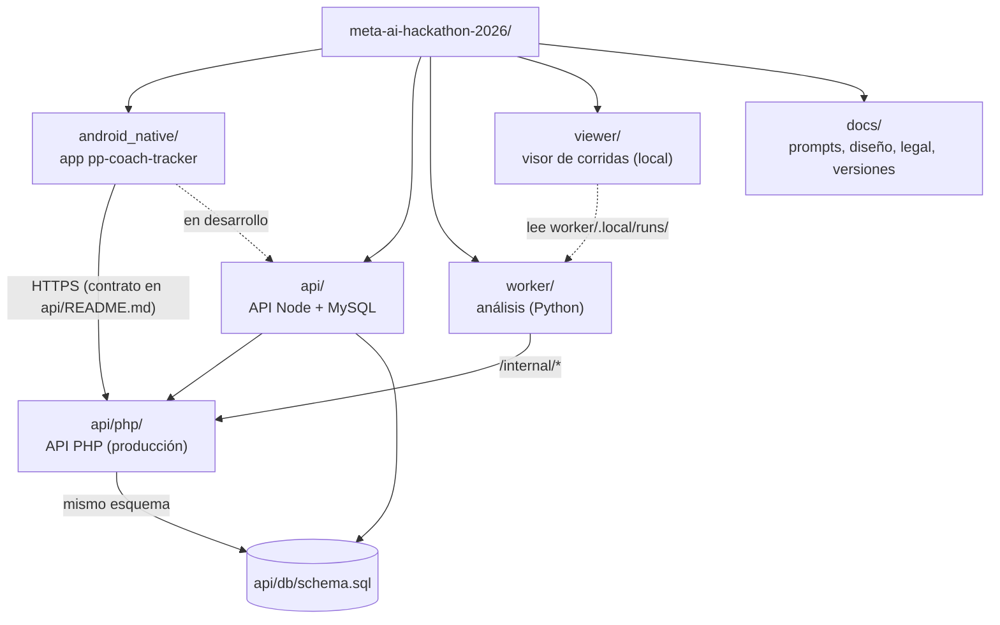

# Estructura del repositorio



## Raíz

| Ruta | Qué es |
|---|---|
| `README.md` | Qué es el proyecto y dónde empezar |
| `THIRD_PARTY.md` | Cada dependencia con su versión y licencia (todas permisivas) |
| `.env.example` | Nombres de las variables: Meta API, worker, simulador, API local y valores de producción (`PROD_*`). El `.env` real no se versiona |
| `.gitignore` | Excluye `.env`, videos, `LOCAL_DATA/`, `/data/`, `.local/`, builds y llaves. `/data/` va anclado a la raíz: sin la barra dejaba fuera el paquete `data` de la app |

## `android_native/`: la app

```
android_native/
├── app/
│   ├── build.gradle.kts            versión, dependencias, firma; perfil de chunks por omisión (debug dev, release demo)
│   ├── src/main/
│   │   ├── AndroidManifest.xml     permisos (cámara, micrófono, red) y el FileProvider
│   │   ├── java/com/ppcoach/tracker/
│   │   │   ├── MainActivity.kt     entrada; monta AppRoot
│   │   │   ├── AppGraph.kt         la biblioteca única del proceso (commit), ajustes y rutas
│   │   │   ├── analysis/           trabajo en segundo plano y procesamiento de imagen
│   │   │   │   ├── Work.kt             cadenas de WorkManager y ConsentWorker
│   │   │   │   ├── ChunkWorker.kt      versión de 10 fps en chunks (Media3 Transformer) + YAML
│   │   │   │   ├── PitchSampler.kt     decodifica cada chunk (MediaCodec) y mide la cancha por cuadro
│   │   │   │   ├── UploadWorker.kt     registro, calibración, imágenes de referencia, partes de 8 MB, complete
│   │   │   │   └── ReferenceImages.kt  fotos de la cancha: enderezar por EXIF, 1600 px, JPEG para subir
│   │   │   ├── data/               modelos y lógica sin UI (casi todo Kotlin puro, con pruebas JVM)
│   │   │   │   ├── Models.kt           Match, Clip, Library, estados, tipos de clip y colores
│   │   │   │   ├── LibraryCodec.kt     library.json ↔ modelos (tolera campos desconocidos)
│   │   │   │   ├── Durable.kt          escritura atómica y LibraryStore
│   │   │   │   ├── StorageLocations.kt memoria del teléfono, interna privada, SD
│   │   │   │   ├── Chunks.kt           perfiles dev/demo, cortes, mapa de cuadros, YAML y rutas de la versión para análisis
│   │   │   │   ├── PitchMask.kt        la máscara de la cancha de un cuadro (la misma regla que pitch.py)
│   │   │   │   ├── PitchTouches.kt     respuesta de la cancha, plantilla de 11 y 7, puntos y líneas, homografía de vista previa
│   │   │   │   ├── PitchReferences.kt  líneas pintadas, trazos, imágenes de referencia y el cuerpo de POST calibration
│   │   │   │   ├── ClipAnalysis.kt     el análisis del worker (también en metros) y su copia local
│   │   │   │   ├── ApiClient.kt        cliente HTTP (OkHttp) y el plan de partes que faltan
│   │   │   │   ├── Consent.kt          versión del consentimiento, enlaces legales y motivos de rechazo
│   │   │   │   └── SettingsStore.kt    ajustes en SharedPreferences y SecretBox (AES-GCM con el Keystore)
│   │   │   └── ui/
│   │   │       ├── AppRoot.kt          pila de pantallas, barra inferior, mensajes y diálogos
│   │   │       ├── CoachViewModel.kt   todo el estado y las acciones
│   │   │       ├── components/         Components (botones, tarjetas, chips, mapa de calor), ConsentDialog, Pitch (pregunta y cancha desde arriba)
│   │   │       ├── i18n/Strings.kt     cada texto en español e inglés
│   │   │       ├── screens/            una pantalla por archivo
│   │   │       └── theme/              Tokens (colores tipo Meta, claro y oscuro) y Theme
│   │   ├── res/                    ícono, colores, temas y file_paths.xml (videos y references/)
│   │   └── src/debug/res/          permite HTTP a 10.0.2.2 solo en debug
│   └── src/test/                   pruebas JVM (JUnit, org.json, MockWebServer)
└── make.bat, gradlew               compilar en Windows
```

## `api/`: la API

```
api/
├── README.md               contrato completo: rutas, cuerpos, errores y límites
├── db/schema.sql           esquema MySQL compartido por Node y PHP (CREATE TABLE IF NOT EXISTS)
├── docker-compose.yml      mysql, php, worker (profile) y viewer (profile)
├── package.json            scripts: test, db:up, php:up, php:migrate, test:php, worker:up, worker:test, viewer:up, user:add
├── src/                    API Node (Express)
│   ├── server.js, config.js   arranque y variables (.env de la raíz)
│   ├── app.js              rutas y reglas del contrato
│   ├── auth.js             scrypt, JWT HS256, API_TOKENS
│   ├── consent.js          versión vigente y validación de eventos
│   ├── calibration.js      validación de puntos, líneas pintadas y referencias
│   ├── storage.js          nombres de archivos por clip, .partial, sha256, imágenes de referencia
│   ├── repo/memory.js      repositorio en memoria (pruebas)
│   ├── repo/mysql.js       repositorio MySQL
│   └── cli/add-user.js     crear cuentas
├── tests/
│   ├── api.test.js         contrato completo contra la API Node (memoria o MySQL)
│   └── php/contract.test.js   el mismo contrato por HTTP contra la API PHP en Docker
└── php/                    API PHP
    ├── src/                App, Auth, Calibration, Config, Consent, Db, Repo, Schema, Storage y Http/ (Request, Response, Router, Multipart)
    ├── public/             entrada web: index.php, .htaccess, .user.ini y legal/ (páginas generadas)
    ├── bin/                migrate.php, user.php (solo terminal)
    ├── tools/legal_pages.py   genera public/legal/ desde docs/legal/
    └── docker/Dockerfile   PHP 8.3 + Apache, como el hosting
```

## `worker/`: el análisis

```
worker/
├── ppcoachtracker_worker/
│   ├── __main__.py         CLI: run (servicio), once, analyze DIR (sin API)
│   ├── config.py           variables de entorno
│   ├── api.py              cliente de /internal/* (urllib)
│   ├── meta_api.py         cliente de la Meta Model API: reintentos, SSE, caché de respuestas crudas, uso
│   ├── sam.py              conceptos, lector del stream de SAM 3.1 y unión de tracks entre chunks
│   ├── insights.py         Muse Spark: hechos sin nombres, salida estructurada y su validación
│   ├── chunks.py           chunks.yaml y los YAML de la app; cuadros sin el traslape
│   ├── types.py            TrackRow, TrackSet, FrameInfo y los errores (Retryable, Meta, Input)
│   ├── pipeline.py         etapas de un trabajo y armado del resultado
│   ├── teams.py, colors.py    equipo por concepto y color del torso
│   ├── pitch.py            máscara de la cancha por cuadro (cuando la app no la manda)
│   ├── cuts.py             cortes de cámara
│   ├── shots.py            qué cuadros cuentan (fuera acercamientos y tomas sin cancha)
│   ├── ball.py             trayectorias del balón
│   ├── metrics.py          forma, heatmap, posesión, presión, timeline; y en metros
│   ├── debug.py            guarda una corrida para el visor
│   └── calibration/        la cancha en metros
│       ├── template.py         plantillas de 11 y de 7 con puntos y líneas con nombre
│       ├── solver.py           homografía desde puntos y rectas (DLT), RANSAC, modelo de cámara
│       ├── propagate.py        movimiento de la cámara entre cuadros (KLT sobre el pasto)
│       ├── sam_lines.py        líneas con SAM guiado por los trazos del entrenador (apagado)
│       └── __init__.py         cuadros tocados, propagación y reporte
├── tests/                  pytest: streams de SAM sintéticos, canchas sintéticas (pitchscene.py), una API falsa; fixtures compartidos con la app
├── tools/                  make_chunks.py, submit_clip.py, overlay.py, compare_runs.py, rescore.py
├── Dockerfile, requirements*.txt
└── README.md               cómo correrlo, variables, formato de SAM y del resultado, costo
```

## `viewer/`: el visor de corridas

Página local (Vite + React + TypeScript, servida por `server.mjs`) para revisar a ojo una corrida del worker: las cajas de SAM sobre el video, la posesión en una línea de tiempo, las métricas, los hallazgos y el `result.json`. Corre en Docker con `npm run viewer:up` desde `api/` en el puerto 8098 y lee `worker/.local/runs/`, que no se versiona. No se despliega.

## `docs/`

| Ruta | Contenido |
|---|---|
| `prompts/` | Las etapas de la construcción, con criterios de aceptación y trampas conocidas |
| `arquitectura/` | Esta documentación |
| `diseno.md` | Estilo visual de la app y del visor (colores tipo Meta) |
| `01`–`13-*.md` | Evento, propuesta, planes, uso de video, privacidad, estadísticas, chunks y entorno de desarrollo |
| `rules/` | Reglas oficiales del hackathon |
| `legal/` | Aviso de privacidad, consentimiento y formato para jugadores; `legal/en/` en inglés |
| `learnings/` | Lo aprendido en el prototipo previo (antecedente) |
| `versions/<versión>/` | Capturas y notas de cada versión de esta construcción |

## Lo que no se versiona

| Qué | Dónde vive |
|---|---|
| `.env` con secretos | Raíz del repo, en la máquina del desarrollador |
| Videos de prueba y datasets | `LOCAL_DATA/`, `data/` (raíz), `worker/.local/` (trabajos, corridas, caché de Meta); `*.mp4` está en `.gitignore` |
| Chunks e imágenes recibidos | `api/storage/` en local, `STORAGE_DIR` en el servidor |
| Simulador de SAM | Fuera del repo (`PP_DEV_SAM_SIM_DIR`) |
| Llave de firma de release | `android_native/keystore.properties` y el `.jks` |
