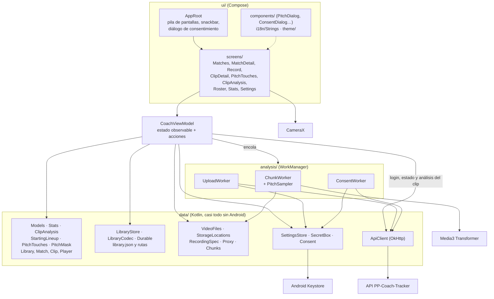
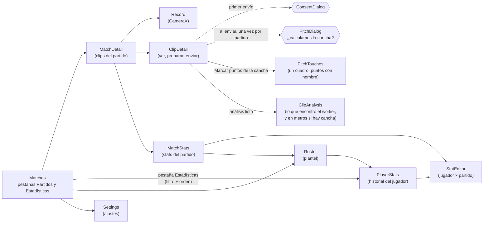
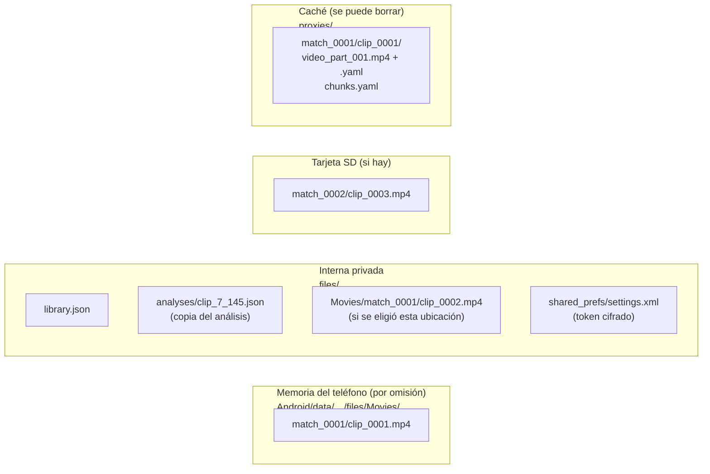
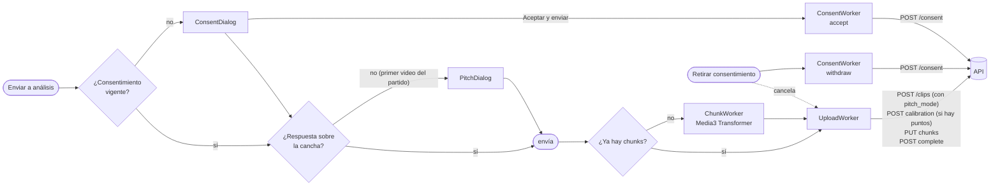
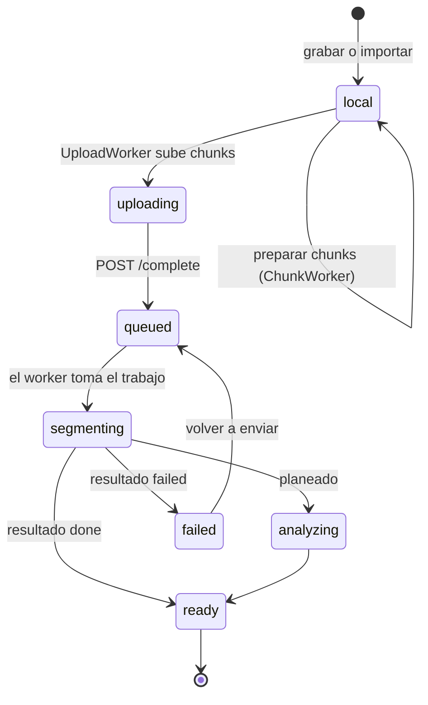
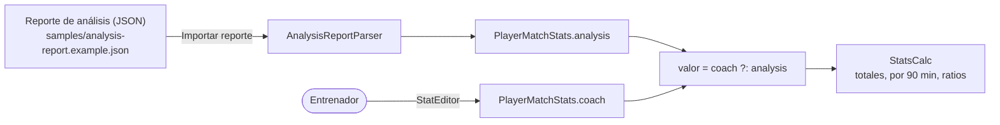

# App Android: pp-coach-tracker

> **Antecedente.** Este documento viene del diseño y del prototipo previos al hackathon, que tenían un respaldo local (detector YOLOv8n, tracker propio e insights por reglas). La versión que se construye **no tiene respaldo**: solo SAM 3.1 y Muse Spark, y solo dependencias con licencia permisiva. Donde este texto diga otra cosa, mandan [prompts/00-contexto.md](../prompts/00-contexto.md) y el prompt de cada etapa.

Kotlin + Jetpack Compose, una sola actividad, sin base de datos: la biblioteca del entrenador es un `library.json` y los videos son archivos MP4. Código en `android_native/`.

## Capas

- **Un solo ViewModel** (`CoachViewModel`) tiene la biblioteca, los ajustes, la pila de navegación y el progreso de los trabajos. Las pantallas leen su estado y llaman sus funciones.
- **Toda escritura de la biblioteca pasa por `commit()`**: cambia el estado en memoria al instante y escribe `library.json` en un solo hilo, en orden, con escritura atómica (`Durable`).
- **`data/` casi no depende de Android**, así que las pruebas JVM cubren chunks, estadísticas, el códec de la biblioteca, el cliente HTTP (con MockWebServer), el consentimiento, la máscara de la cancha, la plantilla y la homografía de los puntos marcados, y la lectura del análisis (también en metros).

## Navegación

No hay librería de navegación: `CoachViewModel` guarda una pila de `Screen` y `AppRoot` dibuja la de arriba. "Atrás" quita una. La pantalla principal tiene dos pestañas, Partidos y Estadísticas (`homeTab`). El filtro de estadísticas (`statsFilter`: todos, últimos N, rango de fechas o partidos elegidos) vive en el ViewModel y lo comparten la pestaña y la página de cada jugador.

## Dónde guarda cada cosa

| Dato | Formato | Notas |
|---|---|---|
| Partidos, clips, plantel, estadísticas | `library.json` | Tolerante a campos desconocidos; si no se puede leer se aparta como `library.json.bad` sin tocar los videos. Cada clip guarda también su respuesta sobre la cancha (`pitchMode`) y los puntos marcados (`touches`); el partido, la última respuesta |
| Videos originales | MP4 (H.264/AAC, 1080p o 720p, 30 fps) | Cada clip recuerda su ubicación; "Mover N clips aquí" los pasa de una a otra |
| Versión para análisis | Chunks MP4 de 10 fps, máx. 720p (1080p con "Alta resolución" en Ajustes), sin audio, 1 min con 1 s de traslape, más un YAML por chunk (con la máscara de la cancha de cada cuadro) y `chunks.yaml` | En la caché: se regenera si Android la borra |
| Análisis de cada clip | JSON tal como lo devuelve la API | Copia para verlo sin conexión; se reemplaza cada vez que se abre con red |
| Ajustes | SharedPreferences | Idioma, ubicación, vista técnica, servidor, correo, consentimiento |
| Sesión (JWT) | Cifrada con AES-256-GCM, llave en el Keystore (`SecretBox`) | Nunca va en los datos de entrada de WorkManager |

## Trabajos en segundo plano

Cada clip tiene **una sola cadena de WorkManager** (`clip-<id>`), así que preparar y enviar nunca se pisan. El consentimiento tiene su propia cadena (`consent`), que respeta el orden de los eventos.

| Worker | Qué hace | Reintentos |
|---|---|---|
| `ChunkWorker` | Corta el original en chunks de 1 min (1 s de traslape), los convierte a 10 fps/720p (o 1080p, según Ajustes) sin audio, lee el tiempo de cada frame y escribe el YAML con el mapa al original y el `sha256`. Con `PitchSampler` decodifica cada chunk y mide la cancha en cada cuadro (`PitchMask`, la misma regla que el worker); si menos de la mitad tiene cancha, el clip lo avisa. Si se interrumpe, sigue en el chunk que faltaba | Lo relanza la cadena |
| `UploadWorker` | Registra el clip (con el consentimiento y `pitch_mode`), manda los puntos marcados a `POST /clips/:id/calibration` (si el servidor los rechaza, el video se envía igual, sin metros), sube solo los chunks que el servidor no tiene con el mismo `sha256` y completa. Lee la sesión cifrada al correr | Con red; backoff exponencial, hasta 8 intentos en errores de red, `5xx`, `408`, `429` y `422`. Se detiene con `401`, `400` y `428` |
| `ConsentWorker` | Manda cada aceptación o retiro a `POST /consent` | Con red; espera también a que haya sesión (`401`); hasta 20 intentos |

## Estados de un clip

- La app guarda el estado en `Clip.status` y el id del servidor en `Clip.remoteId`.
- Al abrir un clip enviado consulta `GET /clips/:id` y actualiza el estado.
- Con el estado `ready`, "Ver análisis" abre `ClipAnalysis`: resumen, posesión, hallazgos, los dos equipos lado a lado y dónde estuvo cada uno; si el resultado trae metros, la sección "En la cancha, en metros" con la cancha vista desde arriba. La pantalla muestra al instante la copia guardada en `files/analyses/clip_<id local>_<id del servidor>.json` y pide `GET /clips/:id/analysis` para tenerla al día. Sin conexión se queda la copia; solo si no hay copia dice por qué no se pudo (todavía no está, sin conexión, sesión vencida). Borrar el clip o el partido borra la copia.
- La vista simple lo muestra como "En cola para el análisis", "Analizando…", "Análisis listo" o "El análisis falló".

## Estadísticas de jugadores

- Las estadísticas que puede dar el video (`Stat.fromAnalysis`) se desbloquean cuando el partido tiene reporte; las demás (goles, tarjetas) las captura el entrenador.
- Lo que escribe el entrenador gana sobre lo del análisis, y borrarlo regresa al valor del análisis. Detalle en [11-stats-jugadores.md](../11-stats-jugadores.md).
- Hoy el reporte se importa como archivo. Cuando exista el worker vendrá de la API.

## Seguridad en el teléfono

- **Sesión cifrada** con una llave del Keystore; en 0.3.0 el token se guardaba en claro, y 0.3.1 lo migra y borra los registros viejos de WorkManager.
- **HTTP en claro solo en debug** (`src/debug/res/xml/network_security_config.xml`) para llegar a la API local en `10.0.2.2`; el release exige HTTPS.
- **Permisos:** cámara, micrófono (el audio del original; la versión para análisis no lleva), internet y estado de la red.
