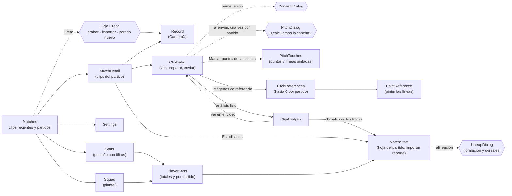
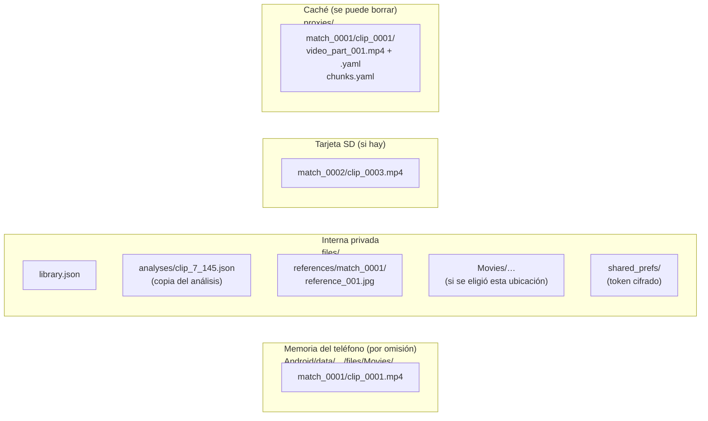
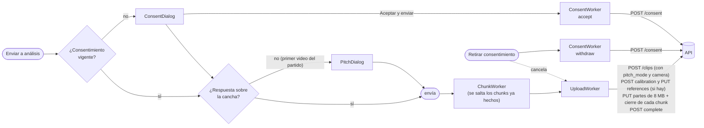
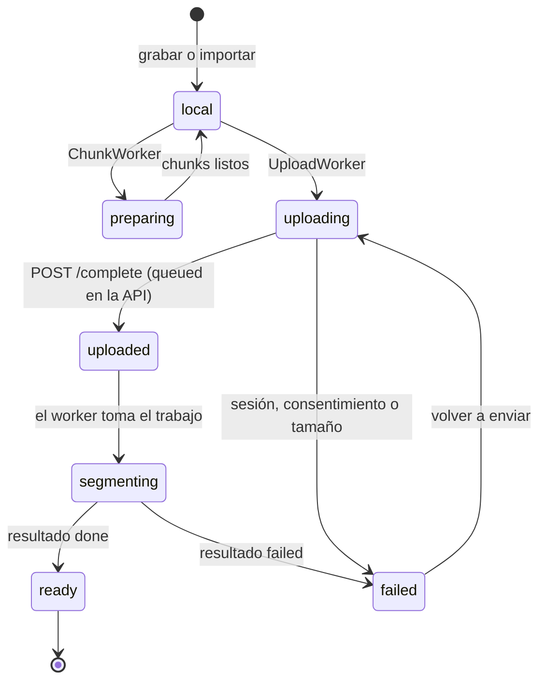

# App Android: pp-coach-tracker

Kotlin + Jetpack Compose, una sola actividad, sin base de datos: la biblioteca del entrenador es un `library.json` y los videos son archivos MP4. El estilo sigue a las apps de Meta, en claro y oscuro ([diseno.md](../diseno.md)). Código en `android_native/`; id `com.ppcoach.tracker` (`.debug` en debug), versión 0.1.0.

## Capas

```mermaid
flowchart TB
    subgraph ui["ui/ (Compose)"]
        root["AppRoot<br/>pila de pantallas, barra inferior,<br/>hoja Crear, mensajes, diálogos"]
        screens["screens/<br/>Matches, MatchDetail, Record, ClipDetail,<br/>PitchTouches, PitchReferences, PaintReference,<br/>ClipAnalysis, Settings"]
        comps["components/ (Components, ConsentDialog, Pitch)<br/>i18n/Strings · theme/Tokens, Theme"]
    end

    vm["CoachViewModel<br/>estado observable + acciones"]
    graph["AppGraph<br/>una biblioteca por proceso (commit)"]

    subgraph data["data/ (Kotlin, casi todo sin Android)"]
        models["Models · LibraryCodec · Durable<br/>Library, Match, Clip"]
        video["StorageLocations · Chunks · PitchMask"]
        pitch["PitchTouches · PitchReferences<br/>plantilla, homografía, trazos"]
        net["ApiClient (OkHttp) · ClipAnalysis"]
        sec["SettingsStore · SecretBox · Consent"]
    end

    subgraph work["analysis/"]
        chunk["ChunkWorker<br/>+ PitchSampler"]
        upload["UploadWorker"]
        consent["ConsentWorker (Work.kt)"]
        refimg["ReferenceImages"]
    end

    camx["CameraX"]
    media3["Media3 Transformer<br/>y MediaCodec"]
    ks["Android Keystore"]
    apiext["API pp-coach-tracker"]

    root --> screens --> vm
    comps -.-> screens
    vm --> graph --> models
    vm --> video
    vm --> pitch
    vm --> sec
    vm -->|"login, estado y análisis"| net
    vm -->|"encola"| work
    vm --> refimg
    screens --> camx
    chunk --> media3
    upload --> net
    upload --> refimg
    consent --> net
    upload --> graph
    chunk --> graph
    sec --> ks
    net --> apiext
```

- **Un solo ViewModel** (`CoachViewModel`) tiene los ajustes, la pila de navegación, el progreso de los trabajos y los análisis cargados. Las pantallas leen su estado y llaman sus funciones.
- **Una sola biblioteca por proceso** (`AppGraph`): el ViewModel y los workers de WorkManager la cambian con `commit()`, que actualiza la memoria al instante y escribe `library.json` en orden con escritura atómica (`Durable`). Así nunca se pisan.
- **`data/` casi no depende de Android**, así que las pruebas JVM cubren chunks, el códec de la biblioteca, el cliente HTTP (con MockWebServer), el consentimiento, la máscara de la cancha, la plantilla y la homografía de los puntos y las líneas, el cuerpo de la calibración y la lectura del análisis. La plantilla de la cancha se compara contra el mismo fixture que usa el worker.

## Navegación

No hay librería de navegación: `CoachViewModel` guarda una pila de `Screen` y `AppRoot` dibuja la de arriba; "Atrás" quita una. Las pantallas raíz (Partidos, Estadísticas, Plantel y Ajustes) llevan la barra inferior con **Partidos**, **Estadísticas**, **Crear** (hoja con grabar jugada, importar video o partido nuevo), **Plantel** y **Ajustes**.



**Ajustes:** idioma (español o inglés), apariencia (sistema, claro, oscuro), sistema de análisis (servidor, iniciar y cerrar sesión), privacidad y consentimiento (enlaces legales, retirar), ubicación de los videos (con "Mover N clips aquí"), vista técnica, video para el análisis (720p, 1080p u original) y perfil de chunks (`dev` o `demo`).

## Dónde guarda cada cosa



| Dato | Formato | Notas |
|---|---|---|
| Partidos y clips | `library.json` | Tolerante a campos desconocidos. Cada clip guarda su respuesta sobre la cancha (`pitchMode`), sus puntos y líneas pintadas (`touches`) y qué parte de sus cuadros tiene cancha (`pitchShare`); el partido, la última respuesta y sus imágenes de referencia con sus trazos |
| Videos originales | MP4 (H.264/AAC, 1080p o 720p, 30 fps) | Cada clip recuerda su ubicación. El tipo de clip (jugada, medio tiempo, partido) se propone por la duración |
| Versión para análisis | Chunks MP4 de 10 fps, a 720p, 1080p o la resolución original hasta 2160p ("Video para el análisis"), sin audio, más un YAML por chunk (con la máscara de la cancha de cada cuadro) y `chunks.yaml` | Perfil `dev`: 1 min con 2 s de traslape; `demo`: 5 min con 3 s. En la caché: se regenera si Android la borra |
| Imágenes de referencia | JPEG enderezado según el EXIF, lado mayor de 1600 px | De la cámara del teléfono (FileProvider) o de un cuadro del clip. Hasta 6 por partido; sirven para todos sus videos |
| Análisis de cada clip | JSON tal como lo devuelve la API | Copia para verlo sin conexión; se reemplaza cada vez que se abre con red; se borra con el clip |
| Ajustes | SharedPreferences | Idioma, tema, ubicación, vista técnica, resolución del video para el análisis, perfil, servidor, correo, consentimiento |
| Sesión (JWT) | AES-256-GCM, llave en el Keystore (`SecretBox`) | Nunca va en los datos de entrada de WorkManager, que se guardan en claro |

## Trabajos en segundo plano

Cada clip tiene **una sola cadena de WorkManager** (`clip-<id>`), así que preparar y enviar nunca se pisan. El consentimiento tiene su propia cadena (`consent`), que respeta el orden de los eventos.



| Worker | Qué hace | Reintentos |
|---|---|---|
| `ChunkWorker` | Corta el original en chunks con traslape, los convierte con Media3 Transformer a 10 fps y a la resolución elegida (720p, 1080p u original; los chunks se acortan para no pasar de 140 MB) sin audio, mide el tiempo real de cada cuadro y escribe el YAML con el mapa al original y el `sha256`. `PitchSampler` decodifica cada chunk con MediaCodec y mide la cancha por cuadro (`PitchMask`, la misma regla que el worker); si menos de la mitad tiene cancha, el clip lo avisa. Si se interrumpe, conserva los chunks con YAML válido y sigue | Lo relanza la cadena |
| `UploadWorker` | Registra el clip (consentimiento, `pitch_mode` y `camera`). Si la respuesta no es "No calcular" y hay algo marcado, manda los puntos, las líneas pintadas y los trazos de las referencias (`CalibrationRequest`) y sube cada imagen; si el servidor los rechaza, el video se envía igual, sin metros. Sube en partes de 8 MB solo lo que falta, siguiendo el `offset` del servidor, cierra cada chunk con su YAML y `sha256`, y completa | Con red; backoff exponencial, hasta 8 intentos en errores de red, `5xx`, `408`, `429` y `422`. Se detiene con `401`, `428` y `413` |
| `ConsentWorker` | Manda cada aceptación o retiro a `POST /consent` | Con red; espera también a que haya sesión (`401`); hasta 20 intentos |

## Estados de un clip



- La app guarda el estado en `Clip.status` y el id del servidor en `Clip.remoteId`; `ClipStatus.fromRemote` traduce los estados de la API.
- Al abrir un clip enviado consulta `GET /clips/:id` y actualiza el estado; si falla, se queda el último conocido.
- Con `ready`, "Ver análisis" abre `ClipAnalysis`: resumen, posesión, hallazgos de Muse Spark con "ver en el video" (salta al momento en el clip), los dos equipos lado a lado con sus mapas de calor y, si el resultado trae metros, la cancha vista desde arriba. Muestra al instante la copia guardada y pide `GET /clips/:id/analysis` para tenerla al día; sin copia dice por qué no se pudo (todavía no está, sin conexión, sesión vencida).
- La etiqueta del clip dice "En el teléfono", "Preparando", "Enviando", "Subido", "Analizando…", "Listo" o "Falló"; la vista técnica agrega los chunks, el tamaño y el costo estimado en SAM.

## La cancha en la app

- **"Calcular la cancha"** es un interruptor por video. Al enviar el primer video de un partido, `PitchDialog` pregunta si las líneas se ven bien (`lines`), se ven poco o no hay (`no_lines`) o no calcular (`off`); la respuesta vale para los demás videos del partido.
- **"La cámara queda fija todo el video":** casilla junto a "Calcular la cancha". Marcada (tripié o panorámica), el worker usa una sola homografía; sin marcar, la sigue cuadro por cuadro. Se guarda en el clip y en el partido y viaja como `analysis.camera`.
- **Canchas guardadas:** en `PitchTouchesScreen` un menú (`PitchPicker`) elige una cancha guardada con su largo y ancho en metros, fútbol 11 o 7 sin guardar, o crea una nueva. El partido recuerda su cancha y las medidas viajan como `length_m` y `width_m`.
- **Puntos:** en `PitchTouchesScreen` se elige un cuadro con la barra, se toca un punto de la imagen y luego cuál es en el dibujo de la cancha (11 o 7).
- **Líneas pintadas:** en el modo "Pintar líneas" el dedo pasa sobre una línea tenue o borrada y luego se toca cuál es en el dibujo, o "No sé cuál, solo es una línea". Una línea con nombre cuenta como marca; una sin nombre solo le enseña a SAM cómo se ve una línea.
- Con 4 marcas o más, `Homography.fitPointsAndLines` dibuja la cancha calculada en violeta sobre el cuadro; con 4 exactas pide una quinta, porque con 4 cualquier nombre encaja.
- **Imágenes de referencia:** hasta 6 por partido, con "Tomar foto" o "Usar este cuadro", y en cada una se pintan las líneas (`PaintReferenceScreen`). Viajan con cada video del partido.
- Los nombres de los puntos y de las líneas son los mismos que los de `worker/…/calibration/template.py`, y una prueba lo verifica con el fixture `worker/tests/fixtures/pitch_template_lines.json`.

## Seguridad en el teléfono

- **Sesión cifrada** con una llave del Keystore; `UploadWorker` y `ConsentWorker` la leen al correr.
- **HTTP en claro solo en debug** (`src/debug/res/xml/network_security_config.xml`) para llegar a la API local en `10.0.2.2`; el release exige HTTPS.
- **Permisos:** cámara, micrófono (el audio del original; la versión para análisis no lleva), internet y estado de la red. Las fotos de referencia usan la app de cámara del sistema con un `FileProvider`, sin permisos extra.
