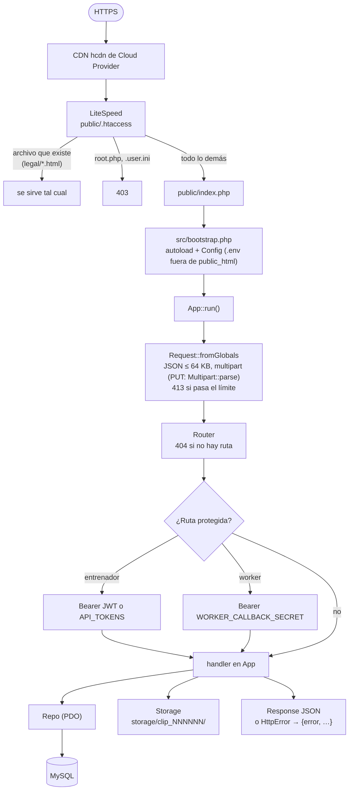
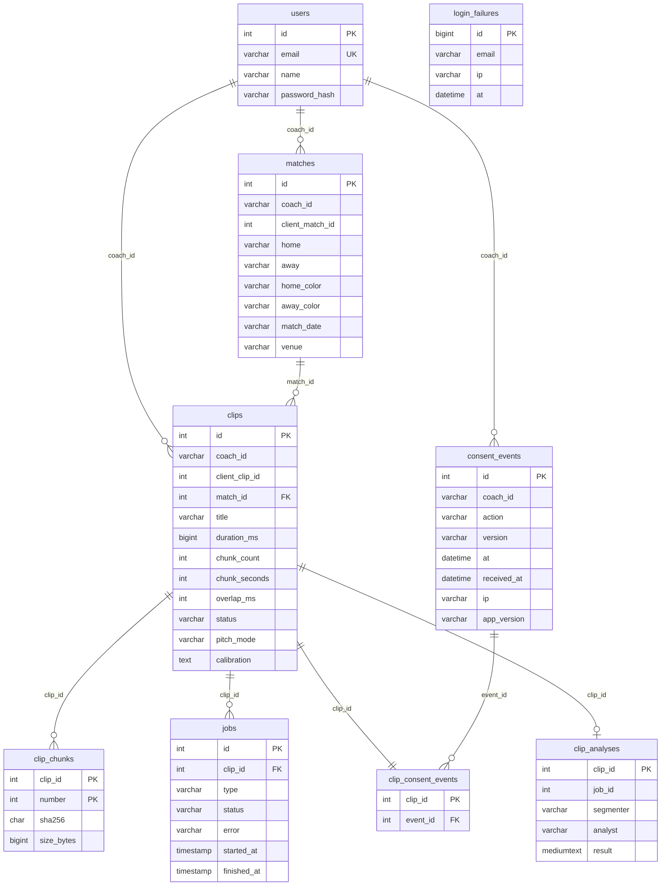
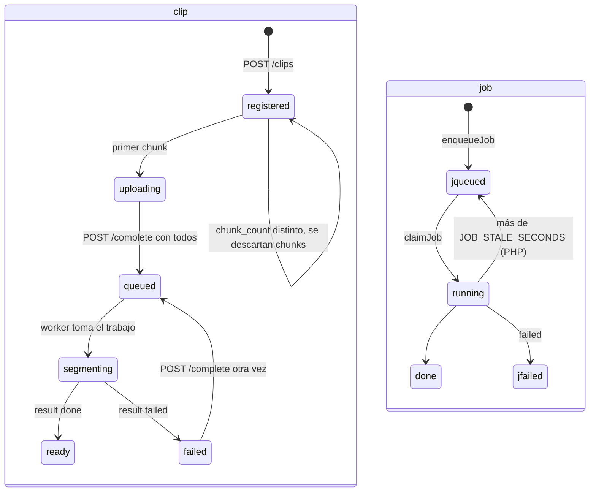

# API

> **Antecedente.** Este documento viene del diseño y del prototipo previos al hackathon, que tenían un respaldo local (detector YOLOv8n, tracker propio e insights por reglas). La versión que se construye **no tiene respaldo**: solo SAM 3.1 y Muse Spark, y solo dependencias con licencia permisiva. Donde este texto diga otra cosa, mandan [prompts/00-contexto.md](../prompts/00-contexto.md) y el prompt de cada etapa.

Un contrato HTTP+JSON con dos implementaciones que pasan las mismas pruebas:

| | API Node (`api/src/`) | API PHP (`api/php/`) |
|---|---|---|
| Para qué | Desarrollo y pruebas rápidas | **Producción** en Cloud Provider (`https://ppcoachtracker.pepemxl.com`) |
| Stack | Express, multer, mysql2, jsonwebtoken | PHP 8.3 sin dependencias (autoload propio, PDO) |
| Repositorio | Memoria (`REPO=memory`) o MySQL | MySQL / MariaDB |
| Contraseñas | scrypt | bcrypt (`password_hash`) |
| Límite de login | 10 fallos por correo en 15 min, en memoria | 10 por correo y 30 por IP en 15 min, en la tabla `login_failures` |
| Worker | Puede leer los chunks del disco (`clip.dir`) o descargarlos | Los descarga por `GET /internal/clips/{id}/files/{nombre}` |
| Pruebas | `npm test` (memoria) y `TEST_MYSQL=1 npm test` | `npm run test:php` (por HTTP contra Docker) |

Los JWT son compatibles (HS256, `sub` = `u<id>`, 30 días): con el mismo `JWT_SECRET`, un token de una sirve en la otra. Las contraseñas no: cada API verifica los hashes que ella misma crea.

## Rutas

| Método | Ruta | Quién | Qué hace |
|---|---|---|---|
| GET | `/health` | Cualquiera | `{ok, version, db, authenticated, consent_version}` |
| POST | `/auth/login` | Entrenador | Correo y contraseña → JWT de 30 días |
| POST | `/clips` | Entrenador | Registra (idempotente) partido y clip con el consentimiento y la respuesta sobre la cancha (`analysis.pitch_mode`: `lines`, `no_lines` u `off`) → chunks que ya están |
| POST | `/clips/:id/calibration` | Entrenador | Los puntos marcados en la cancha (de 4 a 40 por cuadro, con el nombre de la plantilla, `x`, `y` de 0 a 1); `409` cuando el worker ya tomó el clip |
| PUT | `/clips/:id/chunks/:n` | Entrenador | Un chunk: `video` (mp4) + `yaml` + `sha256`, verificado |
| POST | `/clips/:id/complete` | Entrenador | `chunks.yaml`; con todos los chunks, encola el análisis |
| GET | `/clips/:id` | Entrenador | Estado y chunks recibidos |
| POST | `/consent` | Entrenador | Una aceptación o un retiro del consentimiento |
| GET | `/consent` | Entrenador | Historial y estado del consentimiento |
| GET | `/clips/:id/analysis` | Entrenador | El análisis del worker (formato) o `404` |
| GET | `/internal/jobs/next` | Worker | Toma el trabajo más viejo en cola (`204` si no hay), con los archivos del clip, los equipos y colores del partido, `options.pitch_mode` y los puntos de la cancha (`calibration`) |
| POST | `/internal/jobs/:id/result` | Worker | `done` (con el análisis como archivo multipart) o `failed`; el clip pasa a `ready` o `failed` |
| GET | `/internal/clips/:id/files/:nombre` | Worker | Descarga un chunk, su YAML o `chunks.yaml` |
| GET | `/legal/*.html`, `/legal/en/*.html` | Cualquiera | Textos legales estáticos (solo PHP) |

Contrato completo, cuerpos y errores: `api/README.md`.

## Ciclo de una petición (PHP)



La API Node sigue el mismo camino con Express: `express.json` (64 KB), `multer` (25 MB por archivo), middleware `auth` / `workerAuth` y el repositorio elegido.

## Autenticación

| Quién | Cómo | Dónde se valida |
|---|---|---|
| Entrenador | `POST /auth/login` → JWT HS256 (`sub: u<id>`, `exp` a 30 días). La app lo manda como `Authorization: Bearer` | `coachFor()` / `App::auth()` |
| Scripts y pruebas | Tokens fijos en `API_TOKENS` (`token:coach_id,…`), comparados en tiempo constante | Igual que el JWT |
| Worker | `WORKER_CALLBACK_SECRET` como Bearer en `/internal/*` | `workerAuth()` |

Las cuentas no tienen registro público: las crea el administrador con `npm run user:add` (Node) o `php bin/user.php add` (PHP, también en el instalador de Cloud Provider con `user.env`).

## Modelo de datos

Un solo esquema (`api/db/schema.sql`) para las dos APIs. `coach_id` es `u<id>` del usuario (o el id de un token fijo).



- **Idempotencia:** `matches` y `clips` son únicos por `(coach_id, client_*_id)`: registrar dos veces devuelve la misma fila, y eso permite reintentar y reanudar.
- **Historial del consentimiento:** cada aceptación y retiro es una fila; el mismo evento dos veces (misma acción, versión y hora) queda una vez.
- **Migraciones:** `schema.sql` solo tiene `CREATE TABLE IF NOT EXISTS`. Lo que eso no cubre lo hace `Schema::migrate()` en PHP, revisando antes si hace falta: el paso de `consents` de 0.3.2 a `consent_events`, `clips.pitch_mode` (0.3.8) y `clips.calibration` (0.3.9). Las dos columnas ya existen en producción.
- **Lo que la API no interpreta:** `clips.calibration` se valida (`calibration.js`, `Calibration.php`) y se guarda como JSON; el análisis (`clip_analyses.result`) se guarda y se devuelve tal cual. Por eso los cambios del resultado, como las métricas en metros, no piden desplegar la API.

## Estados en el servidor



- Completar dos veces no crea un segundo trabajo: si hay uno en `queued` o `running`, se reutiliza.
- Node toma trabajos con `FOR UPDATE SKIP LOCKED`; PHP con un `UPDATE … LIMIT 1` atómico, que también funciona en MariaDB, y regresa a la cola los que se quedaron en `running` (worker caído).

## Archivos en el servidor

```
STORAGE_DIR/                      ~/ppcoachtracker_api/storage en Cloud Provider (fuera de public_html)
├── tmp/                          subidas en curso; se borran al terminar la petición
└── clip_000065/
    ├── video_part_001.mp4        chunk verificado (sha256 del campo y del YAML)
    ├── video_part_001.yaml       frames del original que contiene el chunk
    ├── video_part_002.mp4
    ├── video_part_002.yaml
    └── chunks.yaml               índice del clip (llega con POST /complete)
```

Los nombres siguen `Storage::FILE_PATTERN` (`video_part_NNN.(mp4|yaml)` o `chunks.yaml`); la ruta de descarga del worker no acepta otros.

## Límites

| Límite | Valor |
|---|---|
| Chunk | `MAX_CHUNK_BYTES`, 25 MB por omisión (un chunk de 1 min pesa ≤ 11 MB). En PHP también `upload_max_filesize` 32M y `post_max_size` 40M (`.user.ini`) |
| JSON | 64 KB |
| Registro | `duration_ms` ≤ 6 h, `chunk_count` ≤ 1000, textos ≤ 160 caracteres |
| Login | 10 fallos por correo (y 30 por IP en PHP) en 15 min → `429` con `Retry-After` |
| Consentimiento | Fecha del teléfono a lo más 1 día en el futuro |
