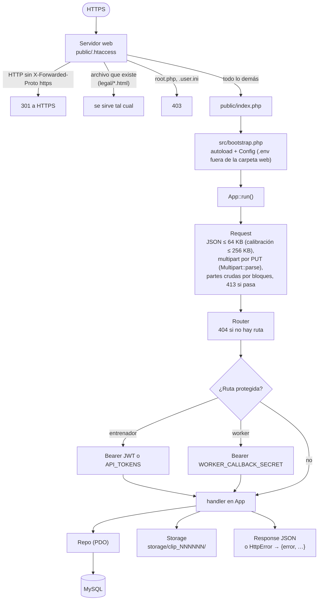
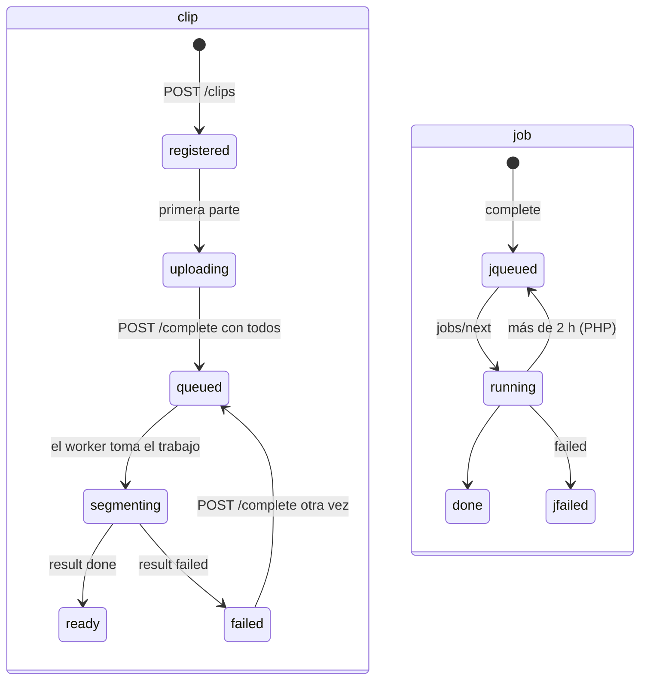

# API

Un contrato HTTP+JSON con dos implementaciones que pasan las mismas pruebas. El contrato completo, con cuerpos y errores, está en [`api/README.md`](../../api/README.md); las diferencias de la PHP, en [`api/php/README.md`](../../api/php/README.md).

| | API Node (`api/src/`) | API PHP (`api/php/`) |
|---|---|---|
| Para qué | Desarrollo y pruebas rápidas | **Producción** en `https://ppcoachtracker.pepemxl.com` (pendiente de desplegar, etapa 9) |
| Stack | Express, multer, mysql2, jsonwebtoken | PHP 8.3 sin Composer ni dependencias (autoload propio, PDO) |
| Repositorio | Memoria (`REPO=memory`) o MySQL | MySQL / MariaDB |
| Contraseñas | scrypt | bcrypt (`password_hash`) |
| Límite de login | 10 fallos por correo en 15 min, en memoria | 10 por correo y 30 por IP en 15 min, en la tabla `login_failures` |
| Tomar un trabajo | `FOR UPDATE SKIP LOCKED` | `UPDATE … LIMIT 1` atómico (sirve en MariaDB), y antes regresa a la cola lo que lleva más de 2 h en `running` |
| Pruebas | `npm test` (memoria) y `TEST_MYSQL=1 npm test` | `npm run test:php` (por HTTP contra Docker, con `.htaccess`) |

Los JWT son compatibles (HS256, `sub` = `u<id>`, 30 días): con el mismo `JWT_SECRET`, un token de una sirve en la otra. Las contraseñas no: cada API verifica los hashes que ella misma crea.

## Rutas

| Método | Ruta | Quién | Qué hace |
|---|---|---|---|
| GET | `/health` | Cualquiera | `{ok, version, db, authenticated, consent_version}` |
| POST | `/auth/login` | Cualquiera | Correo y contraseña → JWT de 30 días |
| POST | `/clips` | Entrenador | Registra (idempotente) partido y clip con el consentimiento y la respuesta sobre la cancha (`analysis.pitch_mode`: `lines`, `no_lines` u `off`) → chunks completos y partes recibidas |
| POST | `/clips/:id/calibration` | Entrenador | Puntos y líneas pintadas por cuadro, y los trazos de las imágenes de referencia; `409` cuando el worker ya tomó el clip |
| PUT | `/clips/:id/references/:n` | Entrenador | Una imagen de referencia: JPEG crudo de hasta 2 MB, `n` de 1 a 6 |
| PUT | `/clips/:id/chunks/:n/video?offset=` | Entrenador | Una parte cruda del chunk (hasta 8 MB), escrita solo si `offset` es lo que ya hay |
| PUT | `/clips/:id/chunks/:n` | Entrenador | Cierra el chunk: `yaml` + `sha256`, verificado contra lo recibido |
| POST | `/clips/:id/complete` | Entrenador | `chunks.yaml`; con todos los chunks, encola el análisis |
| GET | `/clips/:id` | Entrenador | Estado, chunks recibidos, partes y el trabajo |
| GET | `/clips/:id/analysis` | Entrenador | El análisis del worker, o `404` |
| POST | `/consent` | Entrenador | Una aceptación o un retiro del consentimiento |
| GET | `/consent` | Entrenador | Historial y estado del consentimiento |
| GET | `/internal/jobs/next` | Worker | Toma el trabajo más viejo en cola (`204` si no hay): el clip con sus archivos e imágenes de referencia, el partido con equipos y colores, `options.pitch_mode` y `calibration` |
| GET | `/internal/clips/:id/files/:nombre` | Worker | Descarga un chunk, su YAML, `chunks.yaml` o `reference_N.jpg` |
| POST | `/internal/jobs/:id/result` | Worker | `done` (con el análisis como archivo multipart) o `failed`; el clip pasa a `ready` o `failed` |
| GET | `/legal/*.html`, `/legal/en/*.html` | Cualquiera | Textos legales estáticos (solo PHP), generados desde `docs/legal/` |

## Ciclo de una petición (PHP)



La API Node sigue el mismo camino con Express: `express.json` (64 KB; 256 KB en la calibración), `express.raw` para las partes y las imágenes, `multer` para el YAML, el índice y el análisis, los middlewares `auth` / `workerAuth` y el repositorio elegido.

## Autenticación

| Quién | Cómo | Dónde se valida |
|---|---|---|
| Entrenador | `POST /auth/login` → JWT HS256 (`sub: u<id>`, `exp` a 30 días). La app lo manda como `Authorization: Bearer` | `auth` (Node) / `App::auth()` (PHP) |
| Scripts y pruebas | Tokens fijos en `API_TOKENS` (`coach_id:token,…`), comparados en tiempo constante | Igual que el JWT |
| Worker | `WORKER_CALLBACK_SECRET` como Bearer en `/internal/*`; vacío = `401` | `workerAuth` |

Las cuentas no tienen registro público: las crea el administrador con `npm run user:add` (Node) o `php bin/user.php add` (PHP). Un entrenador nunca ve ni toca clips de otro: recibe `404`.

## Modelo de datos

Un solo esquema (`api/db/schema.sql`) para las dos APIs. `coach_id` es `u<id>` del usuario (o el id de un token fijo).


- **Idempotencia:** `matches` y `clips` son únicos por `(coach_id, client_*_id)`: registrar dos veces devuelve la misma fila, y eso permite reintentar y reanudar. Si cambia `chunk_count`, `chunk_seconds` u `overlap_ms`, se descartan los chunks y las partes, y el clip vuelve a `registered`.
- **Historial del consentimiento:** cada aceptación y retiro es una fila; el mismo evento dos veces (misma acción, versión y hora) queda una vez.
- **Migraciones:** `schema.sql` solo tiene `CREATE TABLE IF NOT EXISTS`. `Schema::migrate()` (PHP) agrega `clips.pitch_mode` y `clips.calibration` a una base que no las tenga.
- **Lo que la API no interpreta:** `clips.calibration` se valida (`calibration.js`, `Calibration.php`) y se guarda como JSON; el análisis (`clip_analyses.result`) se guarda y se devuelve tal cual, y de su bloque `backends` salen `segmenter` y `analyst`. Por eso los cambios del resultado, como las métricas en metros, no piden desplegar la API.
- **Resultados del simulador:** con `PP_COACH_TRACKER_REQUIRE_META=1` (producción), un `segmenter` distinto de `meta_sam` se rechaza con `422` y el clip pasa a `failed`.

## Estados en el servidor



- Completar dos veces no crea un segundo trabajo: si hay uno en `queued` o `running`, se reutiliza.
- La calibración y las imágenes de referencia se pueden reemplazar mientras el clip está en `registered`, `uploading` o `queued`; después, `409`. Las partes del video se rechazan con `409` mientras el clip está en `queued` o `segmenting`.

## Archivos en el servidor

```
STORAGE_DIR/                      fuera de la carpeta web
├── tmp/                          subidas en curso; se borran al terminar la petición
└── clip_000065/
    ├── video_part_001.mp4.partial   partes recibidas de un chunk sin cerrar
    ├── video_part_001.mp4        chunk cerrado (sha256 del campo y del YAML)
    ├── video_part_001.yaml       cuadros del original que contiene el chunk y máscara de la cancha
    ├── reference_1.jpg           imagen de referencia de la cancha (0644)
    └── chunks.yaml               índice del clip (llega con POST /complete)
```

Los nombres siguen `FILE_PATTERN` (`video_part_NNN.(mp4|yaml)`, `chunks.yaml` o `reference_N.jpg`); la ruta de descarga del worker no acepta otros.

## Límites

| Límite | Valor |
|---|---|
| Parte de un chunk | `MAX_PART_BYTES`, 8 MB; llega cruda, sin pasar por `upload_max_filesize` |
| Chunk armado | `MAX_CHUNK_BYTES`, 160 MB por omisión (un chunk de 5 min a 720p cabe) |
| Imagen de referencia | 2 MB, empieza con `FF D8 FF`; hasta 6 por clip |
| JSON | 64 KB; la calibración, 256 KB (hasta 3000 puntos de trazos) |
| Registro | `duration_ms` ≤ 6 h, `chunk_count` ≤ 1000, `chunk_seconds` 60..300, `overlap_ms` 2000..5000, textos ≤ 160 caracteres |
| PHP (`.user.ini`) | `upload_max_filesize` 32M, `post_max_size` 40M, 120 s, 256 MB de memoria |
| Login | 10 fallos por correo (y 30 por IP en PHP) en 15 min → `429` con `Retry-After` |
| Consentimiento | Versión vigente; fecha del teléfono a lo más 1 día en el futuro |
