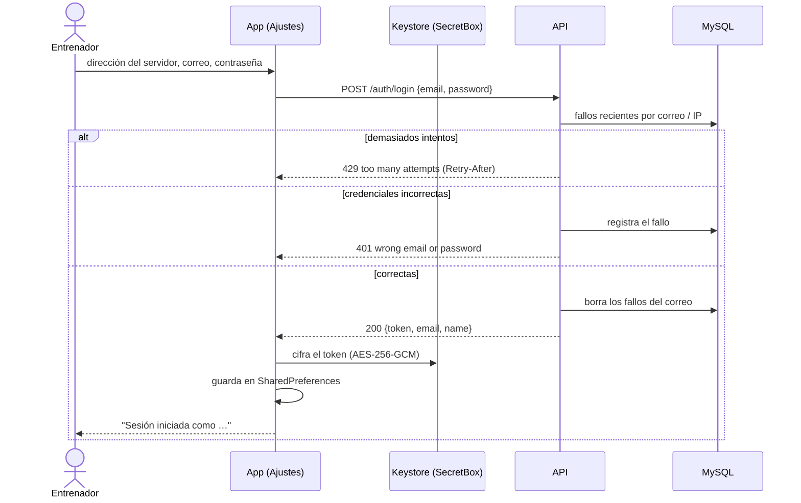
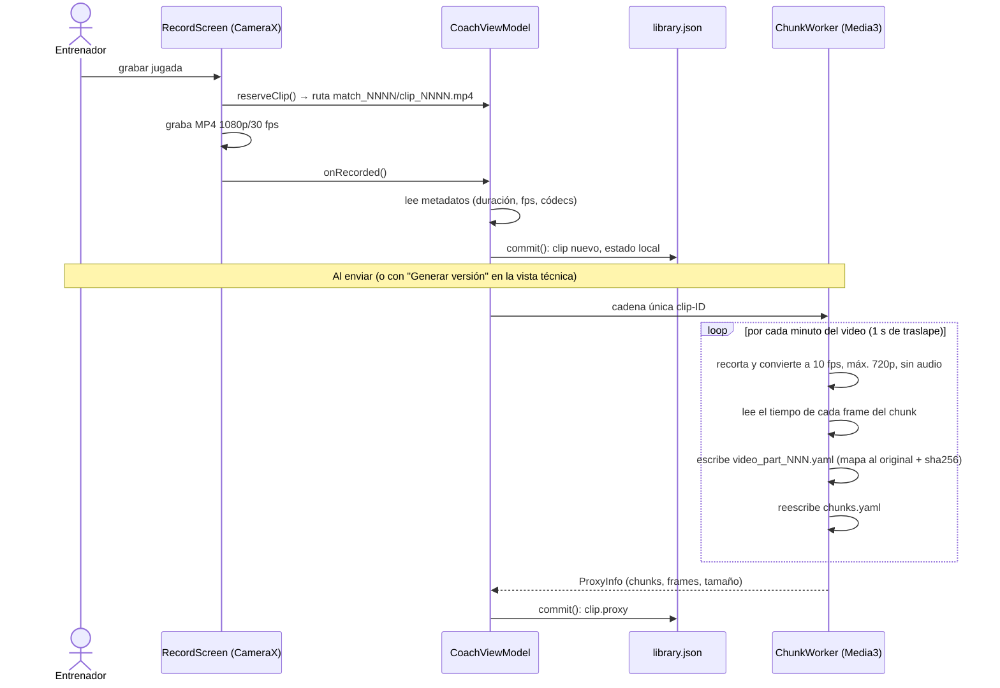
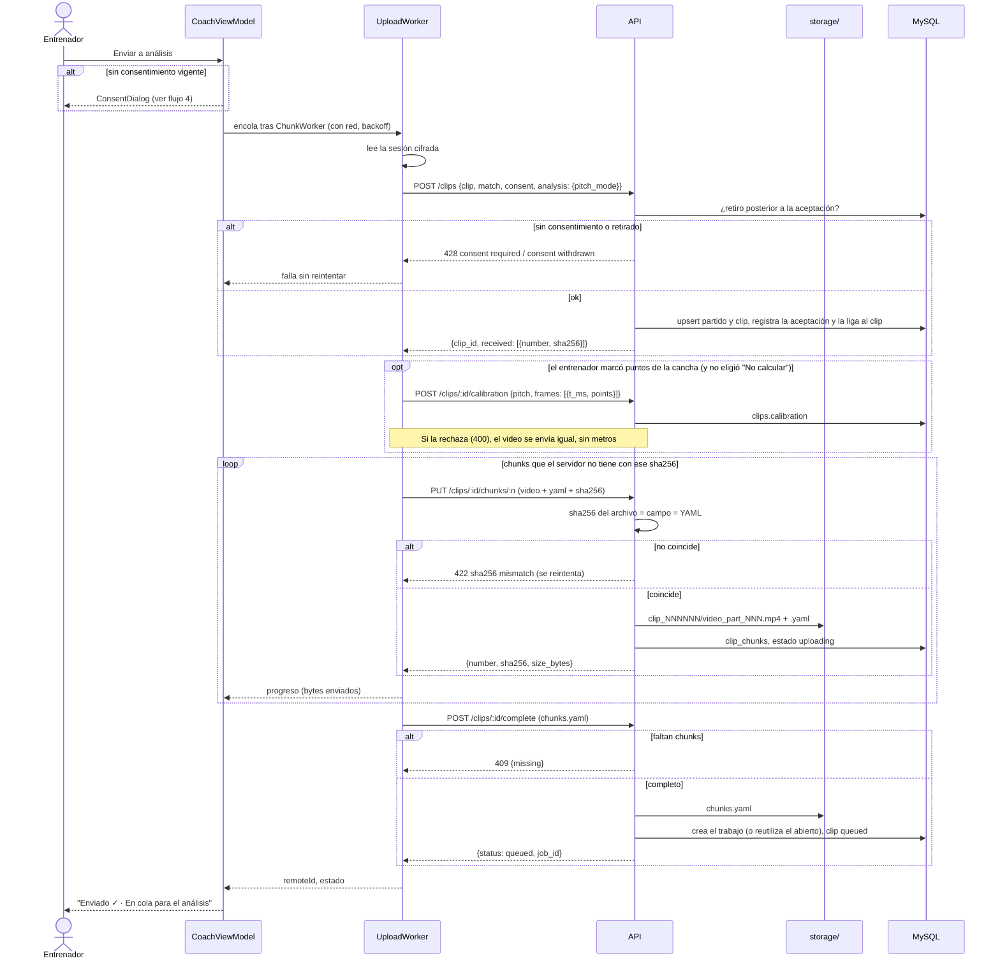
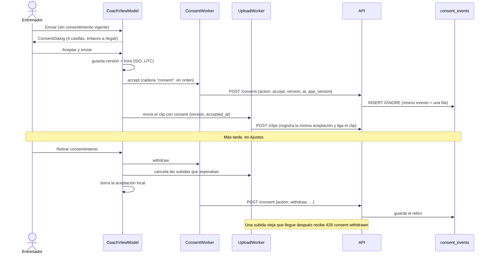
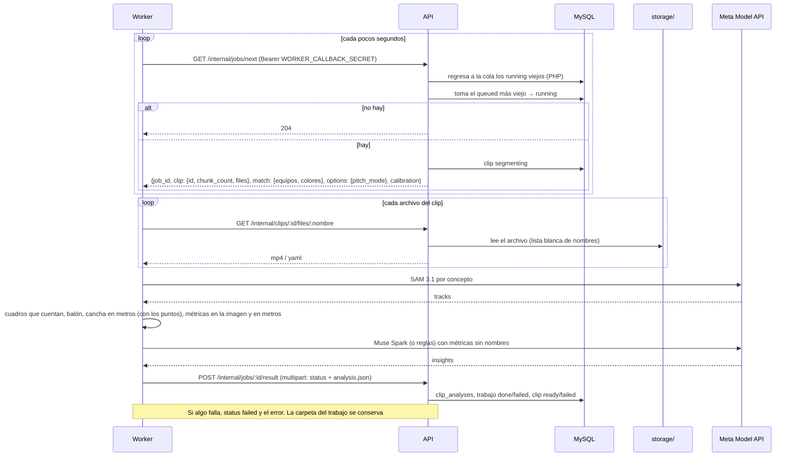
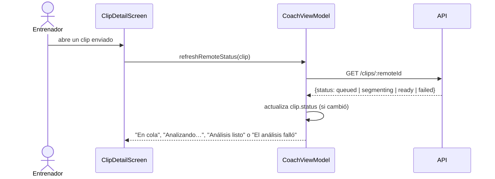
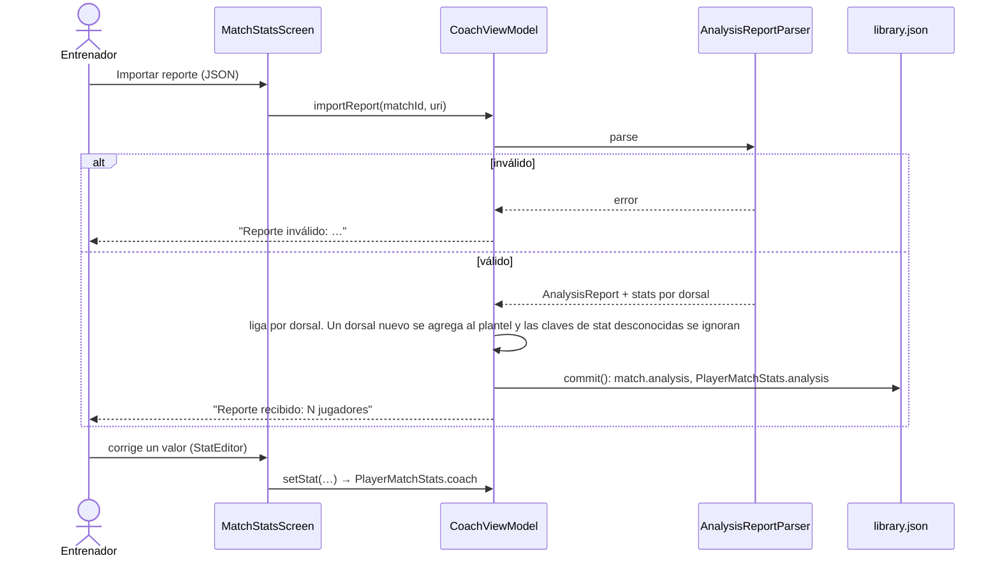

# Flujos de punta a punta

> **Antecedente.** Este documento viene del diseño y del prototipo previos al hackathon, que tenían un respaldo local (detector YOLOv8n, tracker propio e insights por reglas). La versión que se construye **no tiene respaldo**: solo SAM 3.1 y Muse Spark, y solo dependencias con licencia permisiva. Donde este texto diga otra cosa, mandan [prompts/00-contexto.md](../prompts/00-contexto.md) y el prompt de cada etapa.

Diagramas de secuencia de lo que pasa entre el entrenador, la app, la API y el worker ([06-pipeline-analisis.md](06-pipeline-analisis.md)). Lo marcado como *planeado* todavía no existe.

## 1. Iniciar sesión



## 2. Grabar y preparar



## 3. Enviar a análisis (subida reanudable)



Si la red se corta a la mitad, WorkManager reintenta; el `POST /clips` siguiente dice qué chunks ya llegaron y solo se suben los que faltan.

## 4. Consentimiento: aceptar y retirar



`ConsentWorker` espera a tener red y, si la sesión venció, a que el entrenador vuelva a iniciar sesión. El historial se consulta con `GET /consent`.

## 5. Cola de análisis



Probado con el worker y la API PHP en Docker. El entrenador lee el resultado con `GET /clips/:id/analysis` (flujo 6).

## 6. Estado del análisis en la app



Si la consulta falla, el clip conserva el último estado conocido, sin mostrar error.

Con el estado `ready`, "Ver análisis" abre `ClipAnalysisScreen`: muestra al instante la copia guardada del análisis y pide `GET /clips/:id/analysis` para tenerla al día (`ClipAnalysis.parse`, que también lee el bloque en metros).

## 8. Marcar la cancha

```mermaid
sequenceDiagram
    actor E as Entrenador
    participant PT as PitchTouchesScreen
    participant H as Homography (vista previa)
    participant VM as CoachViewModel
    participant L as library.json

    E->>PT: "Marcar puntos de la cancha" (con "Calcular la cancha" encendido)
    E->>PT: elige un cuadro con la barra
    loop cada punto
        E->>PT: toca un punto de la imagen
        E->>PT: elige cuál es en el dibujo de la cancha (11 o 7)
    end
    PT->>H: con 4 o más puntos, ajusta la homografía
    H-->>PT: las líneas de la cancha en violeta sobre el cuadro
    Note over E,PT: Si no caen sobre las de verdad, algún punto tiene el nombre equivocado; con 4 exactos se pide un quinto
    PT->>VM: saveTouches(clip, puntos)
    VM->>L: commit(): clip.touches
```

Los puntos viajan con el envío (flujo 3). En el worker, la homografía del cuadro marcado se lleva a los demás cuadros de su toma siguiendo el pasto, y los pies de cada jugador pasan a metros ([mejora 04](../mejoras/04-homografia-por-cuadro.md)).

## 7. Reporte de análisis y estadísticas



*Planeado:* el reporte llegará por la API en lugar de un archivo (`AnalysisReport.via = "api"`), cuando los tracks se liguen a dorsales con el etiquetado en la app.
