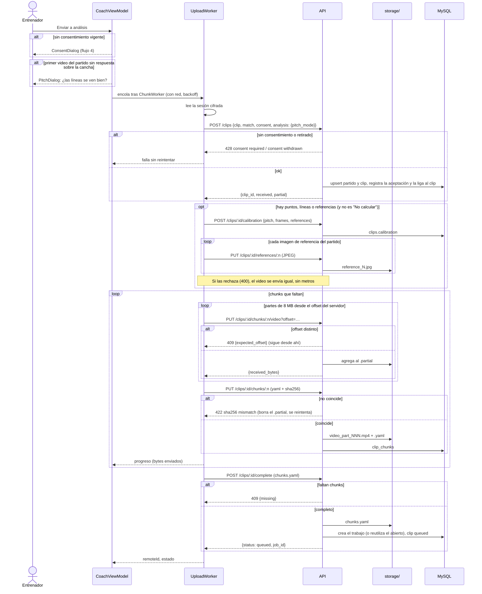
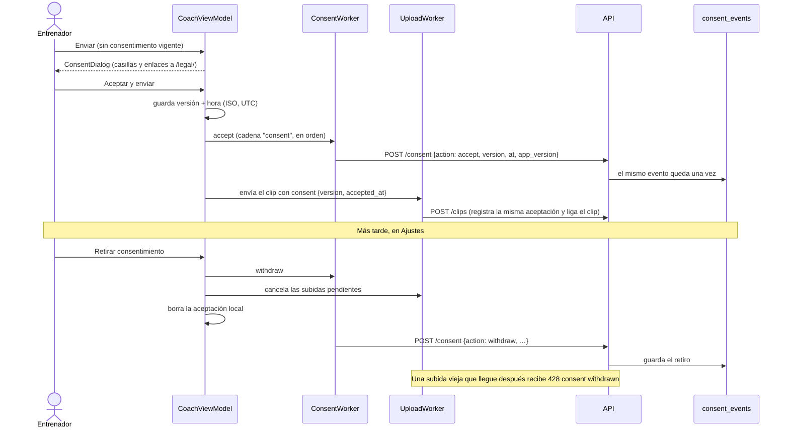
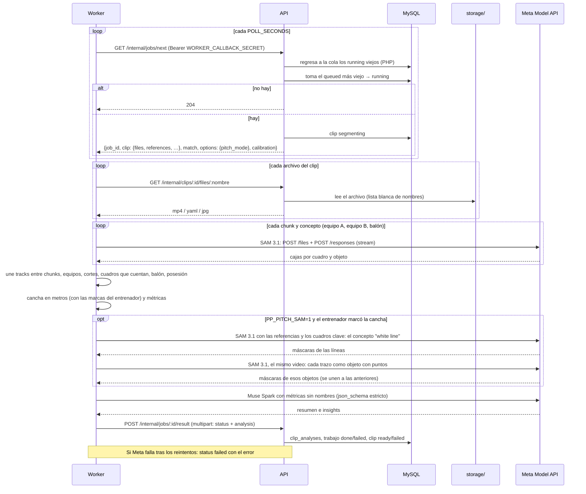
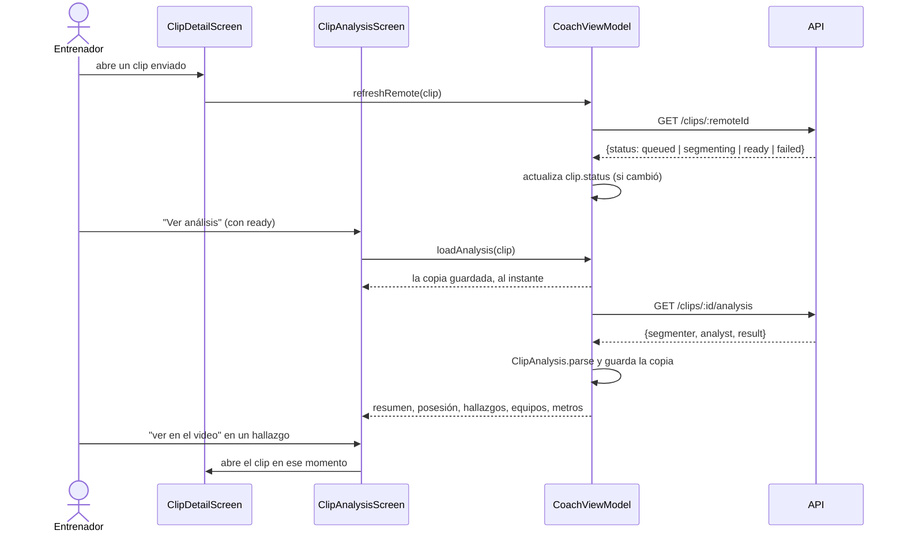

# Flujos de punta a punta

Diagramas de secuencia de lo que pasa entre el entrenador, la app, la API y el worker ([06-pipeline-analisis.md](06-pipeline-analisis.md)). Los flujos de la app (1 a 5 y 7) se probaron en el emulador contra la API local en Docker. La cola de análisis (6) se prueba con las pruebas del worker, contra una API falsa y con streams de SAM sintéticos: falta la key de la Meta Model API.

## 1. Iniciar sesión


## 2. Grabar y preparar

```mermaid
sequenceDiagram
    actor E as Entrenador
    participant R as RecordScreen (CameraX)
    participant VM as CoachViewModel
    participant L as library.json
    participant CW as ChunkWorker
    participant PS as PitchSampler

    E->>R: grabar jugada (o importar un video)
    R->>VM: newClipFile() → reserva el id y la ruta match_NNNN/clip_NNNN.mp4
    R->>R: graba MP4 1080p o 720p, 30 fps
    R->>VM: addClip() al terminar
    VM->>VM: lee metadatos (duración, fps, tamaño); tipo de clip por la duración
    VM->>L: commit(): clip nuevo, estado local
    Note over E,CW: Al enviar (o con "Generar versión" en la vista técnica)
    VM->>CW: cadena única clip-ID
    loop cada chunk (1 o 5 min, con traslape)
        CW->>CW: recorta y convierte a 10 fps, máx. 720p, sin audio (Media3)
        CW->>CW: mide el tiempo real de cada cuadro
        CW->>PS: decodifica el chunk y mide la cancha por cuadro
        PS-->>CW: polígono de la cancha por cuadro
        CW->>CW: escribe video_part_NNN.yaml (mapa al original, pitch, sha256)
        CW->>CW: reescribe chunks.yaml
    end
    CW->>L: commit(): chunks, perfil, parte con cancha (pitchShare)
```

## 3. Enviar a análisis (subida reanudable)



Si la red se corta a la mitad, WorkManager reintenta; el `POST /clips` siguiente dice qué chunks ya llegaron y cuántos bytes de cada parte, y solo se sube lo que falta.

## 4. Consentimiento: aceptar y retirar



`ConsentWorker` espera a tener red y, si la sesión venció, a que el entrenador vuelva a iniciar sesión. El historial se consulta con `GET /consent`.

## 5. Marcar la cancha

```mermaid
sequenceDiagram
    actor E as Entrenador
    participant PT as PitchTouchesScreen
    participant PR as PitchReferencesScreen
    participant H as Homography (vista previa)
    participant VM as CoachViewModel
    participant L as library.json

    E->>PT: "Marcar puntos de la cancha" (con "Calcular la cancha" encendido)
    E->>PT: elige un cuadro con la barra
    loop cada marca
        alt Tocar puntos
            E->>PT: toca un punto de la imagen
            E->>PT: elige cuál es en el dibujo de la cancha (11 o 7)
        else Pintar líneas
            E->>PT: pasa el dedo sobre una línea
            E->>PT: toca la línea en el dibujo, o "No sé cuál, solo es una línea"
        end
    end
    PT->>H: con 4 marcas o más, puntos + líneas con nombre
    H-->>PT: la cancha calculada en violeta sobre el cuadro
    Note over E,PT: Si no cae sobre la de verdad, alguna marca tiene el nombre equivocado; con 4 exactas se pide una quinta
    PT->>VM: saveTouches(clip, puntos y líneas)
    VM->>L: commit(): clip.touches

    opt la cancha se ve mal (poca luz, líneas borradas)
        E->>PR: "Imágenes de referencia"
        E->>PR: "Tomar foto" (cámara del teléfono) o "Usar este cuadro"
        PR->>VM: guarda el JPEG (enderezado, 1600 px)
        E->>PR: pinta encima las líneas (PaintReferenceScreen)
        VM->>L: commit(): match.references con sus trazos
    end
```

Los puntos, las líneas y las referencias viajan con el envío (flujo 3). En el worker, la homografía del cuadro marcado se lleva a los demás cuadros de su toma siguiendo el pasto, y los pies de cada jugador pasan a metros. Con `PP_PITCH_SAM=1`, SAM busca las líneas dos veces: con el concepto `white line` y con cada trazo como un objeto marcado con puntos, "esto es una línea" ([06-pipeline-analisis.md](06-pipeline-analisis.md#la-cancha-en-metros)).

## 6. Cola de análisis



## 7. Ver el análisis en la app



Si la consulta del estado falla, el clip conserva el último conocido, sin mostrar error. Si no hay copia y no se puede bajar, la pantalla dice por qué (todavía no está, sin conexión, sesión vencida).
