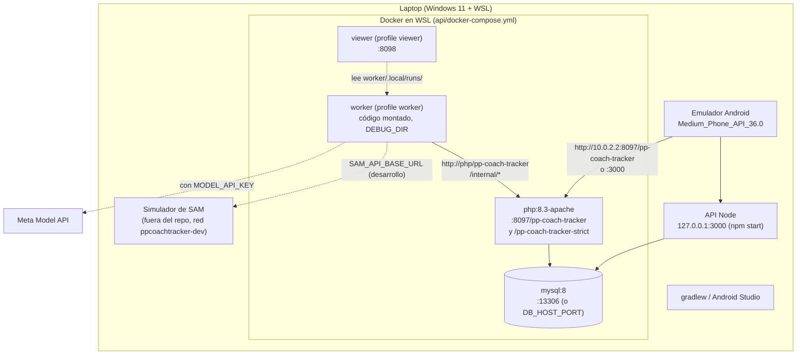
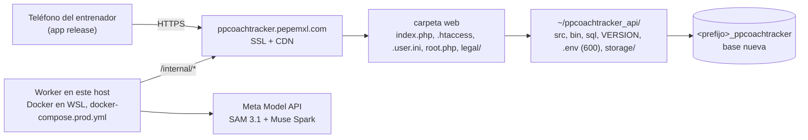
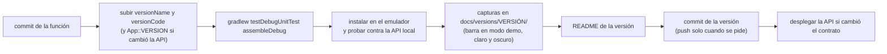

# Entornos y despliegue

La API PHP está en producción desde el 30 de octubre en https://ppcoachtracker.pepemxl.com (etapa 9, [prompts/09-despliegue.md](../prompts/09-despliegue.md)). El worker de producción corre desde el mismo día en la máquina de desarrollo, en Docker dentro de WSL ([worker/README.md](../../worker/README.md#producción-en-este-host-docker-en-wsl)).

## Entorno local

| Pieza | Cómo se levanta (desde `api/`) |
|---|---|
| MySQL | `npm run db:up`. Si el puerto cae en un rango reservado de Hyper-V, otro con `DB_HOST_PORT` (por ejemplo 23306) y `DB_PORT` al correr |
| API PHP | `npm run php:up && npm run php:migrate`. `/pp-coach-tracker-strict` es la misma carpeta con `PP_COACH_TRACKER_REQUIRE_META=1` y un tope de chunk menor, para probar esos casos |
| API Node | `npm start` (lee el `.env` de la raíz; no arranca sin `JWT_SECRET` de 32+ caracteres) |
| Worker | `npm run worker:up`: consulta la cola de la API PHP local cada 5 s y guarda cada corrida para el visor |
| Visor | `npm run viewer:up` → `http://localhost:8098` |
| App | `gradlew :app:assembleDebug` e instalar en el emulador; en Ajustes, servidor `http://10.0.2.2:8097/pp-coach-tracker` |
| Cuentas | `npm run user:add` (Node) o `php bin/user.php add` dentro del contenedor (PHP) |

## Pruebas

| Qué | Comando | Contra qué |
|---|---|---|
| API Node | `npm test` | Repositorio en memoria |
| API Node con MySQL | `TEST_MYSQL=1 npm test` | MySQL de Docker; las pruebas borran sus datos |
| API PHP | `npm run php:up && npm run php:migrate && npm run test:php` | PHP + MySQL en Docker, por HTTP, `.htaccess` incluido |
| Worker | `npm run worker:test` | pytest en Docker, sin red: SAM con streams sintéticos, Muse Spark falso, canchas sintéticas (puntos, líneas pintadas, propagación, SAM para las líneas), métricas y un trabajo contra una API falsa |
| App | `gradlew :app:testDebugUnitTest` | JVM: chunks, biblioteca, cliente HTTP (MockWebServer), consentimiento, máscara de la cancha, puntos, líneas y homografía, calibración, análisis, textos |

Ninguna prueba llama a Meta ni al simulador. Las pruebas de la app y del worker comparten fixtures (`worker/tests/fixtures/`): la máscara de la cancha y las plantillas de puntos y líneas deben dar lo mismo en los dos lados.

## Configuración y secretos

- **Nada de secretos en el repo.** `.env.example` solo tiene los nombres; el `.env` de la raíz no se versiona y nunca se imprime.
- **Local:** la API Node y el worker leen el `.env` de la raíz; `docker-compose.yml` trae valores de prueba para la PHP y el worker (`WORKER_CALLBACK_SECRET` de prueba, `PP_COACH_TRACKER_ALLOW_HTTP=1`).
- **Producción:** el `.env` del servidor se genera desde los `PROD_*` del `.env` de la raíz, vive fuera de la carpeta web con permisos 600 y la API lo lee con `Config::load()` (`getenv` gana). Lleva `PP_COACH_TRACKER_REQUIRE_META=1` y `PP_COACH_TRACKER_ALLOW_HTTP` vacío.
- **Worker:** `MODEL_API_KEY` y `WORKER_CALLBACK_SECRET` como secretos de la plataforma donde corra; `SAM_API_BASE_URL` vacío en producción (SAM real).

## Producción (etapa 9)

- **API:** PHP en el hosting compartido, en la raíz del subdominio; la app vive en `~/ppcoachtracker_api` y la carpeta web es `~/domains/pepemxl.com/public_html/ppcoachtracker`. Sin SSH: un paquete (`api/php/tools/package.sh`, sin secretos en las actualizaciones), subido por la API de archivos del hosting a `_deploy/` (protegida con un `.htaccess` que niega todo) y un instalador (`install_cloud_provider.php`) que corre un cron de una sola vez: reemplaza el código, aplica el esquema, copia `public/` y borra `_deploy`. El cron se borra al terminar.
- **Worker:** el hosting no corre procesos largos ni Docker, así que la imagen de `worker/` corre en la máquina de desarrollo (Docker en WSL) con `worker/docker-compose.prod.yml`: `PP_COACH_TRACKER_API_URL=https://ppcoachtracker.pepemxl.com`, el `PROD_WORKER_CALLBACK_SECRET`, SAM real, sin copias del video y con `restart: unless-stopped`. Una tarea programada al iniciar sesión (`worker/tools/register_wsl_task.ps1`) mantiene WSL vivo. Solo hace peticiones de salida: no abre puertos. El simulador nunca se despliega.
- **Retención:** falta el cron que borre los chunks y las imágenes después del análisis, como promete el aviso de privacidad.

## Cómo se publica una versión de la app

- Si cambia el contrato, la API y la app se publican juntas. Si solo cambia la app o el resultado del worker, la API no se despliega.
- El release se firma con la llave de `android_native/keystore.properties`, que no se versiona; el perfil de chunks por omisión del release es `demo` (5 min).
