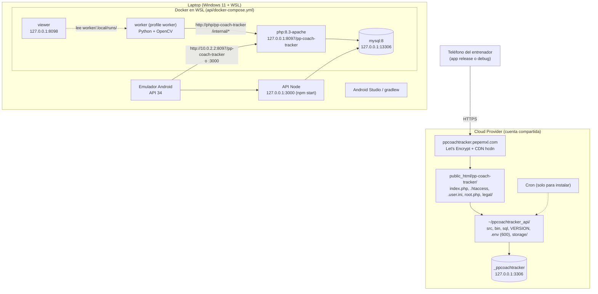
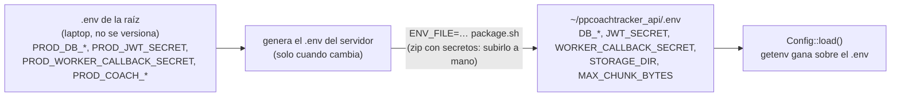
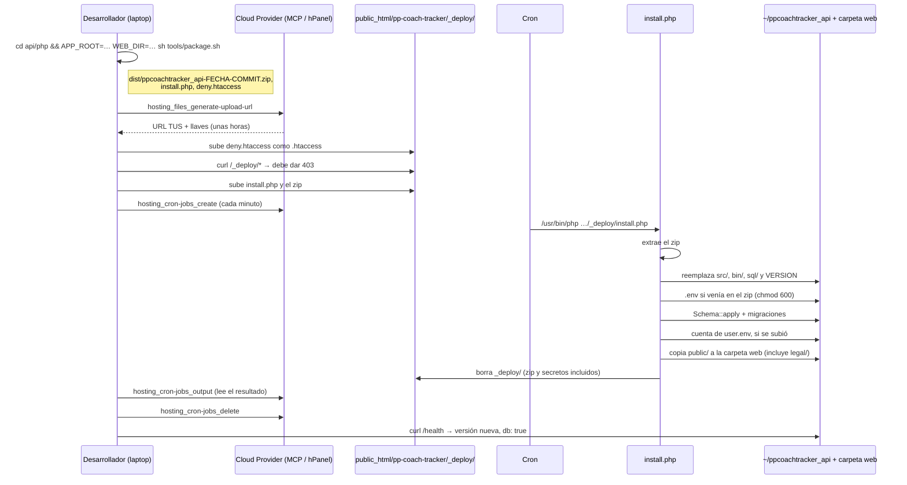
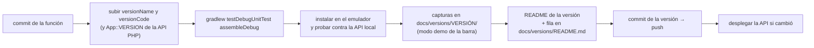

# Entornos y despliegue

> **Antecedente.** Este documento viene del diseño y del prototipo previos al hackathon, que tenían un respaldo local (detector YOLOv8n, tracker propio e insights por reglas). La versión que se construye **no tiene respaldo**: solo SAM 3.1 y Muse Spark, y solo dependencias con licencia permisiva. Donde este texto diga otra cosa, mandan [prompts/00-contexto.md](../prompts/00-contexto.md) y el prompt de cada etapa.

## Entornos

| | Local | Producción |
|---|---|---|
| API | Node (`npm start`) o PHP en Docker (`npm run php:up`) | PHP en `https://ppcoachtracker.pepemxl.com` |
| Base | MySQL 8 en Docker (volumen persistente) | MySQL/MariaDB de Cloud Provider, `127.0.0.1:3306` desde la app |
| Configuración | Variables de entorno de `docker-compose.yml` (valores de prueba) | `~/ppcoachtracker_api/.env`, fuera de `public_html`, chmod 600 |
| HTTPS | No (`PP_COACH_TRACKER_ALLOW_HTTP=1`; la app debug permite HTTP) | Sí; `.htaccess` redirige HTTP → HTTPS |
| Cuentas | `npm run user:add` / `php bin/user.php add` | `user.env` en el instalador, o `php bin/user.php` |

## Configuración y secretos

- Las actualizaciones normales **no llevan `.env`**: `package.sh` sin `ENV_FILE` arma un zip sin secretos y el servidor conserva el suyo.
- `root.php` (en la carpeta web) le dice a `index.php` dónde está la app; `.htaccess` lo niega a la web, igual que `.user.ini`.
- Nada de secretos en el repo: `.env.example` solo tiene los nombres.

## Cómo se despliega la API

Cloud Provider compartido no da SSH en este plan, así que la instalación usa la API de archivos (TUS) y un cron de una sola corrida.

Detalle y comandos: `api/php/README.md`.

## Cómo se publica la app

- Pasos completos en [docs/versions/README.md](../pantallas/README.md#para-agregar-una-versión).
- Si cambia el contrato (como el consentimiento en 0.3.2), la API y la app se publican juntas. Si solo cambia la app o el resultado del worker (como 0.3.10), la API PHP se queda en su versión y no se despliega.
- El release se firma con la llave de `android_native/keystore.properties`, que no se versiona.

## Pruebas

| Qué | Comando | Contra qué |
|---|---|---|
| API Node | `npm test` | Repositorio en memoria |
| API Node con MySQL | `TEST_MYSQL=1 npm test` | MySQL de Docker; las pruebas borran sus datos |
| API PHP | `npm run php:up && npm run php:migrate && npm run test:php` | PHP + MySQL en Docker, por HTTP, `.htaccess` incluido |
| Worker | `npm run worker:test` | pytest en Docker: chunks, tracker, equipos, cortes, cuadros que cuentan, balón, cancha (plantilla, solver, propagación, líneas, SAM con streams inventados), métricas en la imagen y en metros, reglas, escalera y un trabajo contra una API falsa |
| App | `gradlew testDebugUnitTest` | JVM: chunks, stats, biblioteca, cliente HTTP (MockWebServer), consentimiento, máscara de la cancha, puntos y homografía, análisis, textos |
| Chunks reales | `python experiments/check_chunks.py <carpeta>` | Chunks sacados del teléfono: PyYAML y OpenCV |
| Meta API | `python3 experiments/smoke_test.py` | Muse Spark y SAM 3.1 con `MODEL_API_KEY` |
| Producción | `curl https://ppcoachtracker.pepemxl.com/health` | Versión y base de datos |

## El worker en producción (pendiente)

Cloud Provider compartido no puede correr el worker (procesos largos, OpenCV). La misma imagen de `worker/` va en un VPS o en Modal, con `PP_COACH_TRACKER_API_URL=https://ppcoachtracker.pepemxl.com` y el `WORKER_CALLBACK_SECRET` de producción (de `PROD_WORKER_CALLBACK_SECRET`, sin versionar), más `MODEL_API_KEY` cuando haya. El modelo `yolov8n.onnx` se monta o se copia a la imagen (licencia AGPL: no se versiona). La API de producción ya tiene todo lo que el worker necesita (`clip_analyses`, las rutas `/internal/*`, `pitch_mode` y `calibration`). Las líneas de la cancha y SAM se encienden con `PP_PITCH_LINES` y `PP_PITCH_SAM`; por omisión están apagados.
