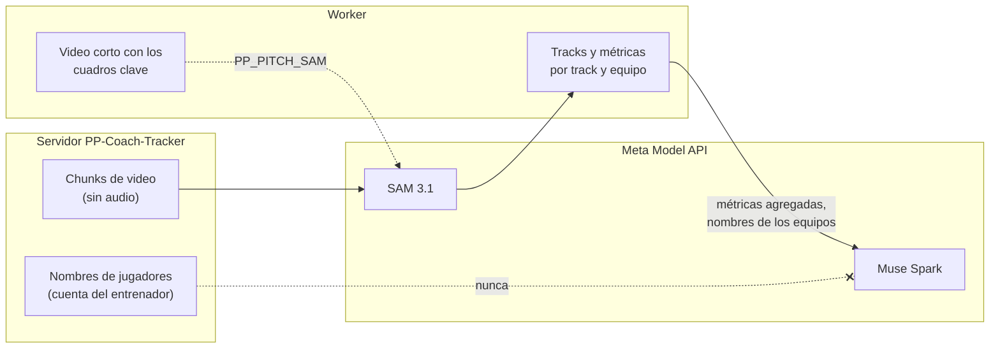
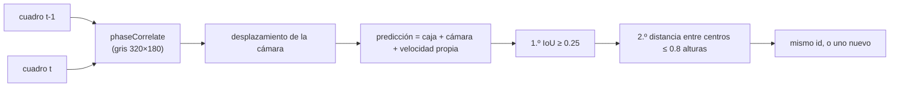
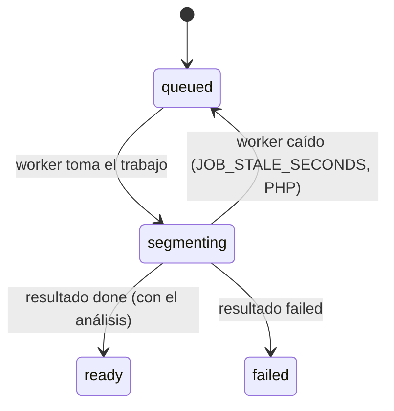

# Pipeline de análisis

> **Antecedente.** Este documento viene del diseño y del prototipo previos al hackathon, que tenían un respaldo local (detector YOLOv8n, tracker propio e insights por reglas). La versión que se construye **no tiene respaldo**: solo SAM 3.1 y Muse Spark, y solo dependencias con licencia permisiva. Donde este texto diga otra cosa, mandan [prompts/00-contexto.md](../prompts/00-contexto.md) y el prompt de cada etapa.

El worker está en `worker/`: Python 3.12 con OpenCV, en Docker. Funciona con el tracker local y las reglas, y está probado contra la API PHP en Docker y con una transmisión de 10 minutos en local. **No está desplegado** todavía, y los backends de Meta (SAM 3.1 y Muse Spark) están escritos pero **sin verificar**, porque no hay `MODEL_API_KEY`. Diseño de origen: [03-arquitectura.md](../03-arquitectura.md), el plan de respaldo del prototipo previo y [12-videos-largos-chunks.md](../12-videos-largos-chunks.md); las mejoras que ya entraron, en [mejoras/](../mejoras/README.md).

## Dónde corre

| Opción | Cuándo |
|---|---|
| Docker junto a la API local (`npm run worker:up`) | Desarrollo y pruebas; hoy |
| `analyze DIR` sobre una carpeta de chunks, sin API (`--touches`, `--debug-dir`) | Medir cambios con videos locales y verlos en el visor |
| VPS de Cloud Provider o Modal (la misma imagen) | Producción, contra `https://ppcoachtracker.pepemxl.com` con su `WORKER_CALLBACK_SECRET` |
| Script en la laptop | Plan C para el demo |

En todos los casos el worker **pide** trabajo (`GET /internal/jobs/next`) en lugar de recibir un webhook, así que la API en hosting compartido no necesita llamar a nadie.

## Etapas

```mermaid
flowchart TB
    claim["1. Tomar trabajo<br/>GET /internal/jobs/next<br/>clip, archivos, equipos y colores,<br/>options.pitch_mode y calibration"] --> dl["2. Descargar chunks<br/>GET /internal/clips/:id/files/*"]
    dl --> read["3. Leer como un solo video<br/>sin repetir el traslape, con la hora<br/>del original y la máscara de la cancha<br/>del YAML de la app"]
    read --> seg{"4. Segmentar y seguir"}
    seg -->|"con MODEL_API_KEY"| sam["meta_sam (sin verificar)<br/>SAM 3.1 por chunk y por concepto:<br/>camiseta A, camiseta B, balón;<br/>une tracks en el traslape"]
    seg -->|"respaldo"| own["local_cv<br/>YOLOv8n en mosaicos + tracker IoU<br/>con compensación de cámara,<br/>equipo por color, cortes de cámara<br/>y la cancha de cada cuadro"]
    sam --> ts["TrackSet común<br/>cajas normalizadas, equipo A/B,<br/>info por cuadro (cancha, corte)"]
    own --> ts
    ts --> shots["5. Cuadros que cuentan (shots.py)<br/>fuera acercamientos, repeticiones<br/>y tomas sin cancha"]
    shots --> ball["6. Balón (ball.py)<br/>fuera balones falsos,<br/>huecos cortos rellenados"]
    ball --> cal{"7. Cancha en metros<br/>(si hay puntos y pitch_mode no es off)"}
    cal -->|"sin puntos"| metrics
    cal --> touch["Puntos del entrenador → homografía<br/>del cuadro, propagada por su toma"]
    touch -.->|"PP_PITCH_LINES / PP_PITCH_SAM<br/>(apagados)"| lines["Líneas en cuadros clave:<br/>locales o máscaras de SAM 3.1"]
    touch --> feet["Pies de cada jugador en metros"]
    lines --> feet
    feet --> metrics["8. Métricas<br/>en la imagen: forma, heatmap, posesión,<br/>presión, timeline, tracks<br/>en metros (con ≥ 10 s de cancha):<br/>carrera, piques, ancho, mapa"]
    metrics --> an{"9. Insights"}
    an -->|"con MODEL_API_KEY"| muse["muse_spark (sin verificar)<br/>salida estructurada, sin nombres"]
    an -->|"respaldo"| rules["rules<br/>umbrales y textos en español"]
    muse --> result["10. Resultado<br/>POST /internal/jobs/:id/result<br/>(multipart, analysis.json)"]
    rules --> result
    result --> app["GET /clips/:id/analysis<br/>(la app lo muestra)"]
```

Cada nivel de la escalera reintenta 3 veces los errores temporales (429, 5xx, timeout) y baja al siguiente con los definitivos (sin key, 401/403, salida ilegible). El resultado guarda qué backend se usó y por qué se bajó (`backends.fallbacks`). `PP_FORCE_SEGMENTER` / `PP_FORCE_ANALYST` empiezan la escalera en un nivel, para ensayar los respaldos.

| Etapa | Qué hace | Detalle |
|---|---|---|
| Máscara de la cancha | La app la mide al preparar el video y la escribe en el YAML de cada chunk; si no viene, `pitch.py` la mide. Sirve para quitar detecciones de la tribuna | [mejora 01](../mejoras/01-mascara-cancha.md) |
| Cortes y cuadros que cuentan | `cuts.py` ve los cambios de cámara; `shots.py` descarta acercamientos, repeticiones y tomas sin cancha. Lo descartado no entra a ninguna métrica | [mejora 02](../mejoras/02-descartar-acercamientos.md) |
| Balón | `ball.py` quita balones falsos y rellena huecos cortos; la posesión se mide en cuadros con balón | [mejora 03](../mejoras/03-otras-mejoras.md) |
| Cancha en metros | `calibration/`: la homografía de los cuadros que marcó el entrenador, propagada siguiendo el pasto; las líneas locales y SAM 3.1 la buscan en las demás tomas, apagados por omisión | [mejora 04](../mejoras/04-homografia-por-cuadro.md) |
| Métricas | `metrics.py`: las de la imagen sobre todo lo que cuenta; las de metros (`pitch`) solo sobre los cuadros con la cancha | formato |

### La cancha según la respuesta del entrenador

| `pitch_mode` | Qué hace el worker |
|---|---|
| `off` ("No calcular") | Nada; coordenadas de la imagen, aunque haya puntos |
| `no_lines` ("Se ven poco o no hay") | Solo los puntos marcados; nunca líneas ni SAM |
| `lines` o sin el campo | Los puntos, y las líneas o SAM si están encendidos (`PP_PITCH_LINES`, `PP_PITCH_SAM`) |

Sin puntos marcados no se calcula nada: en un solo cuadro, el lugar de la cámara, la inclinación y el zoom se compensan, así que hace falta un cuadro marcado para saber dónde está la cámara.

**Lo que cambió respecto al diseño:** las métricas van en coordenadas de la imagen, y en metros solo donde se calculó la cancha (en una transmisión, 4 % del video con un cuadro marcado y 13–15 % con las líneas; con tripié, toda la toma). El worker no normaliza con ffmpeg (los chunks de la app ya vienen a 10 fps) y no hay nivel `cache` ni SAM 3 propio.

## Qué recibe Meta y qué no

- **SAM 3.1** sigue como máximo 16 objetos por frame, por eso una llamada por concepto (equipo A, equipo B, balón). Para la cancha recibe solo los cuadros clave (uno por segundo de cada toma que cuenta) con dos conceptos: las líneas y el círculo central.
- **Muse Spark** solo recibe métricas agregadas por equipo (también las de metros), eventos y la línea de tiempo: ni el heatmap celda por celda ni los tracks, y nunca nombres de jugadores.
- **Costo:** US$0.20 por cada 1,000 frames de SAM; un clip de 2 min a 10 fps con 3 prompts son ~3,600 frames, unos US$0.72. La cancha suma cuadros clave × 2 (el resultado lo dice en `calibration.sam_frames_charged`). La app ya muestra la estimación por clip.

## Tracker local en una cámara que se mueve

En un video de transmisión (70 s), compensar la cámara subió de ~6 a ~7 los jugadores seguidos por cuadro y bajó el tiempo de 69 s a 44 s. Con el teléfono en tripié (el caso del producto) la cámara casi no se mueve. En un corte de cámara el tracker empieza de nuevo.

## Lo que falta

| Hoy | Falta |
|---|---|
| Resultado con métricas por equipo e insights | Estadísticas por dorsal para el reporte de la app: requiere etiquetar los tracks (v0.4) |
| Metros solo donde se calculó la cancha | Probarlo con un video de tripié; decidir si se encienden las líneas o SAM para cubrir las tomas sin marcar |
| Las reglas escriben hallazgos solo con las métricas de la imagen | Hallazgos con los metros (cuánto corre cada equipo, el ancho real) |
| `meta_sam` y `muse_spark` sin probar | Probarlos con `MODEL_API_KEY` (`PP_FORCE_SEGMENTER=meta_sam once --keep`; `PP_PITCH_SAM=1` para la cancha) |
| El worker corre en local | Desplegarlo (VPS o Modal) apuntando a producción |
| Los chunks se quedan en `storage/` | Cron de retención que los borre después del análisis (lo promete el aviso de privacidad) |

## Estados mientras analiza

`analyzing` existe en la app (`ClipStatus.ANALYZING`), pero la API todavía no lo asigna: un clip pasa de `segmenting` directo a `ready` o `failed`.
