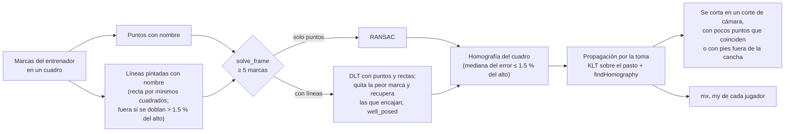
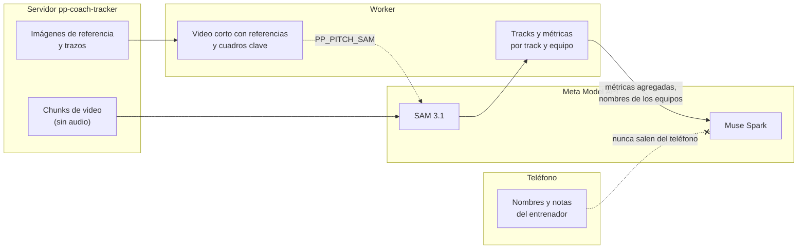
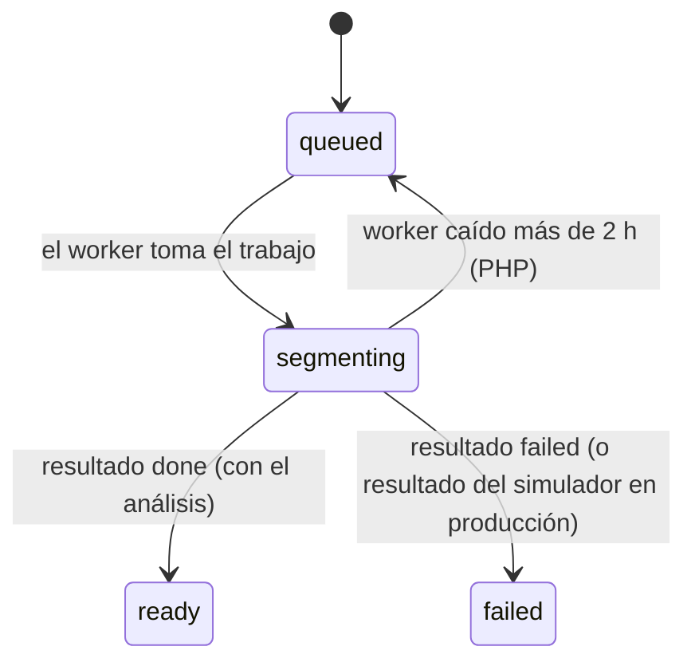

# Pipeline de análisis

El worker está en `worker/`: Python 3.12 con OpenCV, numpy y PyYAML, en Docker. **Solo usa Meta:** SAM 3.1 sigue a jugadores y balón y Muse Spark escribe los hallazgos; no hay detector, tracker ni reglas locales. Sin `MODEL_API_KEY` no arranca. Los dos backends están escritos según el formato documentado, pero **sin verificar** contra la API real: las pruebas usan streams sintéticos (`tests/fakes.py`). Cómo correrlo, las variables y el formato del resultado: [`worker/README.md`](../../worker/README.md).

## Dónde corre

| Opción | Cuándo |
|---|---|
| `run` en Docker junto a la API local (`npm run worker:up`) | Desarrollo: consulta la cola de la API PHP local |
| `once` | Un solo trabajo y termina |
| `analyze DIR` sobre una carpeta de chunks, sin API (`--touches`, `--pitch-mode`, `--debug-dir`) | Medir cambios con videos locales y verlos en el visor |
| Modal o un VPS, con la misma imagen | Producción, contra `https://ppcoachtracker.pepemxl.com` (pendiente, etapa 9) |

En todos los casos el worker **pide** trabajo (`GET /internal/jobs/next`) en lugar de recibir un webhook, así que la API en hosting compartido no llama a nadie. En desarrollo, `SAM_API_BASE_URL` apunta al simulador local (fuera del repo, [13-entorno-desarrollo.md](../13-entorno-desarrollo.md)); lo que sale de ahí se marca `sam_simulator`.

## Etapas

```mermaid
flowchart TB
    claim["1. Tomar trabajo<br/>GET /internal/jobs/next<br/>clip, archivos, referencias, equipos y colores,<br/>options.pitch_mode y calibration"] --> dl["2. Descargar<br/>chunks, YAML, chunks.yaml, reference_N.jpg"]
    dl --> read["3. Leer como un solo video<br/>sin repetir el traslape, con la hora del original<br/>y la máscara de la cancha del YAML de la app"]
    read --> sam["4. SAM 3.1 por chunk y por concepto<br/>player in &lt;color&gt; jersey (A y B), soccer ball;<br/>une los tracks en el traslape"]
    sam --> pass["5. Una pasada por el video<br/>máscara de la cancha donde no vino de la app,<br/>histogramas para los cortes, pasto junto al balón"]
    pass --> post["6. Después de SAM<br/>cortes (cuts.py), cuadros que cuentan (shots.py),<br/>balón por trayectorias (ball.py), equipos y árbitro"]
    post --> cal{"7. Cancha en metros<br/>(calibration y pitch_mode distinto de off)"}
    cal -->|"sin marcas"| metrics
    cal --> touch["Cuadros tocados: puntos + líneas pintadas<br/>→ homografía, propagada por su toma (KLT)"]
    touch -.->|"PP_PITCH_SAM=1 (apagado)"| lines["SAM guiado por los trazos:<br/>confirma o corrige en cuadros clave"]
    touch --> feet["Pies de cada jugador en metros"]
    lines --> feet
    feet --> metrics["8. Métricas (metrics.py)<br/>en la imagen: forma, heatmap, posesión con histéresis,<br/>presión, timeline, tracks<br/>en metros (con ≥ 10 s de cancha): carrera, piques, ancho, mapa"]
    metrics --> muse["9. Muse Spark<br/>hechos agregados sin nombres,<br/>json_schema estricto, una reparación"]
    muse --> result["10. Resultado<br/>POST /internal/jobs/:id/result<br/>(multipart, analysis)"]
    result --> app["GET /clips/:id/analysis<br/>(la app lo muestra)"]
```

**Errores, sin respaldo:** `RetryableError` (429, 5xx, timeout, stream cortado) se reintenta 3 veces con backoff exponencial y respeta `Retry-After`; `MetaError` (401/403, modelo inexistente, salida ilegible) falla el trabajo con `meta_sam: …` o `muse_spark: …`; `InputError` (clip inválido o más de `META_MAX_FRAMES_PER_JOB` cuadros) falla antes de gastar créditos. La key nunca aparece en los mensajes. Si sale bien, la carpeta del trabajo se borra.

**Caché, no respaldo:** cada respuesta cruda se guarda con la llave `URL base + sha256(chunk) + modelo + concepto` (o el sha256 del prompt para Muse Spark). La URL base evita que una respuesta del simulador salga en una corrida contra SAM real.

| Etapa | Qué hace | Detalle |
|---|---|---|
| Unión de chunks | Mismo track si IoU > 0.5 en al menos la mitad de los cuadros del traslape donde aparecen los dos, y en 5 o más | `sam.py` |
| Equipos | Del concepto; el color del torso decide solo si un track aparece en los dos conceptos. Un tercer grupo de color chico y lejos de los dos (el árbitro) queda sin equipo | `teams.py`, `colors.py` |
| Máscara de la cancha | La de la app (YAML de cada chunk) o, donde no viene, medida con la misma regla. Los cuadros sin cancha no cuentan y un jugador cuenta si sus pies caen en la cancha | `pitch.py`, [etapa 12](../prompts/12-mascara-cancha.md) |
| Cortes y cuadros que cuentan | Un corte cuando el histograma de tono y saturación salta 0.44 o más (los tracks empiezan de nuevo). No cuentan los acercamientos (una persona de más de 1/3 del alto), por tomas | `cuts.py`, `shots.py`, [etapa 11](../prompts/11-worker-calidad.md) |
| Balón | Una trayectoria por candidato, cada una con su Kalman; gana la que dura y pasa junto a los pies. Huecos de hasta 5 cuadros solo dentro de una trayectoria; un balón sin pasto alrededor se descarta | `ball.py`, [etapa 11](../prompts/11-worker-calidad.md) |
| Posesión | Se gana a 0.06 y se suelta cuando nadie del equipo está a 0.09; dura hasta 2 s sin ver el balón; la racha mínima se cuenta en cuadros con balón | `metrics.py` |

Todos los tiempos del resultado (`t_ms`, `t_start_ms`…) son del video **original**, traducidos con el mapa de cada chunk: "ver en el video" usa el mismo reloj que el clip del teléfono.

## La cancha en metros

| `pitch_mode` | Qué hace el worker |
|---|---|
| `off` ("No calcular") | Nada; coordenadas de la imagen, aunque haya marcas |
| `no_lines` ("Se ven poco o no hay") | Las marcas del entrenador; SAM para las líneas solo si pintó algo |
| `lines` o sin el campo | Las marcas, y SAM para las líneas si `PP_PITCH_SAM=1` |

- **Nada automático sin un cuadro tocado:** en un solo cuadro, el lugar de la cámara, la inclinación y el zoom se compensan entre sí, así que hace falta un cuadro marcado para saber dónde está la cámara.
- **Con 4 marcas cualquier nombre encaja:** por eso se piden 5. Líneas de una sola dirección dejan la cancha libre (`well_posed`) y no se usan. Las líneas sin nombre no entran al cálculo; solo le muestran a SAM dónde hay una línea.
- **SAM guiado por los trazos** (`calibration/sam_lines.py`, `PP_PITCH_SAM=1`, apagado por omisión): un MP4 a 1 fps con las imágenes de referencia (con franjas negras al tamaño del video) y un cuadro clave por segundo. Van dos peticiones con ese video, porque SAM no combina una frase con puntos: el concepto (`SAM_LINE_CONCEPT`, `white line`) y los trazos, cada uno un objeto con hasta 8 puntos positivos a lo largo, movidos al píxel más brillante cercano (un dedo es más ancho que una línea lejana); hasta 16 objetos, los trazos más largos. Las máscaras de las dos se unen. Con el lugar de la cámara del cuadro tocado: si la homografía propagada cae sobre los píxeles blancos, se confirma; si no, se ajustan paneo, inclinación y zoom contra ellos y, si pasa el filtro de calidad, se vuelve un cuadro clave nuevo. Un cuadro con líneas en dos direcciones lejos de la propagada la corta. Si SAM falla, queda la cancha de las marcas y una nota. El concepto `white line` y las máscaras ya se probaron con SAM real (las decodifica `meta-sam-parser`, de Meta); falta ver si SAM sigue una línea pintada (puntos) de una foto a los cuadros del video ([prompts/14](../prompts/14-referencias-y-lineas-pintadas.md)).
- **Métricas en metros:** solo de los cuadros con homografía y solo con 10 s o más; las velocidades salen de las posiciones medias de cada segundo, y un paso de más de 11 m/s es un cambio de track y no cuenta. El resultado dice qué parte del video tiene metros (`pitch.frames_with_homography`) y el bloque `calibration` cómo se calculó (`calibration.sam` con lo que hizo SAM).

## Qué recibe Meta y qué no

- **SAM 3.1** sigue como máximo 16 objetos por cuadro, por eso una llamada por concepto (equipo A, equipo B, balón). Para las líneas de la cancha recibe solo las referencias y los cuadros clave, con un concepto.
- **Muse Spark** recibe métricas agregadas por equipo (también las de metros), eventos y la línea de tiempo: ni el heatmap celda por celda ni los tracks, y nunca nombres de jugadores ([10-privacidad-jugadores.md](../10-privacidad-jugadores.md)).

### La Meta Model API

- Base `https://api.meta.ai/v1`, `Authorization: Bearer $MODEL_API_KEY`.
- **SAM 3.1** (`SAM_MODEL`, por omisión `sam-3.1`): `POST /files` (`purpose=user_data`) con el chunk y `POST /responses` con stream, un mensaje con `input_text` (el concepto) e `input_video`. MP4/MOV con H.264, H.265 o MPEG-4, hasta 15,000 cuadros, con un mínimo de 50 cuadros cobrados por petición. El stream trae una línea por cuadro: `<Nf>` y registros separados por comas, cada uno con el id del objeto, `<|box;x1;y1;x2;y2;w;h;c|>` en píxeles (el final incluido) y `<|mask;x=0;y=0;c;data=H,W,<marca><base85>|>`, la máscara de la caja del objeto, en el códec propio de Meta que decodifica `meta-sam-parser`. Ningún objeto: el stream termina vacío, sin error. Probado con SAM real el 30 de octubre.
- **Prompts de SAM** ([documentación](https://dev.meta.ai/docs/sam/segmenting), revisada el 28 oct):
  - Una frase sustantiva corta por petición, con atributos si hace falta ("red square" solo da los rojos). Las listas con comas o "+" no dan nada; las órdenes, las preguntas, la negación y lo espacial ("on the left") fallan, y las palabras de relleno empeoran el resultado.
  - Los del worker: `player in <color> jersey` por equipo, `soccer player` si los colores no distinguen a los equipos, `soccer ball` y `white line` para las líneas (antes `white line on a soccer field`, que llevaba relleno). Se pueden cambiar con `SAM_PLAYER_CONCEPT`, `SAM_BALL_CONCEPT` y `SAM_LINE_CONCEPT`.
  - Las cajas y los puntos van como tokens dentro del texto (`<Nf>1<|point;x;y;w;h|>`, con `-` para un punto negativo), hasta 16 objetos, y **no se pueden combinar con una frase**. Por eso las líneas van en dos peticiones: el concepto y los trazos como puntos (`sam_lines.object_prompt`). Cada petición cobra al menos 50 cuadros.
- **Muse Spark** (`MUSE_SPARK_MODEL`, por omisión `muse-spark-1.3`): Responses con salida estructurada (`json_schema` estricto).
- **Costo de SAM:** US$0.20 por cada 1,000 cuadros y concepto. Un minuto a 10 fps son ~600 cuadros por concepto, con 3 conceptos ~US$0.37; las líneas suman las referencias y un cuadro clave por segundo. El resultado lo cuenta en `backends.usage.frames_sent` y en `calibration.sam`. **El costo medido está pendiente** (falta la key).

## Lo que falta

| Hoy | Falta |
|---|---|
| SAM 3.1 y Muse Spark escritos con el formato documentado y streams sintéticos | Con la key: capturar el stream real de un clip propio, ajustar el parser y las pruebas, y medir el costo |
| Conceptos `player in <color> jersey` y `soccer ball` | Medirlos con SAM real (`compare_runs.py`) contra otros conceptos |
| SAM para las líneas, apagado: el concepto y los trazos como puntos, en dos peticiones con el formato documentado; el concepto y las máscaras ya probados con SAM real | Ver si SAM sigue un trazo de una foto a los cuadros del video y medir con un video propio de noche o con líneas gastadas cuántos cuadros confirma o corrige, y cuánto cuesta |
| Metros donde el entrenador marcó la cancha | Probarlo con un video de tripié propio; con 5 marcas a ojo el error en la imagen no dice cuánto se corre la cancha |
| Resultado con métricas por equipo | Estadísticas por dorsal: requiere etiquetar los tracks en la app |
| El worker corre en local; el simulador no existe todavía | El simulador (etapa 8a, fuera del repo) y el worker desplegado (etapa 9) |
| El visor dibuja cajas, posesión y la cancha calculada | Que dibuje las líneas pintadas y las máscaras de SAM |
| Los chunks se quedan en el servidor | Cron de retención que los borre después del análisis |

## Estados mientras analiza

