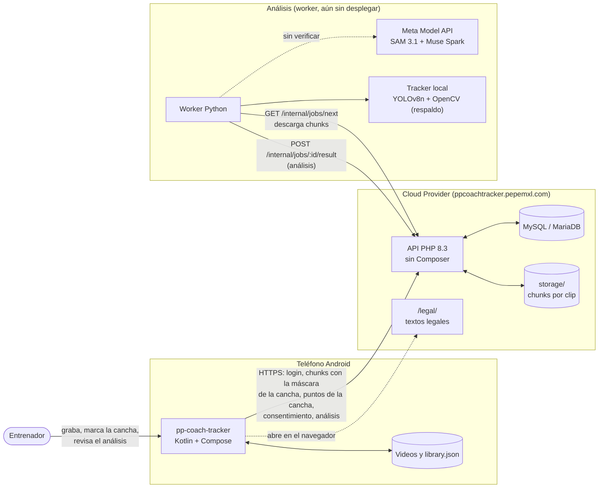

# Arquitectura de PP-Coach-Tracker

> **Antecedente.** Este documento viene del diseño y del prototipo previos al hackathon, que tenían un respaldo local (detector YOLOv8n, tracker propio e insights por reglas). La versión que se construye **no tiene respaldo**: solo SAM 3.1 y Muse Spark, y solo dependencias con licencia permisiva. Donde este texto diga otra cosa, mandan [prompts/00-contexto.md](../prompts/00-contexto.md) y el prompt de cada etapa.

Cómo está construido PP-Coach-Tracker hoy (app 0.3.10, API 0.3.9 en producción, worker en local) y cómo encajan las piezas que faltan. Los diagramas están en [Mermaid](https://mermaid.js.org/), que GitHub dibuja directamente.

> [03-arquitectura.md](../03-arquitectura.md) es el diseño original del hackathon. Esta carpeta documenta lo que **existe en el código**, y marca como *planeado* lo que todavía no.

| Documento | Contenido |
|---|---|
| [01-repositorio.md](01-repositorio.md) | Estructura completa del repo: qué hay en cada carpeta y archivo |
| [02-app-android.md](02-app-android.md) | pp-coach-tracker: capas, navegación, almacenamiento, workers y estados del clip |
| [03-api.md](03-api.md) | API (Node y PHP): rutas, ciclo de una petición, autenticación, modelo de datos y disco |
| [04-flujos.md](04-flujos.md) | Diagramas de secuencia: login, grabar y enviar, marcar la cancha, consentimiento, cola de análisis y ver el análisis |
| [05-despliegue.md](05-despliegue.md) | Entornos (local con Docker y Cloud Provider), configuración, secretos y cómo se despliega |
| [06-pipeline-analisis.md](06-pipeline-analisis.md) | El worker de análisis: escalera SAM 3.1 / tracker local, cuadros que cuentan, balón, cancha en metros, métricas, insights y lo que falta |

## Vista general

El worker funciona con el tracker local y está probado contra la API en Docker, pero no está desplegado. La línea punteada es la Meta API: sus backends están escritos y sin verificar, porque no hay `MODEL_API_KEY`.

## Qué existe y qué falta

| Pieza | Estado | Dónde |
|---|---|---|
| App: grabar, importar, organizar partidos y clips | Listo (0.1) | `android_native/` |
| App: plantel y estadísticas por jugador, importar reporte JSON | Listo (0.2) | `data/Stats.kt`, `AnalysisReportParser.kt` |
| App: versión de 10 fps en chunks de 1 min con YAML | Listo (0.2.2) | `analysis/ChunkWorker.kt`, `data/Chunks.kt` |
| App: login, subida reanudable, estado del análisis | Listo (0.3.0–0.3.1) | `analysis/UploadWorker.kt`, `data/ApiClient.kt` |
| App: consentimiento con historial, textos en dos idiomas | Listo (0.3.2–0.3.4) | `data/Consent.kt`, `analysis/ConsentWorker.kt` |
| App: ver el análisis (resumen, posesión, hallazgos, mapas de calor) | Listo (0.3.6); la sección en metros, 0.3.10 | `ui/screens/ClipAnalysisScreen.kt`, `data/ClipAnalysis.kt` |
| App y API: "Calcular la cancha" por video, con la pregunta de las líneas al enviar (`clips.pitch_mode`) | Listo (0.3.8); el worker la respeta (`off`, `no_lines`) | `ui/components/PitchDialog.kt`, `api/` |
| App: máscara de la cancha medida al preparar el video, en el YAML de cada chunk | Listo (0.3.9) | `analysis/PitchSampler.kt`, `data/PitchMask.kt` |
| App y API: marcar puntos de la cancha en un cuadro (`POST /clips/:id/calibration`) | Listo (0.3.9), desplegado | `ui/screens/PitchTouchesScreen.kt`, `data/PitchTouches.kt`, `api/` |
| API Node (desarrollo y pruebas) | Listo | `api/src/` |
| API PHP (producción en Cloud Provider) | Listo y desplegado (0.3.9) | `api/php/` |
| API: resultado del análisis (`GET /clips/:id/analysis`) | Listo y desplegado | `api/`, `api/php/` |
| Worker: tracker local, equipos por color, métricas, insights por reglas | Listo en local, sin desplegar | `worker/` |
| Worker: cortes de cámara, cuadros que cuentan, balón | Listo | `cuts.py`, `shots.py`, `ball.py` |
| Worker: cancha en metros con los puntos del entrenador, propagada por la toma; métricas en metros | Listo; sin probar con un video de tripié | `calibration/`, `metrics.py` ([mejora 04](../mejoras/04-homografia-por-cuadro.md)) |
| Worker: líneas de la cancha (locales y con SAM 3.1) en las tomas sin puntos | Escrito, **apagado** (`PP_PITCH_LINES`, `PP_PITCH_SAM`): todavía deja pasar cuadros malos en una transmisión, y SAM sin verificar | `calibration/lines.py`, `calibration/sam_lines.py` |
| Worker con SAM 3.1 y Muse Spark | Escrito, **sin verificar** (falta `MODEL_API_KEY`) | `segmenters/meta_sam.py`, `analysts/muse_spark.py` |
| Visor de corridas del worker (cajas y cancha sobre el video, posesión), solo local | Listo | `viewer/` |
| Tracks sobre el video y post-tagging en la app | **Planeado** (v0.4) | [07-plan-android.md](../07-plan-android.md) |
| Retención: borrar chunks después del análisis | **Planeado** | [legal/README.md](../legal/README.md) |

## Decisiones que dan forma a todo

1. **El teléfono hace el trabajo pesado de video.** La app genera una copia de 10 fps, máximo 720p y sin audio, partida en chunks de 1 minuto, y mide ahí mismo dónde está la cancha. Así se sube un tercio de los frames, la subida se reanuda por chunk y el servidor compartido no necesita ffmpeg ([12-videos-largos-chunks.md](../12-videos-largos-chunks.md)).
2. **Hosting compartido para la API, cómputo aparte para la IA.** Cloud Provider sirve bien PHP + MySQL, pero no procesos largos. El análisis va en un worker que pide trabajos a la API ([03-arquitectura.md](../03-arquitectura.md#por-qué-un-worker-separado)).
3. **Un solo contrato, dos implementaciones.** La API Node sirve para desarrollar y probar rápido; la PHP corre en producción. Las dos pasan las mismas pruebas de contrato y comparten `api/db/schema.sql`.
4. **IDs en lugar de nombres.** El pipeline y la Meta API solo ven `player_id` y dorsal; los nombres se quedan en la cuenta del entrenador ([10-privacidad-jugadores.md](../10-privacidad-jugadores.md)).
5. **Sin video sin consentimiento.** Cada clip va ligado a una aceptación registrada, y el servidor guarda el historial de aceptaciones y retiros ([legal/](../legal/README.md)).
6. **Mejor sin metros que con metros falsos.** La cancha sale de los puntos que marca el entrenador; lo automático (líneas, SAM) queda apagado hasta probarlo. Las métricas de la imagen siempre están, y las de metros van aparte y dicen de qué parte del video salen ([mejora 04](../mejoras/04-homografia-por-cuadro.md)).
