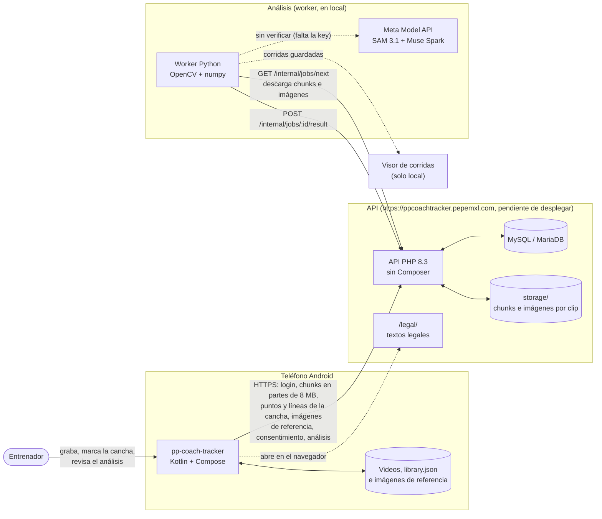

# Arquitectura de pp-coach-tracker

Cómo está construido pp-coach-tracker durante el hackathon (app 0.1.0, API 0.1.0, worker 0.1.0) y qué falta. Describe lo que **existe en el código**; lo que todavía no, va marcado como *pendiente*. Los diagramas están en [Mermaid](https://mermaid.js.org/), que GitHub dibuja directamente.

Las reglas de la construcción (sin respaldo local, solo licencias permisivas, un commit por función) están en [prompts/00-contexto.md](../prompts/00-contexto.md), y el detalle de cada pieza, en el prompt de su etapa.

| Documento | Contenido |
|---|---|
| [01-repositorio.md](01-repositorio.md) | Qué hay en cada carpeta y archivo del repo |
| [02-app-android.md](02-app-android.md) | La app: capas, navegación, dónde guarda cada cosa, trabajos en segundo plano y estados del clip |
| [03-api.md](03-api.md) | La API (Node y PHP): rutas, ciclo de una petición, autenticación, modelo de datos, archivos y límites |
| [04-flujos.md](04-flujos.md) | Diagramas de secuencia: login, grabar y preparar, enviar, consentimiento, marcar la cancha, cola de análisis y ver el análisis |
| [05-despliegue.md](05-despliegue.md) | Entorno local con Docker, pruebas, configuración y secretos, y el despliegue pendiente |
| [06-pipeline-analisis.md](06-pipeline-analisis.md) | El worker: SAM 3.1, cuadros que cuentan, balón, posesión, cancha en metros, Muse Spark, lo que recibe Meta y el costo |

## Vista general

**No hay respaldo local:** si la Meta Model API falla después de los reintentos, el trabajo termina en `failed` con un mensaje claro. Mientras no haya `MODEL_API_KEY`, el worker se prueba con streams sintéticos (pruebas) o contra el simulador local de SAM, que vive fuera de este repo ([13-entorno-desarrollo.md](../13-entorno-desarrollo.md)); sus resultados se marcan `sam_simulator` y la API de producción los rechaza.

## Qué existe y qué falta

| Pieza | Estado | Dónde (etapa) |
|---|---|---|
| App: partidos, grabar, importar, clips, ubicaciones de los videos, español e inglés, tema claro y oscuro | Listo | `android_native/` (1) |
| App: versión de 10 fps en chunks con YAML (perfiles `dev` de 1 min y `demo` de 5 min), vista simple y técnica | Listo | `analysis/ChunkWorker.kt`, `data/Chunks.kt` (3) |
| App: login, sesión cifrada, subida en partes de 8 MB que se reanuda, estado del análisis | Listo | `analysis/UploadWorker.kt`, `data/ApiClient.kt` (5) |
| App: consentimiento con historial; páginas públicas de los textos legales | Listo | `data/Consent.kt`, `ui/components/ConsentDialog.kt`, `api/php/public/legal/` (7) |
| App: ver el análisis (resumen, posesión, hallazgos, mapas de calor, sección en metros) | Listo | `ui/screens/ClipAnalysisScreen.kt`, `data/ClipAnalysis.kt` (10, en parte) |
| App: máscara de la cancha medida al preparar, en el YAML de cada chunk | Listo | `analysis/PitchSampler.kt`, `data/PitchMask.kt` (12) |
| App: "Calcular la cancha", la pregunta de las líneas, los puntos marcados y la vista previa | Listo | `ui/components/Pitch.kt`, `ui/screens/PitchTouchesScreen.kt`, `data/PitchTouches.kt` (13) |
| App: líneas pintadas e imágenes de referencia de la cancha | Listo | `ui/screens/PitchReferencesScreen.kt`, `data/PitchReferences.kt`, `analysis/ReferenceImages.kt` (14) |
| API Node (desarrollo y pruebas) y API PHP (producción), mismo contrato | Listo; la PHP **sin desplegar** | `api/src/`, `api/php/` (4, 6) |
| Worker: SAM 3.1 por concepto, equipos, métricas en la imagen, Muse Spark con salida estructurada, caché y costo | Escrito; **sin verificar con Meta** (falta la key) | `worker/` (8) |
| Worker: corridas guardadas, cortes, cuadros que cuentan, balón, posesión, árbitro | Listo; los conceptos de SAM, sin medir con la key | `cuts.py`, `shots.py`, `ball.py`, `metrics.py` (11) |
| Worker: máscara de la cancha (de la app o medida) | Listo | `pitch.py` (12) |
| Worker: cancha en metros con los puntos y las líneas del entrenador, propagada por la toma; métricas en metros | Listo; sin probar con un video de tripié propio | `calibration/` (13, 14) |
| Worker: líneas de la cancha con SAM guiado por los trazos del entrenador | Escrito, **apagado** (`PP_PITCH_SAM`) y sin verificar | `calibration/sam_lines.py` (14) |
| Visor de corridas (cajas, posesión, métricas, hallazgos) | Listo; no dibuja las líneas pintadas ni las máscaras de SAM | `viewer/` (11) |
| Plantel y estadísticas por jugador, alineación inicial | **Pendiente** | etapas 2 y 10 |
| Simulador local de SAM | **Pendiente** (fuera del repo) | etapa 8a |
| API en producción y worker desplegado | **Pendiente** | etapa 9 |
| Retención: borrar los chunks después del análisis | **Pendiente** | [legal/README.md](../legal/README.md) |

## Decisiones que dan forma a todo

1. **El teléfono hace el trabajo pesado de video.** La app genera una copia de 10 fps, máximo 720p (1080p opcional) y sin audio, partida en chunks, y ahí mismo mide dónde está la cancha. Así se sube un tercio de los cuadros, la subida se reanuda por partes y el servidor compartido no necesita ffmpeg ([12-videos-largos-chunks.md](../12-videos-largos-chunks.md)).
2. **Hosting compartido para la API, cómputo aparte para la IA.** El hosting sirve bien PHP + MySQL, pero no procesos largos. El worker **pide** trabajos a la API, así que la API nunca tiene que llamar a nadie.
3. **Un solo contrato, dos implementaciones.** La API Node sirve para desarrollar y probar rápido; la PHP corre en producción. Las dos pasan las mismas pruebas de contrato y comparten `api/db/schema.sql`.
4. **Solo Meta para la IA.** SAM 3.1 sigue a jugadores y balón y Muse Spark escribe los hallazgos; no hay detector, tracker ni reglas locales. Las dependencias son solo de licencia permisiva ([THIRD_PARTY.md](../../THIRD_PARTY.md)).
5. **IDs en lugar de nombres.** El pipeline y la Meta API solo ven ids de track y equipos; los nombres no salen del teléfono ([10-privacidad-jugadores.md](../10-privacidad-jugadores.md)).
6. **Sin video sin consentimiento.** Cada clip va ligado a una aceptación registrada, y el servidor guarda el historial de aceptaciones y retiros ([legal/](../legal/README.md)).
7. **Mejor sin metros que con metros falsos.** La cancha sale de lo que marca el entrenador (puntos y líneas pintadas); SAM solo confirma o corrige a partir de ahí, y está apagado hasta probarlo. Las métricas de la imagen siempre están, y las de metros van aparte y dicen de qué parte del video salen ([mejora 04](../mejoras/04-homografia-por-cuadro.md)).
