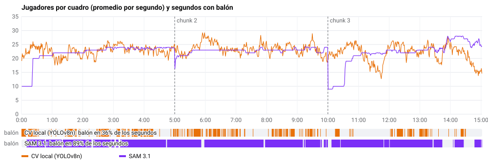
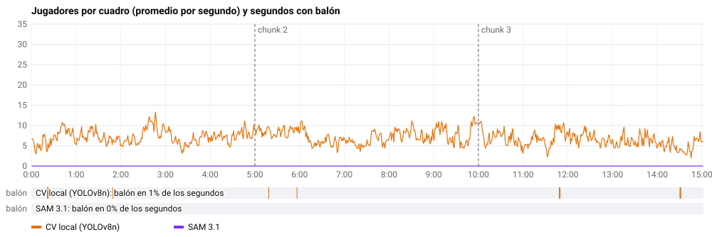
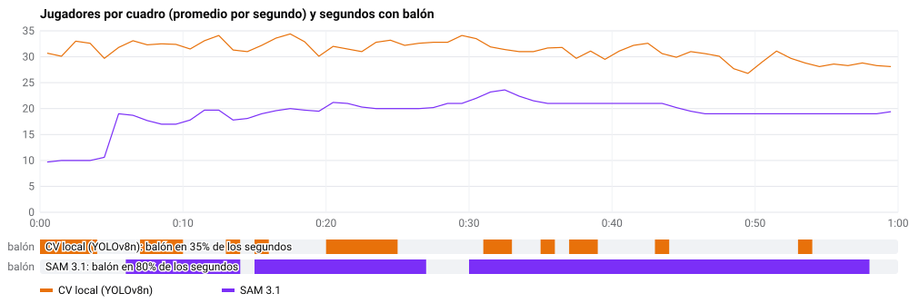

# CV local (YOLOv8n) contra SAM 3.1: tres pruebas sobre el mismo partido

**Fecha:** 30 de octubre de 2026.
**Qué se midió:** dos clips de 15 min del mismo partido, cada uno analizado una vez con el segmentador local de desarrollo y otra con SAM 3.1 real por la Meta Model API. El clip 1 es la toma normal de la transmisión. El clip 2 es una cámara panorámica que muestra la cancha entera, reescalada a 16:9 como si la hubiera grabado un teléfono ([más abajo](#clip-2-cámara-panorámica-reescalada)). El clip 3 es esa misma panorámica a su resolución original (3840×800, como un teléfono 4K), partida en tres videos de 1024 px con traslape ([más abajo](#clip-3-la-panorámica-nativa-en-tres-partes)).

> **La versión local no es SAM.** Es **YOLOv8n** (detector de COCO, en ONNX con OpenCV), con un tracker por IoU con compensación del movimiento de la cámara y el equipo por k-means del color del torso. Es el mismo motor que, en desarrollo, está detrás del simulador de la API de SAM ([13-entorno-desarrollo.md](../13-entorno-desarrollo.md)): el simulador responde con el formato de SAM, pero por dentro corre YOLO. Aquí se corrió directo, sin el simulador, y en los resultados aparece como `local_cv`. YOLOv8n es AGPL-3.0: vive fuera del repo, solo en la máquina de desarrollo, y nunca va a la app, a la API ni a producción. Producción usa solo SAM 3.1.

## Clip 1: la toma de la transmisión

- **Duración:** 15 min 02 s de la transmisión de TV de un partido profesional. Cámara alta en la tribuna, que sigue la jugada; sin cortes ni repeticiones en este tramo.
- **Equipos anonimizados:**
  - **Equipo A**, local, camiseta blanca;
  - **Equipo B**, visitante, camiseta oscura.
- **El video no está en el repo** ([08-uso-de-video.md](../08-uso-de-video.md)): es de terceros y solo se usó para probar en local. Este reporte publica solo números agregados, sin cuadros, sin nombres y sin datos que identifiquen el partido.

## Cómo se corrió

Las dos corridas leyeron **los mismos chunks**, cortados como los corta la app ([12-videos-largos-chunks.md](../12-videos-largos-chunks.md)):

- 3 chunks de 5 min con 3 s de traslape (perfil `demo`);
- 10 fps a 1280×720, en H.264 a 1.5 Mbps;
- 9,020 cuadros en total;
- la máscara de la cancha en el YAML de cada chunk.

No hubo puntos de cancha, así que todo está en coordenadas de pantalla.

| | CV local (YOLOv8n) | SAM 3.1 |
|---|---|---|
| Detección | YOLOv8n en el cuadro completo y en mosaicos 2×2 (jugadores lejanos), solo dentro de la cancha | 3 conceptos por chunk: `player in white jersey`, `player in black jersey` y `soccer ball` |
| Identidad | Tracker IoU propio | Ids de SAM dentro de cada chunk, unidos en el traslape |
| Equipo | k-means del color del torso; árbitro y porteros quedan sin equipo | El concepto que encontró al jugador |
| Hallazgos | Reglas fijas | Muse Spark (`muse-spark-1.3`) |
| Dónde corre | CPU de la laptop | Meta Model API |

Las dos corridas fueron a la vez. CV local compartió la CPU con SAM, que estuvo casi todo el tiempo esperando a la red.

## La gráfica

Arriba van los jugadores por cuadro, en promedio por segundo; las líneas punteadas son los cambios de chunk. Abajo, los segundos en que cada corrida vio el balón en al menos un cuadro: CV local en el 36 % de los segundos (17 % de los cuadros) y SAM en el 89 % de los segundos (85 % de los cuadros).

Lo que se ve:

- **CV local** sube y baja todo el tiempo, entre 13 y 29. Cuenta también al árbitro, a los jueces de línea y al personal de la banda, unos 4 por cuadro sin equipo. Pierde jugadores cuando se amontonan: el hueco de los minutos 11 y 12 es una jugada en el área.
- **SAM 3.1** es casi plano, con escalones: una vez que encuentra a un jugador lo sigue durante el resto del chunk, y suma a los nuevos de golpe.
- **El fallo de SAM está al inicio de los chunks 1 y 3.** Durante 21 s y 31 s, respectivamente, solo ve 10 jugadores, todos del equipo A. Es decir, `player in black jersey` no encontró a nadie hasta bien entrado el chunk. En el chunk 2 los dos equipos aparecen desde el primer segundo.

## Resultados

| Métrica | CV local (YOLOv8n) | SAM 3.1 |
|---|---|---|
| Tiempo de proceso | 1,527 s (1.69 veces el video) | 1,380 s (1.53 veces el video) |
| Costo | US$0 (CPU) | **US$5.45** (27,240 cuadros cobrados: 9,080 × 3 conceptos), más centavos de Muse Spark |
| Personas por cuadro | 22.7: A 8.9, B 9.7 y **4.0 sin equipo** | 22.1: A 10.5, B 11.6 y 0 sin equipo |
| Alto medio de la caja (fracción del alto) | 0.060 | 0.054 |
| **Tracks** | **1,231** | **53** |
| Duración mediana de un track | 7.2 s | 268.8 s |
| Cajas en tracks de 60 s o más | 34 % | 100 % |
| **Balón detectado / visto** | 12 % / **17 %** de los cuadros | 80 % / **85 %** de los cuadros |
| Posesión A / B | 51 % / 49 % | 44 % / 56 % |
| Cambios de posesión | 10 (0.67 por min) | 139 (9.25 por min) |
| Posesión más larga A / B | 7.7 s / 8.3 s | 22.1 s / 23.4 s |
| Hallazgos | 2, de reglas | 6, de Muse Spark |

### Coincidencia cuadro por cuadro

En cada cuadro se emparejaron las cajas de jugador de las dos corridas con IoU ≥ 0.3.

| | |
|---|---|
| Cajas que encontraron las dos | 166,414 |
| De CV local que también encontró SAM | 81 % |
| De SAM que también encontró CV local | 83 % |
| Solo CV local / solo SAM | 38,050 / 33,283 |
| Jugadores chicos (menos del 4 % del alto) que solo vio uno | SAM 10,253 · CV local 1,919 |
| Mismo equipo, cuando los dos asignaron uno | 89 % |
| Cuadros con balón: los dos / solo CV local / solo SAM | 1,443 / 115 / 6,231 |
| Balón en el mismo lugar (a menos del 2 % del ancho), cuando lo ven los dos | 71 % |

Promedio de personas por cuadro en cada minuto:

| Minuto | 1 | 2 | 3 | 4 | 5 | 6 | 7 | 8 | 9 | 10 | 11 | 12 | 13 | 14 | 15 |
|---|---|---|---|---|---|---|---|---|---|---|---|---|---|---|---|
| CV local | 23.2 | 21.0 | 22.7 | 24.0 | 22.8 | 23.5 | 24.5 | 23.4 | 23.6 | 22.8 | 23.2 | 19.1 | 23.6 | 22.8 | 20.2 |
| SAM 3.1 | **16.8** | 22.0 | 23.1 | 23.7 | 23.7 | 21.8 | 23.0 | 22.8 | 23.0 | 23.2 | **14.2** | 21.9 | 22.4 | 23.8 | 26.6 |

### Revisión a ojo

Se revisaron cuatro cuadros con las cajas de las dos corridas encima. Las imágenes no se publican porque son de la transmisión.

- **Saque desde el centro:** CV local marca al árbitro y a los jueces de línea como personas sin equipo. SAM no los marca porque no visten de blanco ni de oscuro. Solo SAM encuentra el balón.
- **Inicio del chunk 2:** a SAM le faltan 6 jugadores del equipo B en un lado de la cancha.
- **Jugada en el área:** SAM separa a los 22 jugadores amontonados frente a la portería. CV local ve 16 y, en cambio, marca al personal de la banda y a los fotógrafos.
- **Medio campo:** las dos corridas coinciden en casi todo. SAM cuenta como equipo B a un juez de línea y a un oficial de la banda con ropa oscura. CV local pone en el equipo A a un jugador del equipo B.

## Clip 2: cámara panorámica reescalada

Otro tramo de 15 min 02 s del mismo partido, con los mismos equipos y colores, pero desde una cámara panorámica que muestra la cancha completa de portería a portería. El original mide 3840×800, una proporción de 4.8:1. Para que se pareciera a una grabación del teléfono, se reescaló a 1920 de ancho y se rellenó con franjas negras hasta 1920×1080: el panorama queda en una franja de 400 px de alto en el centro. Después se cortó y se corrió exactamente igual que el clip 1, con los mismos chunks para las dos corridas.

Al bajarlo a 720p, como hace la app, la franja mide unos 267 px de alto y **un jugador mide unos 8 a 10 px**. En el clip 1, los jugadores que encontró SAM medían 39 px en promedio, y el 10 % más chico, menos de 29 px.

| Métrica | CV local (YOLOv8n) | SAM 3.1 |
|---|---|---|
| Tiempo de proceso | 1,869 s (2.07 veces el video) | 855 s (0.95 veces el video) |
| Costo | US$0 | 27,240 cuadros enviados: **US$5.45** si Meta cobra igual las respuestas vacías (está por confirmar en el panel) |
| Personas por cuadro | 7.0: A 4.7, B 2.3 | **0** |
| Alto de la caja (mediana) | 21 px a 720p | – |
| Tracks | 844 (mediana 2.4 s) | 0 |
| Balón visto | 0.4 % de los cuadros | 0 % |
| Posesión | No se pudo calcular | No se pudo calcular |
| Hallazgos | 3, de reglas, sobre ruido | 1, de Muse Spark: "Sin jugadores ni balón detectados en la imagen" |

Lo que pasó:

- **SAM 3.1 no encontró nada.** Las 9 respuestas (3 chunks × 3 conceptos) llegaron completas y sin error, pero con 0 objetos. Así responde SAM cuando no hay coincidencias. Muse Spark recibió las métricas en cero y dijo que no había juego que analizar; no inventó nada.
- **CV local tampoco sirve aquí.** Ve 7 personas por cuadro de unas 22 en la cancha.
  - El 55 % de sus cajas tiene los pies en los 38 px de abajo de la franja: es la orilla cercana, con jueces de línea, personal de la banda, fotógrafos y los pocos jugadores que pasan cerca.
  - Con tan poco pasto en el cuadro (las franjas negras y la tribuna ocupan casi todo), no aplicó la máscara de la cancha, así que tampoco pudo separar a los jugadores del público.
  - Sus cajas miden unos 21 px: encuentra a las personas más grandes, no a los jugadores lejanos.
- **Revisión a ojo** (4 cuadros, sin publicar): SAM no tiene ninguna caja. CV local marca a 10 personas en el saque desde el centro, la mitad en la banda de abajo, y se le escapan los jugadores del medio campo.

**Conclusión del clip 2:** con jugadores de 8 a 10 px, ninguno de los dos sirve. SAM 3.1 tiene un tamaño mínimo por debajo del cual no reporta nada, en algún punto entre 10 px (aquí) y unos 29 px (los jugadores más chicos que encontró en el clip 1). CV local, con sus mosaicos 2×2, todavía ve algo, pero sobre todo gente de la orilla. Para la app, esto quiere decir que **el teléfono debe grabar lo bastante cerca para que un jugador mida unos 30 px a 720p**, o que esta clase de video hay que mandarla recortada. El clip 3 lo mide.

## Clip 3: la panorámica nativa en tres partes

¿Ayuda grabar a mayor resolución, como permiten los teléfonos 4K y 8K? Se probó con la misma panorámica del clip 2, pero sin reescalarla: el original de 3840×800.

### Por qué no basta con mandar más resolución

SAM, como SAM 2 y otras redes de segmentación, **no trabaja con la resolución original**: reduce cada cuadro hasta que su lado largo mide 1024 px y lo rellena hasta un cuadrado de 1024×1024 antes del encoder (un ViT con parches de 16 px). Un cuadro de 3840 de ancho se reduce a la cuarta parte, y el jugador vuelve a quedar diminuto.

Se comprobó con 1 min de prueba:

| Lo que se le mandó a SAM | Alto del jugador en el video enviado | Alto del jugador después de reducir a 1024 | SAM 3.1 |
|---|---|---|---|
| El panorama nativo, 3840×800 | ~25–45 px | ~7–12 px | **0 objetos** con `player in white jersey` y con `soccer ball` |
| Un recorte de 1280×720 del centro, sin reescalar | ~35–45 px | ~28–36 px | **16 jugadores por cuadro**, balón en el 43 % de los cuadros |

La respuesta vacía también se cobra: el evento final de SAM trae `video_frames_processed: 600`.

### Cómo se partió

Con `worker/tools/make_tiles.py`:

1. Se encontró la cancha con el mismo método que la app, en 30 cuadros repartidos por el video: de x = 193 a 3550 y de y = 90 a 800 del original (3357×710 px).
2. Se colocaron **tres videos de 1024 px de ancho**, lo que SAM ve sin reducir, que cubren la cancha de portería a portería con **128 px de traslape** en cada unión (unas 5 veces el ancho de un jugador).
   - Tres partes de 1024 no alcanzan a cubrir 3357 px a tamaño real, así que se redujo el video al 84 %.
   - El alto es el de la cancha: 596 px.
   - Un jugador queda en unos 26–33 px, en vez de los 8–10 px del clip 2.
3. Cada parte se cortó en chunks como la app (10 fps, H.264) y se analizó por separado, con SAM 3.1 y con CV local.
4. Las tres corridas se unieron en las coordenadas del original (`make_tiles.py merge`):
   - dos tracks de partes vecinas son el mismo jugador si sus cajas coinciden (IoU > 0.5) en al menos la mitad de los cuadros en que los dos están en el traslape, y en 5 o más, la misma regla que une los tracks entre chunks;
   - en el traslape queda una caja por jugador: la de la parte cuyo borde queda más lejos.

Por costo, se analizó **solo el primer minuto** (600 cuadros por parte).

### Resultados del primer minuto

| Métrica (tres partes unidas) | CV local (YOLOv8n) | SAM 3.1 |
|---|---|---|
| Personas por cuadro | 31.2: A 13.3, B 12.1 y **5.8 sin equipo** | **19.0**: A 10.3, B 8.7 |
| Tracks (antes → después de unir) | 170 → 143 (27 uniones) | 51 → **35** (16 uniones) |
| Balón visto | 15 % de los cuadros | **77 %** |
| Duplicados en el traslape después de unir | 0.4 por cuadro | – |
| Costo | US$0 | **US$1.08 por minuto** (3 partes × 600 cuadros × 3 conceptos) |

| Parte | CV local (con equipo + sin equipo) | SAM 3.1 | De SAM que también vio CV local | Mismo equipo |
|---|---|---|---|---|
| 1 (portería izquierda) | 3.2 + 0.8 | 0 | – | – |
| 2 (centro) | 15.4 + 3.1 | 14.6 | 84 % | 95 % |
| 3 (portería derecha) | 8.4 + 2.0 | 5.8 | 92 % | 96 % |

Con las tres partes unidas, el 86 % de las cajas de SAM coincide con una de CV local, con el mismo equipo en el 95 %. Al revés, solo el 53 % de las de CV local coincide con una de SAM. La diferencia son árbitros, porteros, personal de la banda y fotógrafos.

Lo que se vio a ojo, con las cajas unidas dibujadas sobre el panorama original (sin publicar):

- **La unión funciona.** Las cajas de las tres partes caen sobre los jugadores, y un jugador que cruza de una parte a otra conserva un solo track.
- **La parte 1 vacía es correcta.** En ese minuto solo está el portero, con camiseta de otro color, que ningún concepto describe. CV local marcó ahí al portero (como del equipo A), a un fotógrafo y al personal de la banda.
- **Las cajas de SAM son más limpias.** Las 21 cajas del cuadro revisado son jugadores en la cancha. CV local agrega unas 6 personas por cuadro que no juegan.
- **El inicio del chunk se repite:** los primeros 5 s, SAM ve solo a 10 jugadores de un equipo, como en el clip 1.

**Conclusión del clip 3:** grabar en 4K sí ayuda, pero solo si el video se manda a SAM **partido en recortes del tamaño que SAM ve sin reducir** (1024 px de lado largo), y no entero. Partir y unir funciona: 19 jugadores por cuadro y balón en el 77 % de los cuadros donde el clip 2 tenía cero. El precio es una petición por parte: con tres partes, el triple, US$1.08 por minuto contra US$0.36.

## Conclusiones

Del clip 1, la toma normal:

1. **La identidad de los jugadores es para SAM.** Tiene 53 tracks en 15 min, casi uno por jugador en cada chunk; CV local tiene 1,231 pedazos de unos 7 s. Con CV local, las métricas por jugador (distancia, minutos, mapas) salen partidas.
2. **El balón también es para SAM:** 85 % de los cuadros contra 17 %. Por eso la posesión de CV local no sirve (10 cambios en 15 min y posesiones de 8 s como máximo). La de SAM es creíble: 139 cambios y posesiones de hasta 23 s.
3. **El conteo promedio empata, pero cada uno falla distinto.** CV local suma árbitros y personal de la banda, y se pierde a los jugadores amontonados. SAM deja fuera a casi todos los oficiales y encuentra más jugadores chicos, pero puede **tardar decenas de segundos en encontrar a un equipo al inicio de un chunk**, y a veces cuenta como jugador a alguien de la banda vestido como un equipo.
4. **Tiempo parecido, uso de la máquina opuesto.** Los dos tardan entre 1.5 y 1.7 veces la duración del video. CV local ocupa toda la CPU; SAM casi no usa la máquina y pasa el tiempo subiendo chunks y esperando a Meta.
5. **Costo de SAM:** unos **US$0.36 por minuto** de video (3 conceptos a 10 fps). Un partido de 90 min costaría unos US$33.

Del clip 2, la panorámica:

6. **Hay un tamaño mínimo.** Con jugadores de 8 a 10 px de alto a 720p, SAM 3.1 no devuelve nada y CV local ve sobre todo a la gente de la orilla. El clip 1 funcionó con jugadores de 30 px o más.
7. **El costo no depende de lo que encuentra.** Una corrida vacía envía los mismos 27,240 cuadros (y SAM los cuenta como procesados), así que conviene revisar la escala antes de mandar un clip largo.

Del clip 3, la panorámica nativa en tres partes:

8. **La resolución no llega sola a SAM.** SAM reduce todo a 1024 px por el lado largo: mandar 3840×800 da los mismos ceros que mandar el video reescalado.
9. **Partir en recortes de 1024 px con traslape funciona.** SAM ve 19 jugadores por cuadro y el balón en el 77 % de los cuadros, y la unión en el traslape deja un track por jugador. Cuesta una petición por parte: con tres, unos US$1.08 por minuto, y un partido de 90 min, unos US$97.

## Qué sigue

- **El inicio de chunk de SAM.** Hay que confirmar en el visor por qué un concepto no encuentra a nadie durante los primeros segundos. Dos soluciones baratas, que habría que medir antes y después con esta misma corrida:
  - repetir el concepto a mitad del chunk;
  - en el traslape, sembrar el chunk nuevo con los jugadores del anterior.
- **El personal de la banda con ropa del color de un equipo.** Revisar si la máscara de la cancha, ampliada 0.02, deja pasar los pies de la banda, o si conviene un tercer concepto para descartarlos (`referee`, `staff`).
- **Las tres partes en los 15 min completos** (unos US$16), para medir la unión con cambios de chunk y jugadas que cruzan las uniones.
- **Partir en el worker, no a mano.** Si se adopta, que el worker parta los chunks de video ancho y una los tracks (`make_tiles.py` ya tiene las dos mitades), y que solo mande las partes donde hay cancha.
- **Un concepto para los porteros** (`goalkeeper`): con los conceptos de color, SAM no ve a los porteros ni al árbitro.
- **Avisar en la app antes de gastar.** Si los jugadores se ven muy chicos, avisar o pedir que se grabe más cerca antes de subir el clip. Falta definir cómo medirlo en el teléfono.
- **Repetirlo con un partido amateur grabado con tripié**, que es el uso real de la app: una transmisión no es el producto ([learnings/01](../learnings/01-analisis-de-video.md)).

## Cómo reproducirlo

1. Cortar el video: `worker/tools/make_chunks.py VIDEO SALIDA --profile demo --pitch`, y recodificar los chunks a H.264 con `ffmpeg -c:v libx264 -b:v 1500k`.
   - Para el clip 2, antes se reescaló el panorama con `ffmpeg -vf "scale=1920:400,pad=1920:1080:0:340"`.
   - Para el clip 3, antes se partió con `make_tiles.py plan VIDEO tiles.json --margin 0 --overlap 128` y `make_tiles.py encode tiles.json`. Cada parte se cortó con `make_chunks.py --width 1024 --height 596`, se analizó por separado y las corridas se unieron con `make_tiles.py merge tiles.json RUN_1 RUN_2 RUN_3 --out merged.json`.
2. Correr SAM 3.1: `analyze SALIDA --home-color white --away-color black --debug-dir …` con `MODEL_API_KEY` y `SAM_API_BASE_URL` vacío ([worker/README.md](../../worker/README.md)).
3. Correr el segmentador local (fuera del repo) sobre los mismos chunks, guardando su corrida.
4. Comparar las dos en el visor ([viewer/README.md](../../viewer/README.md#comparar-dos-corridas)): marca las dos corridas y toca **Comparar**. Muestra esta misma gráfica, las cajas lado a lado o solo sus diferencias, y la tabla de coincidencia.

Las gráficas salen de los `tracks.json` de las dos corridas (en el clip 3, del `merged.json` de cada una): por cada segundo, cuántas cajas de jugador tuvo en promedio cada cuadro y si apareció el balón en alguno.
