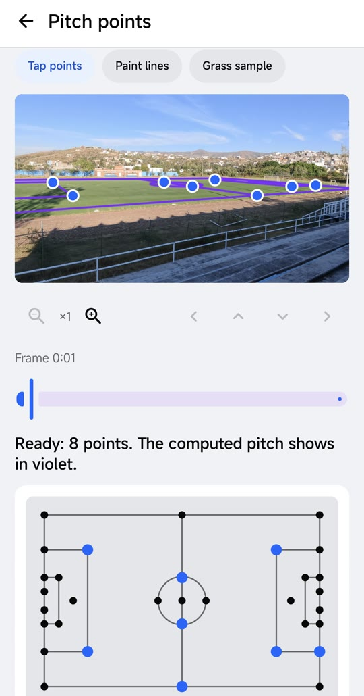
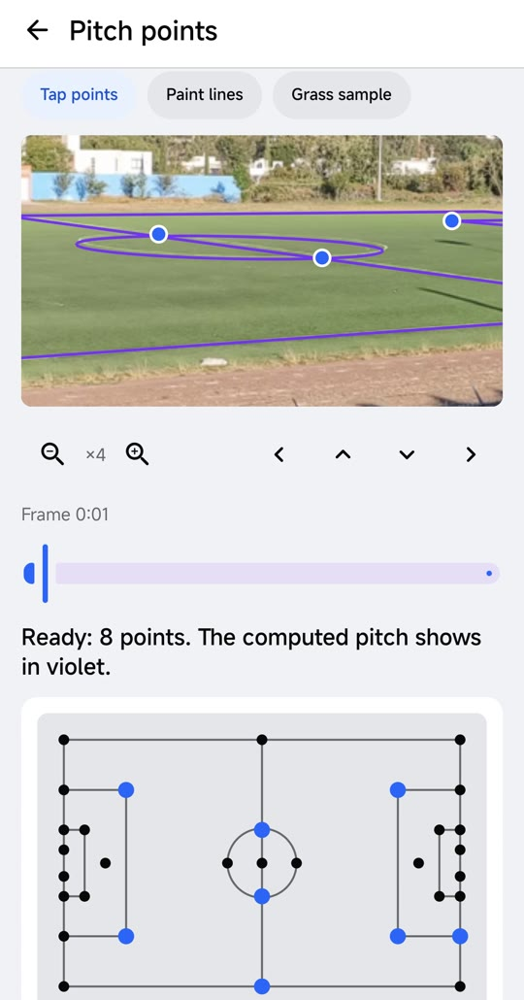
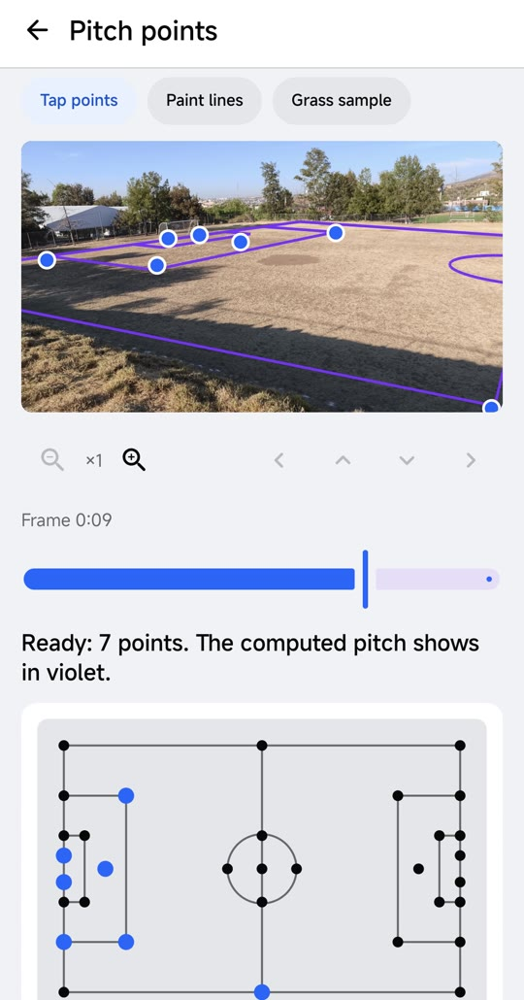
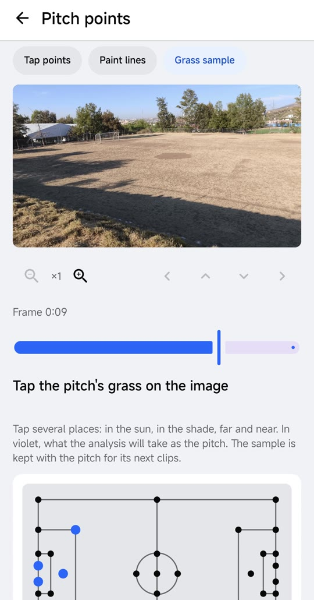

# Hito: la cancha en metros en canchas reales, aun sin líneas visibles

**Fecha:** 4 de noviembre de 2026.
**Qué se logró:** con la app 0.4.4, el entrenador calibra la cancha en sus propias canchas, incluida una de tierra donde las líneas casi no se ven, con 7 u 8 toques sobre un cuadro del video. De ahí sale la homografía que pone a cada jugador en metros. Es la base de **cuánto corre cada jugador y dónde está**, y de todas las métricas en metros que siguen.

- **El video:** propio, grabado por el equipo con la app en las dos canchas de Yerbabuena ([08-uso-de-video.md](../08-uso-de-video.md#video-propio)), sin jugadores. Las capturas son de la app, sin la barra de estado del teléfono.
- **Qué falta medir:** en estas dos canchas no hay puntos medidos en el terreno, así que el error en metros todavía no tiene número. Lo que se ve en las capturas es que la cancha calculada (en violeta) cae sobre lo que queda de las líneas. El error medido con video de partido está en [02](02-homografia-y-sam-cancha.md) y [03](03-homografia-camara-en-movimiento.md).

## Por qué es un hito

Un analizador común necesita una cancha con líneas bien pintadas, una instalación fija o chalecos con GPS. Las canchas donde entrena un equipo amateur tienen líneas borradas, tierra, sombras de árboles y pasto seco. El entrenador sí sabe dónde están las áreas, los postes y la media cancha, aunque la cámara apenas los vea. Por eso la calibración la pone él y el seguimiento lo hace SAM 3.1:

1. **El entrenador** toca en un cuadro los puntos que reconoce (esquinas del área, postes, punto penal, media cancha) y su lugar en el esquema de la cancha. Con 4 puntos ya hay homografía; con 7 u 8 bien repartidos, RANSAC descarta un toque equivocado.
2. **SAM 3.1** sigue a cada jugador y al balón en todo el video, con un concepto por equipo según el color de la camiseta, sin entrenar nada.
3. **El worker** proyecta los pies de cada jugador con la homografía y obtiene su posición en metros. Si la cámara se mueve, sigue la cámara cuadro a cuadro y la vuelve a anclar con las líneas que SAM encuentra.

Así, la calidad de la cancha deja de ser un requisito. Funciona igual en un partido que en un entrenamiento, donde casi nunca hay una cámara profesional ni una cancha en buen estado.

## Lo que se ve en las capturas

| | |
|---|---|
|  | **1. Marcar los puntos (Yerbabuena 1, pasto sintético con pista, desde la grada).** 8 toques: las dos esquinas interiores del área izquierda, los cruces de la media cancha con el círculo, la media cancha cercana y tres esquinas del área derecha. En el esquema de abajo se ve en azul qué punto es cada toque. La cancha calculada se dibuja en violeta sobre el cuadro: el área, el círculo y las bandas caen sobre las líneas pintadas. |
|  | **2. El zoom (×4).** La misma cancha, acercada sobre el círculo central. Con el zoom (hasta 8×) y las flechas para moverse, los toques caen exactos aunque el punto esté lejos y mida pocos píxeles; la elipse violeta coincide con el círculo pintado. |
|  | **3. Una cancha sin líneas visibles (Yerbabuena 2, tierra con pasto seco).** Las líneas casi no existen: quedan la portería, un poco de cal cerca de la banda y la textura del terreno. Con 7 toques en lo que el entrenador reconoce (los dos postes, el punto penal, tres esquinas del área grande y la media cancha cercana) la app calcula toda la cancha. El área y la portería quedan en su lugar, y el círculo central y la banda lejana aparecen donde no se ve nada. |
|  | **4. El mismo cuadro sin marcas.** En la pestaña de muestra del terreno se ve cómo es la cancha en realidad: tierra, sombras largas y ninguna línea que un detector automático pueda seguir. La muestra que toca el entrenador (en el sol, en la sombra, cerca y lejos) le dice al análisis qué es cancha. |

## Qué permite

Con la cancha en metros, cada caja de SAM 3.1 se convierte en una posición sobre el terreno. De ahí salen:

- **Distancia recorrida** por jugador, **metros por minuto** y **velocidad máxima**, que la app muestra en la página de cada jugador y en la hoja del partido ([11-stats-jugadores.md](../11-stats-jugadores.md)).
- **Velocidad de sprint por equipo** (el percentil 95, en km/h) y **mapas de calor** sobre la cancha, no sobre la imagen.
- **Ancho y largo de cada equipo**, en metros.
- **Posesión medida en metros:** un equipo gana el balón cuando un jugador está a menos de 2 m de él durante 1 s, y un pase no se le da a quien pasa cerca.
- **Limpieza de datos:** se descarta un balón a más de 2 m fuera de las líneas y, con la cámara fija, los jugadores fuera del área de juego (bancas, gradas).
- **Lo que no se midió se dice:** los cuadros sin cancha calculada quedan fuera de las métricas en metros, con una nota.

En un partido completo de 49 min grabado con una cámara que se mueve, el 86 % de los cuadros quedó con la cancha en metros a partir de 8 toques en un solo cuadro ([versión 0.4.4](../versions/0.4.4/README.md)).

## Siguiente paso

Medir el error en metros en estas dos canchas con puntos tomados en el terreno (cinta métrica en las esquinas del área y la media cancha), y grabar un entrenamiento con jugadores para ver la distancia recorrida de punta a punta.
