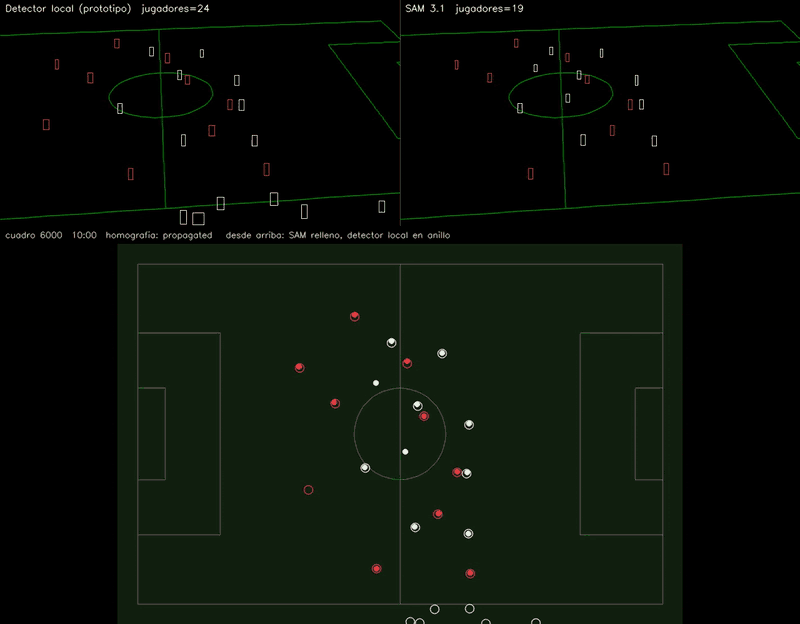

# Un tiempo completo de 49 min: SAM 3.1 contra el detector local

**Fecha:** 3 y 4 de noviembre de 2026; cifras al día el 5 de noviembre, con la regla de pausas.
**Es el primer tiempo:** el partido completo, con el segundo tiempo, está en [07](07-partido-completo-dos-tiempos.md).
**Qué se midió:** un partido entero, analizado una vez con el detector local de desarrollo (YOLOv8n, el mismo de [01](01-cv-local-vs-sam31.md), fuera del repo) y otra con SAM 3.1 real por la Meta Model API, con la cancha en metros a partir de 8 marcas en un solo cuadro.

- **El video:** 49 min 6 s de la cámara táctica de un partido profesional, que se panea toda la toma, analizado como lo sube la app: 10 chunks de 5 min a 1280×720 y 10 fps. Es de terceros y no está en el repo ([08-uso-de-video.md](../08-uso-de-video.md)). Los equipos van anonimizados: **A** de rojo y **B** de blanco.
- **La animación** no tiene ningún píxel del video: son las cajas de cada detector sobre negro, las líneas de la cancha que proyecta la homografía y la cancha vista desde arriba ([08-uso-de-video.md](../08-uso-de-video.md#dibujos-derivados-sin-píxeles-del-video)).

## 15 segundos del partido (minuto 10:00 a 10:15)

- **Arriba a la izquierda, el detector local:** cajas que aparecen y desaparecen de un cuadro a otro, y cajas de más en la banda cercana (gente fuera de la cancha).
- **Arriba a la derecha, SAM 3.1:** los mismos jugadores, estables cuadro a cuadro, sin la gente de la banda cercana.
- **Abajo, la cancha desde arriba en metros:** SAM con círculo relleno y el detector local en anillo. Donde los dos ven a alguien lo ponen en el mismo lugar (0.19 m de mediana); lo que el detector local deja fuera de las líneas son sus detecciones de la banda.

## Los números

| | Detector local | SAM 3.1 |
|---|---|---|
| Tracks de jugadores | 6,102 | **186** |
| Duración mediana de un track | 4.3 s | **90 s** |
| Cajas en tracks de más de 60 s | 7 % | **98 %** |
| Jugadores por cuadro | 17.6 | 20.8 |
| Cuadros con balón (detectado + interpolado) | 55.6 % | 72.5 % |
| Cuadros con la cancha en metros | – (usa la de SAM) | **86 %** |
| Tiempo | 1 h 30 min en CPU | 1 h 50 min por la API |
| Costo | – | unos US$36 (US$0.36 por minuto con 3 conceptos a 10 fps) |

- **Identidad:** un track de SAM es un jugador durante minutos; uno del detector local dura segundos. Sin eso no hay distancia recorrida por jugador ni ligar un track a un dorsal.
- **Dónde coinciden:** de las cajas del detector local, SAM encuentra el 76 %; cuando los dos ven a la misma persona coinciden en el equipo el 92 % de las veces y la ponen a 0.19 m de mediana (p90 0.40 m).
- **La pausa de hidratación queda fuera:** de 24:09 a 27:16 el balón está quieto y entran los cuerpos técnicos. El worker la reconoce por el balón y la saca de las métricas ([versión 0.4.4](../versions/0.4.4/README.md)); por eso cuentan 27,590 de los 29,460 cuadros. La animación es del minuto 10 y no cambia.
- **Posesión:** con las reglas de la [versión 0.4.4](../versions/0.4.4/README.md) (sostener el balón 1 s, medir en metros, no cortar la posesión en un pase entre compañeros), los cambios de posesión bajaron de 5.2 a 1.4 por minuto. Contra 4 min marcados a mano, el dueño del balón coincide en el 95 % de los cuadros.

## Lo que todavía falla

- **El balón de SAM no siempre es el balón.** En esta toma mide unos 5 px. En una auditoría a ojo de 40 cuadros, la mayoría de los balones falsos de SAM estaban en los anuncios, la grada o la banca. Con la cancha en metros se descartan los que caen a más de 2 m fuera de las líneas.
- **La cancha tiene huecos** en algunos minutos donde la cámara se va lejos de las líneas visibles (minutos 20, 25–26 y 45).
- **Gente de la banda:** SAM también sigue a jueces de línea y a la banca; el worker reconoce y deja fuera 33 tracks que se quedan fuera de la cancha.
