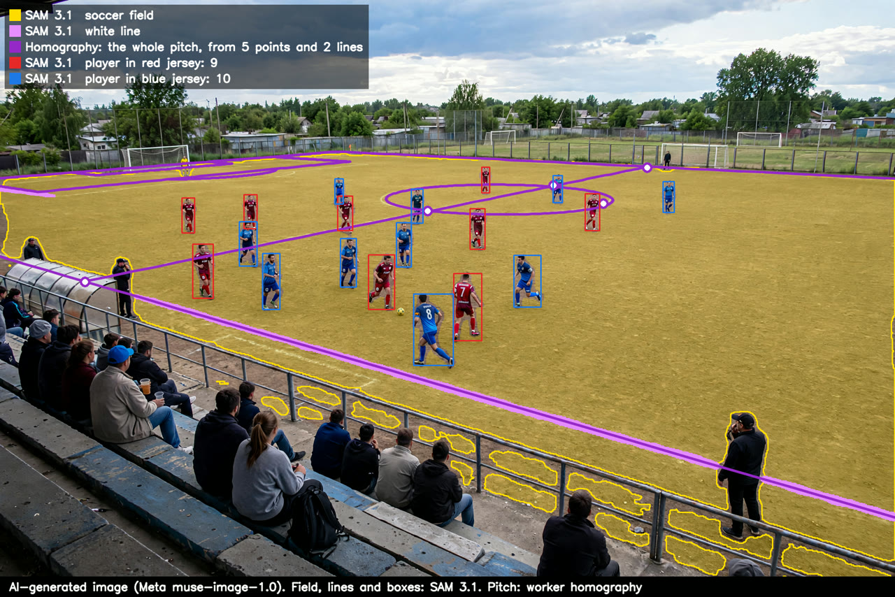

# Lo que SAM 3.1 encuentra en una imagen: jugadores, balón, cancha y líneas

**Fecha:** 4 de noviembre de 2026.
**Qué se midió:** qué encuentra SAM 3.1 en una toma desde la grada con los mismos tres conceptos que usa el worker en cada video, sin entrenar nada ni marcar nada.

- **La imagen:** `jugada_01_sin_pasto.png`, **generada con IA (Meta muse-image-1.0)**: una escena inventada, rojos contra azules en una cancha de tierra, vista desde la grada ([assets/grupo_01/](../assets/grupo_01/README.md)). No es un partido real; sirve para mostrar qué devuelve SAM, no para medir su precisión, que se mide con video real ([01](01-cv-local-vs-sam31.md), [05](05-partido-completo-sam-vs-local.md)).
- **Cómo se mandó:** como un video de 1 s a 10 fps con la imagen fija (1920×1280), porque el worker le manda video a SAM. Un pedido por concepto, con el mismo código del worker (`SamSegmenter`, `parse_stream`). Se dibujan las cajas del primer cuadro.
- **Los conceptos:** `player in red jersey`, `player in blue jersey` y `soccer ball`, los que el worker arma con los colores que el entrenador elige al crear el partido.
- **Costo:** 30 cuadros-concepto, menos de un centavo de dólar.

## Qué encontró

| Concepto | Cajas | Confianza |
|---|---|---|
| `player in red jersey` | 9 | 0.85 a 0.93 |
| `player in blue jersey` | 10 | 0.83 a 0.93 |
| `soccer ball` | 1 | 0.87 |

- **Los 19 jugadores de campo, cada uno con su equipo:** los 9 rojos y los 10 azules, incluidos los lejanos, de unos 50 px de alto. Ninguno quedó en el equipo equivocado ni con dos cajas.
- **El balón**, de unos 15 px, junto al pie del 8 azul.
- **Lo que dejó fuera, como debe:** el público de la grada, los dos hombres de la banda, el entrenador de la derecha, el árbitro de negro y los dos porteros (de amarillo y de negro). El concepto pide una camiseta roja o azul, y SAM no se queda con cualquier persona.
- **Los porteros quedan fuera** porque no visten el color de su equipo: con estos conceptos, el análisis no los sigue.

## La cancha, las líneas y la homografía

Sobre la misma imagen, dos conceptos más de SAM: `soccer field` (en amarillo, la máscara de la cancha) y `white line` (en lila, el concepto con que el worker vuelve a anclar la cancha en metros, [03](03-homografia-camara-en-movimiento.md)). Con ellos y con lo que un entrenador marcaría, el código de calibración del worker (`solve_frame`) calcula la homografía, y con ella se proyecta **la cancha completa** en morado: bandas, líneas de fondo, media cancha, círculo y áreas, también donde no se ve ninguna línea. Costo: 20 cuadros-concepto más, menos de un centavo.

**Lo que dio SAM:**

- **La cancha (`soccer field`, 41 % de la imagen):** toda la tierra de juego, desde el fondo hasta la banda cercana, sin el pasto de atrás, la grada ni el cielo. Se pasa un poco: incluye la franja de tierra entre la banda cercana y la grada, a la gente de la banda parada sobre la tierra y manchas de tierra detrás del barandal. Como zona de juego basta, porque los pies de los jugadores se revisan contra las líneas de la cancha en metros.
- **Las líneas (`white line`, 0.8 % de la imagen):** la **banda cercana** completa, de punta a punta, y un tramo corto al fondo a la izquierda. No encontró la media cancha, el círculo central ni el área, que en esta tierra son líneas de cal delgadas y gastadas.
- **Otros conceptos no encontraron nada:** `field line`, `pitch marking`, `chalk line`, `line` y `center circle` dieron 0 máscaras en esta imagen.

**La homografía (puntos blancos con borde morado):**

| Marca | Cómo se obtuvo | Error al reproyectar |
|---|---|---|
| Banda cercana (`touch_near`) | Recta ajustada a la máscara de SAM | – |
| Banda lejana (`touch_far`) | Leída en la imagen ampliada | – |
| Media cancha con la banda lejana (`halfway_far`) | Leída en la imagen ampliada | 2.7 px |
| Media cancha con la banda cercana (`halfway_near`) | Cruce de la media cancha con la banda cercana de SAM | 1.8 px |
| Círculo central: sus cruces con la media cancha (`circle_far`, `circle_near`) y su extremo derecho (`circle_right`) | Elipse ajustada a los píxeles blancos del círculo, sin los jugadores | 5.6 a 6.6 px |

- **5 puntos y 2 líneas, mediana de 2.7 px**, dentro de la tolerancia del worker (1.5 % del alto, 19 px). La plantilla es la de 11 con las medidas por omisión, 105×68 m.
- **Un punto quedó fuera:** el extremo izquierdo del círculo, sacado con una aproximación que no vale en perspectiva, caía a 72 px; RANSAC lo descartó y se quitó.
- **Lo que muestra:** la media cancha y el círculo proyectados caen sobre los pintados, la banda cercana sobre la de SAM, y el área izquierda aparece al fondo, junto a la portería. La mitad derecha sigue fuera de la imagen.
- **Límite:** la imagen es inventada, así que no hay medidas reales con qué comparar la cancha proyectada; el error en metros se mide con video real ([02](02-homografia-y-sam-cancha.md), [03](03-homografia-camara-en-movimiento.md)).

Es el caso que el [hito de la cancha sin líneas](04-hito-cancha-sin-lineas.md) resuelve: SAM ve pocas líneas, pero unos cuantos puntos que el entrenador reconoce, más las líneas que SAM sí encuentra, alcanzan para calcular toda la cancha y poner a cada jugador en metros.
