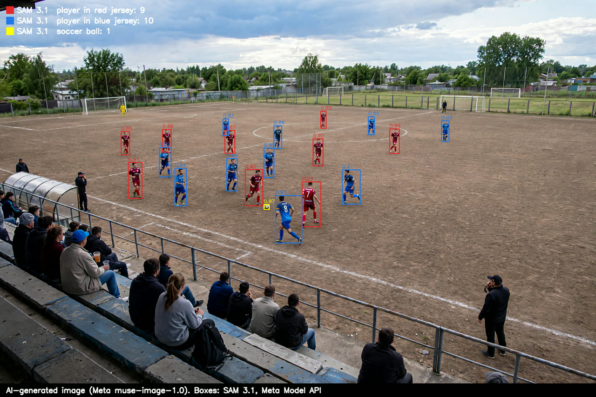

# Las cajas de SAM 3.1 en una imagen

**Fecha:** 4 de noviembre de 2026.
**Qué se midió:** qué encuentra SAM 3.1 en una toma desde la grada con los mismos tres conceptos que usa el worker en cada video, sin entrenar nada ni marcar nada.

- **La imagen:** `jugada_01_sin_pasto.png`, **generada con IA (Meta muse-image-1.0)**: una escena inventada, rojos contra azules en una cancha de tierra, vista desde la grada ([assets/grupo_01/](../assets/grupo_01/README.md)). No es un partido real; sirve para mostrar qué devuelve SAM, no para medir su precisión, que se mide con video real ([01](01-cv-local-vs-sam31.md), [05](05-partido-completo-sam-vs-local.md)).
- **Cómo se mandó:** como un video de 1 s a 10 fps con la imagen fija (1920×1280), porque el worker le manda video a SAM. Un pedido por concepto, con el mismo código del worker (`SamSegmenter`, `parse_stream`). Se dibujan las cajas del primer cuadro.
- **Los conceptos:** `player in red jersey`, `player in blue jersey` y `soccer ball`, los que el worker arma con los colores que el entrenador elige al crear el partido.
- **Costo:** 30 cuadros-concepto, menos de un centavo de dólar.

## Qué encontró

| Concepto | Cajas | Confianza |
|---|---|---|
| `player in red jersey` | 9 | 0.85 a 0.93 |
| `player in blue jersey` | 10 | 0.83 a 0.93 |
| `soccer ball` | 1 | 0.87 |

- **Los 19 jugadores de campo, cada uno con su equipo:** los 9 rojos y los 10 azules, incluidos los lejanos, de unos 50 px de alto. Ninguno quedó en el equipo equivocado ni con dos cajas.
- **El balón**, de unos 15 px, junto al pie del 8 azul.
- **Lo que dejó fuera, como debe:** el público de la grada, los dos hombres de la banda, el entrenador de la derecha, el árbitro de negro y los dos porteros (de amarillo y de negro). El concepto pide una camiseta roja o azul, y SAM no se queda con cualquier persona.
- **Los porteros quedan fuera** porque no visten el color de su equipo: con estos conceptos, el análisis no los sigue.
