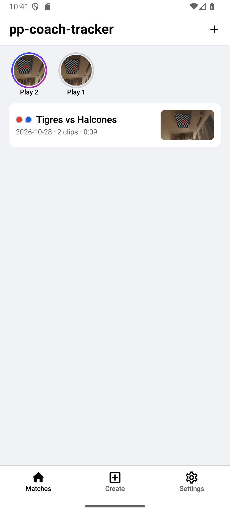
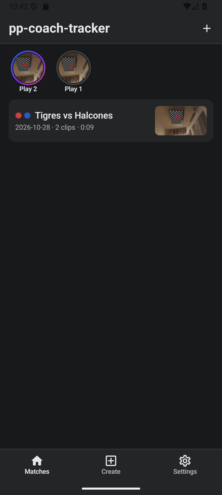
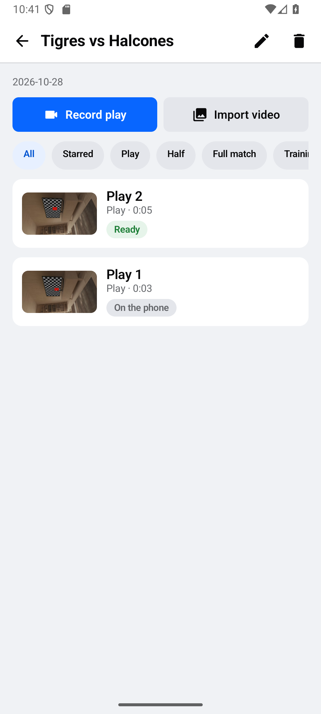
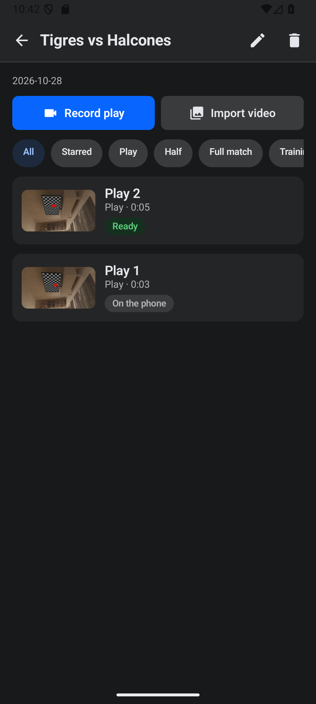
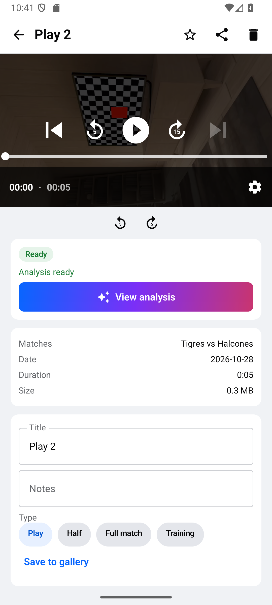
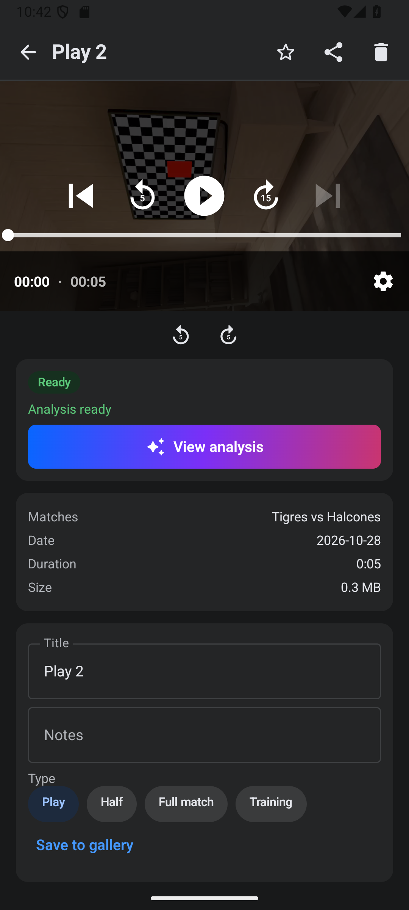
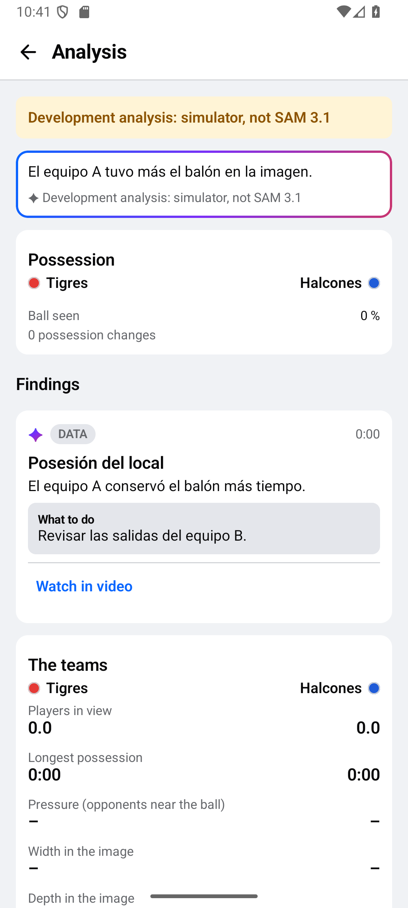
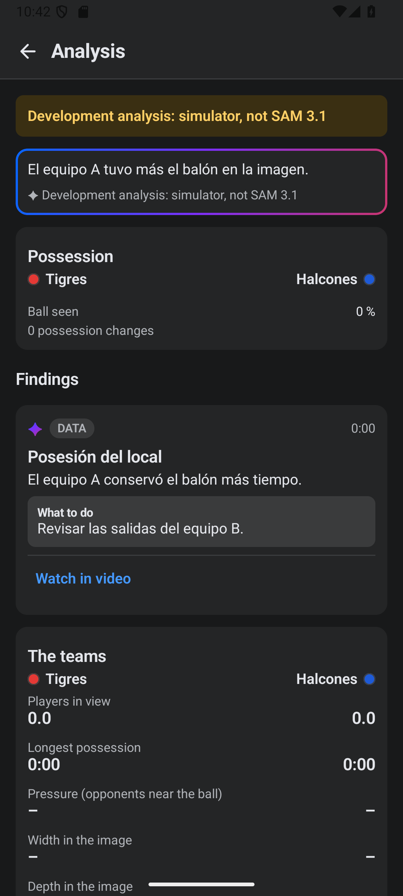
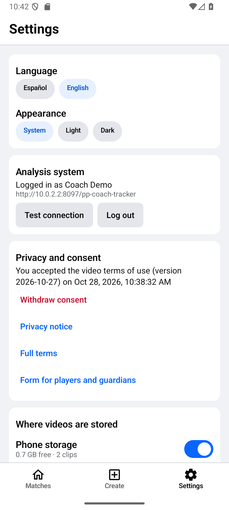
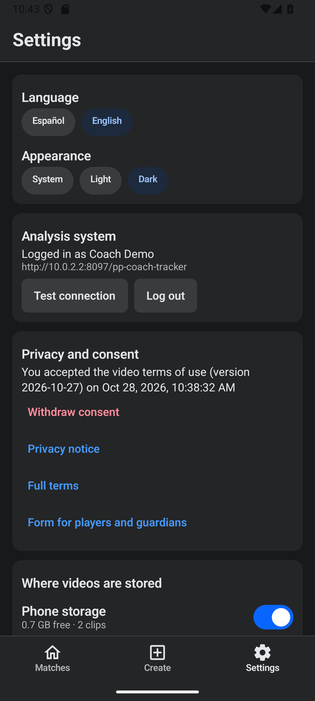

# pp-coach-tracker 0.1.0 (construcción del hackathon)

Capturas del build debug en el emulador (Android 16, API 36), en claro y en oscuro. El video es la escena virtual de la cámara del emulador, no video de terceros. El análisis viene de una corrida de desarrollo con una Meta API falsa (por eso el aviso "Análisis de desarrollo" y los números en cero): muestran la interfaz, no un resultado de SAM 3.1.

| Pantalla | Claro | Oscuro |
|---|---|---|
| Partidos |  |  |
| Partido |  |  |
| Clip con el análisis listo |  |  |
| Análisis |  |  |
| Ajustes |  |  |

Flujo probado en el emulador: crear partido, grabar dos clips con la cámara virtual (MP4 H.264 720p), cerrar y reabrir con los datos intactos, iniciar sesión contra la API PHP local, aceptar el consentimiento, preparar el chunk de 10 fps, subirlo en partes, el worker lo analiza y el clip pasa a "Listo" con su análisis.
