# pp-coach-tracker 0.2.0

- **Fecha:** 30 de octubre de 2026.
- **Versión anterior:** [0.1.0](../0.1.0/README.md).
- **Probado en:** el build debug en el emulador `Medium_Phone_API_36.0` (Android 16, API 36), en claro y en oscuro.
- **Versiones:** app 0.2.0 (`versionCode` 2), API 0.2.0 y worker 0.2.0.

Todos los datos de las capturas son de prueba: los equipos, los dorsales y las iniciales son inventados, y el video es la escena virtual de la cámara del emulador. El análisis del clip viene de una corrida de desarrollo sobre un video sintético propio, de ahí el aviso "Development analysis". El reporte importado es el ejemplo del repo (`android_native/samples/analysis-report.example.json`).

## Qué cambió

**App**

- **Plantel:** pestaña nueva en la barra inferior. Cada jugador tiene dorsal (1 a 99, único), posición y un apodo o iniciales opcional que nunca sale del teléfono.
- **Estadísticas por jugador y partido:** se abren desde el detalle del partido.
  - Cada jugador tiene las 17 stats. Las que vienen del video están bloqueadas hasta que hay reporte.
  - Lo que captura el entrenador gana sobre el análisis; lo editado se marca y "Back to the analysis" lo deshace.
  - **Importar reporte:** lee un JSON por dorsal, agrega los dorsales nuevos al plantel como medios y avisa lo que ignoró.
  - **Página de cada jugador:** totales, valor por 90 minutos (solo con partidos que tienen minutos) y precisión de pase.
- **Dorsales de los tracks:** en el análisis de un clip, cada track se liga a un jugador, y "Send the minutes to the match" suma sus segundos en los clips del partido.
- **"The camera stays still the whole video":** casilla en el detalle del clip. Con ella, el worker usa una sola homografía para todo el video.
- **Canchas guardadas:** un menú en "Pitch points" elige una cancha guardada con su largo y ancho en metros, o crea una nueva.
- `library.json` pasa a la versión 2; una biblioteca de la versión 1 abre sin perder nada.

**API** (desplegada en producción)

- `analysis.camera` en `POST /clips`.
- `video_deleted` en `GET /clips/:id`.
- `bin/retention.php`: borra el video 24 h después del análisis y a los 30 días como máximo. Corre cada día a las 04:30.

**Worker** (en producción)

- Con la cámara fija, la homografía del cuadro tocado vale para todo el video.
- El video ancho (panorámica, o de más de 2048 px) se parte en videos de hasta 1024 px sobre la cancha y los tracks se unen después ([learnings/04](../../learnings/04-video-ancho-y-sam.md)).

## Capturas

| Pantalla | Claro | Oscuro |
|---|---|---|
| Plantel | 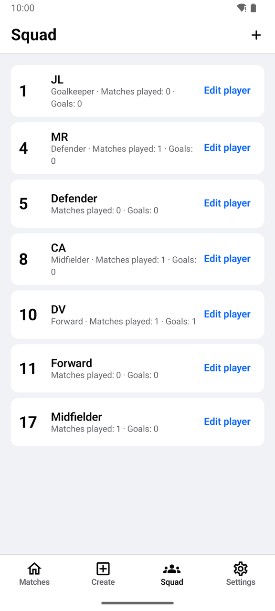 | 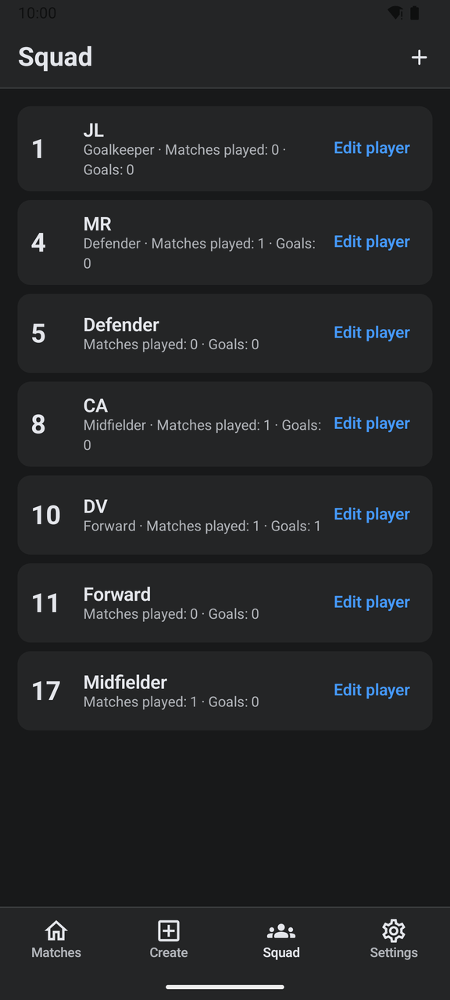 |
| Estadísticas del partido | 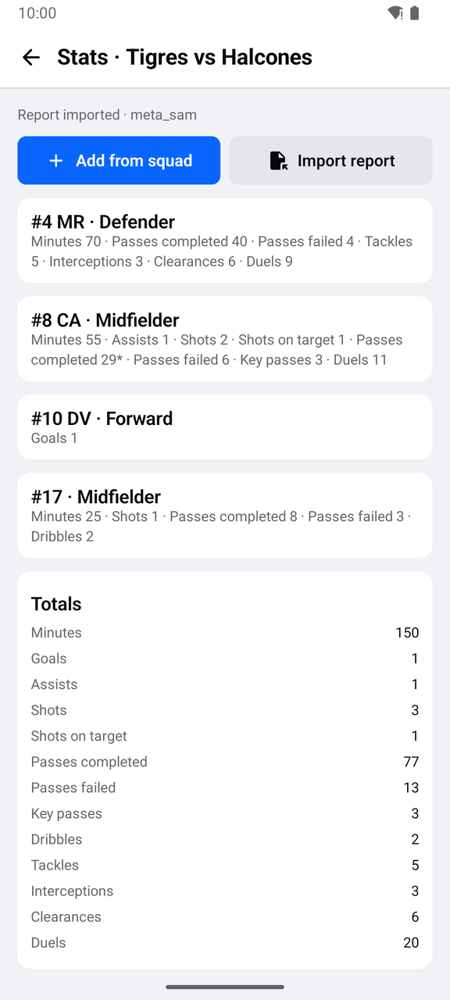 | 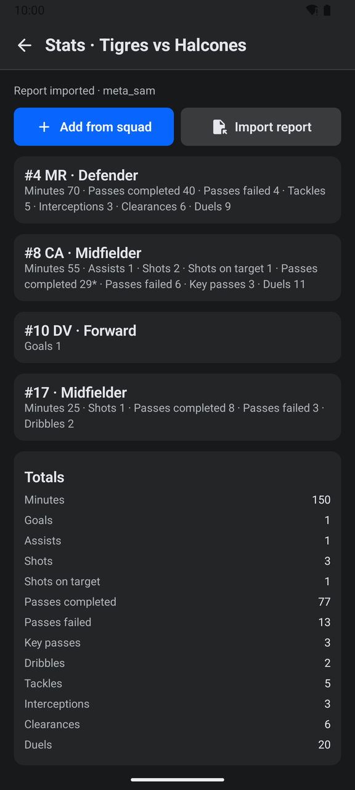 |
| Página del jugador | 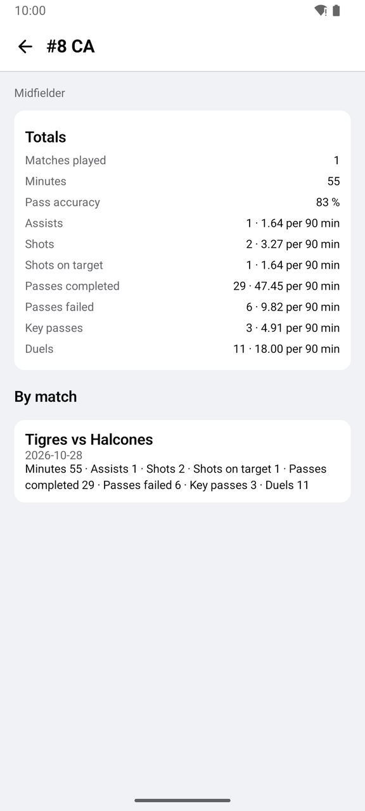 | 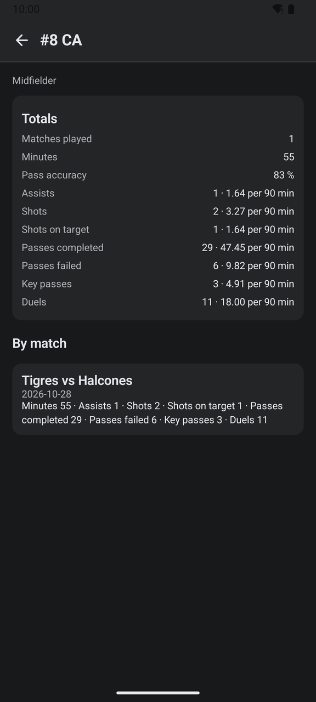 |

| Editar jugador | Reporte importado | Editar una stat |
|---|---|---|
| 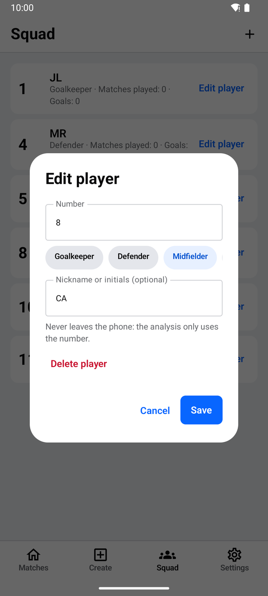 | 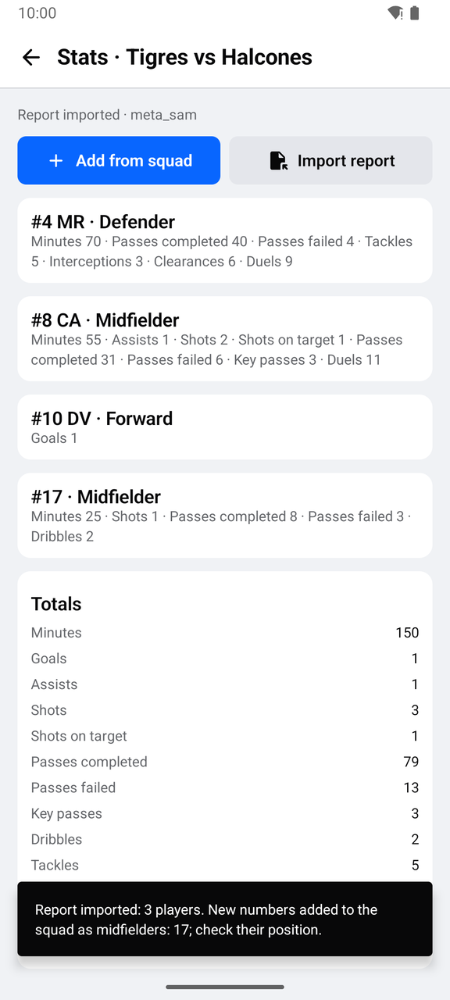 | 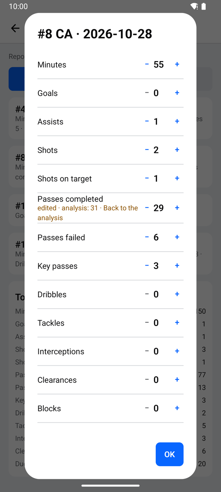 |

| Dorsales de los tracks | Cámara fija | Cancha nueva | Cancha guardada |
|---|---|---|---|
| 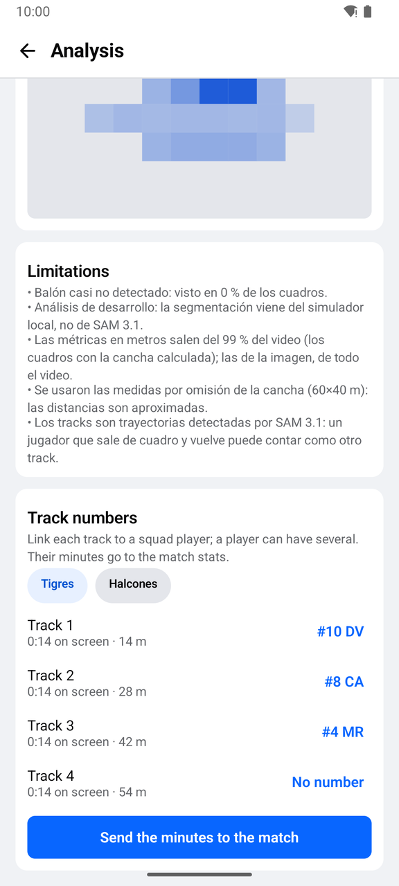 | 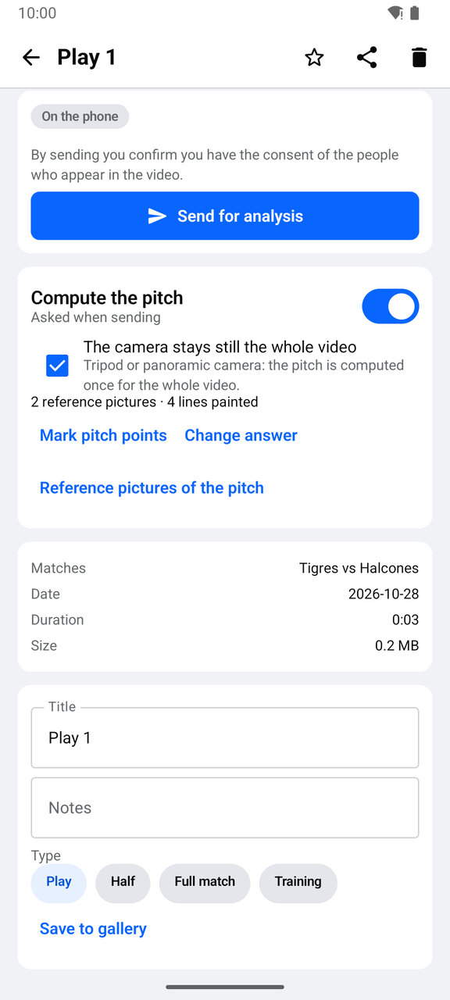 | 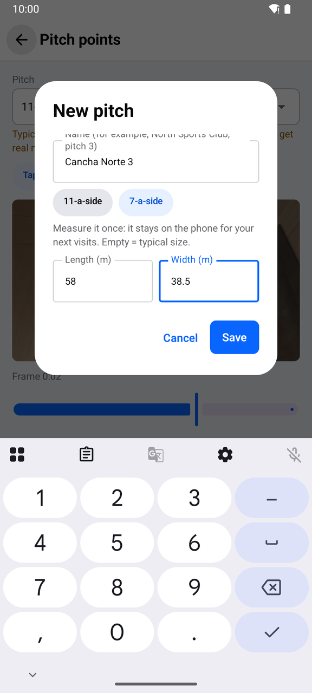 | 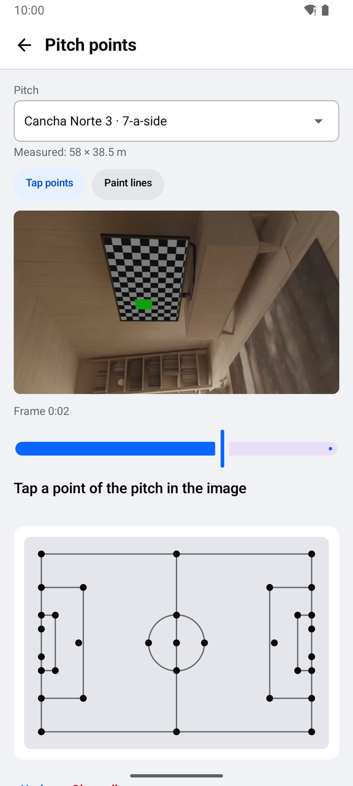 |

## Flujo probado en el emulador

1. Se instaló 0.2.0 sobre 0.1.0 y la biblioteca abrió con sus partidos, clips, referencias y análisis.
2. Se cargó un plantel de prueba de 6 jugadores y se abrió y canceló el editor de un jugador.
3. En el análisis de un clip se ligaron 3 tracks a los dorsales 10, 8 y 4, y se pasaron los minutos al partido. El clip dura 15 s, así que los minutos salen en 0.
4. En las estadísticas del partido se importó el reporte de ejemplo con el selector de archivos del sistema. Se agregó el dorsal 17 al plantel y se conservaron el gol y la asistencia que ya había capturado el entrenador.
5. Se corrigieron los pases acertados del 8 de 31 a 29. La hoja marca el valor editado, el editor muestra el del análisis, y la página del jugador da 83 % de precisión (29 de 35) y los valores por 90 minutos de 55 minutos.
6. En un clip sin enviar se marcó la cámara fija, y se creó y guardó la cancha "Cancha Norte 3" (fútbol 7, 58 × 38.5 m), que quedó elegida con sus medidas.

## Pruebas automáticas

- app: 62 JVM;
- API Node: 23;
- API PHP: 26, de contrato, incluida la retención;
- worker: 92, incluidos el video partido y la cámara fija.

Todas pasan.

## Notas

- En oscuro, los íconos de la barra de estado salen oscuros sobre fondo oscuro. Ya pasaba en 0.1.0.
- Los minutos de los tracks se redondean por minuto: un clip corto da 0. Pases, tiros y duelos por jugador siguen llegando solo con un reporte importado.
- Falta de la etapa 10: la pestaña de estadísticas con filtros y la alineación inicial.
