# pp-coach-tracker 0.3.0

- **Fecha:** 30 de octubre de 2026.
- **Versión anterior:** [0.2.0](../0.2.0/README.md).
- **Probado en:** el build debug en el emulador `Medium_Phone_API_36.0` (Android 16, API 36), en claro y en oscuro.
- **Versiones:** app 0.3.0 (`versionCode` 3). La API y el worker siguen en 0.2.0: esta versión no cambia el contrato.

Todos los datos de las capturas son de prueba: equipos inventados, dorsales e iniciales, y la escena virtual de la cámara del emulador. Los dos partidos nuevos (contra Lobos y contra Linces) se cargaron como datos de prueba para que el filtro y los totales tuvieran varios partidos. El análisis del clip viene de una corrida de desarrollo sobre un video sintético propio.

## Qué cambió

- **Pestaña de estadísticas:** en la barra inferior. Cada jugador muestra partidos, minutos, goles, asistencias y precisión de pase, ordenados por cualquier stat; la elegida va grande a la derecha, con su valor por 90 minutos.
- **Filtro de partidos:** todos, los últimos 3, 5 o 10 por fecha, un rango del calendario (un solo día vale) o partidos elegidos con casillas.
  - Lo comparten la pestaña y la página del jugador.
  - Debajo dice cuántos partidos entran, o "No match fits this filter".
- **Alineación inicial:** se abre con el ícono de balón en la hoja del partido.
  - Fútbol 11 o 7, con 9 formaciones de 11 y 4 de 7.
  - Cada lugar se llena con un jugador del plantel (primero los de su línea) o con un dorsal escrito; "Fill with the squad" coloca a cada uno en su línea.
  - Al cambiar de formación, el portero se queda en la portería y cada jugador conserva su línea mientras quepa.
  - Se guardan solo dorsales.
- **Desde el video, por jugador:** donde se calculó la cancha, los dorsales de los tracks dan, además de los minutos, la distancia recorrida, los metros por minuto y la velocidad máxima. Se ven en la página del jugador y en la hoja del partido.
- **Video para el análisis:** en Ajustes, 720p, 1080p u **Original**.
  - Original manda el video a su resolución, hasta 2160p, para que el worker parta el video 4K o panorámico para SAM.
  - Los chunks se acortan para no pasar de 140 MB: un video 4K va en chunks de 1 min.
  - Con Original, la app graba en 4K si la cámara puede.
- **Barra de estado en oscuro:** los íconos siguen el tema de la app; antes salían oscuros sobre fondo oscuro.
- **Correcciones:**
  - un clip ya enviado muestra la cámara que mandó;
  - los minutos del video ya no borran los del reporte con un 0 ni le quitan su marca;
  - plurales en inglés.

## Capturas

| Pantalla | Claro | Oscuro |
|---|---|---|
| Estadísticas, ordenadas por goles | 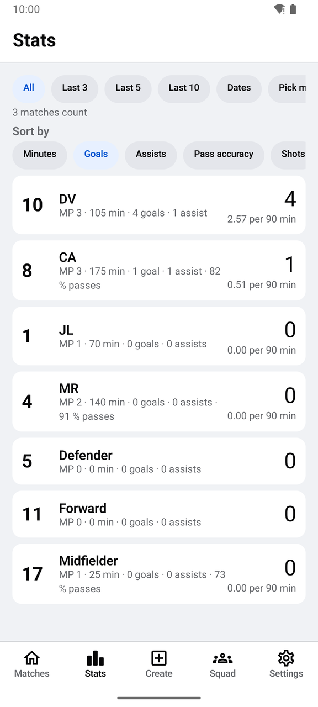 | 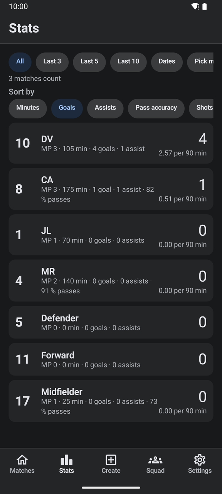 |
| Jugador, con lo del video | 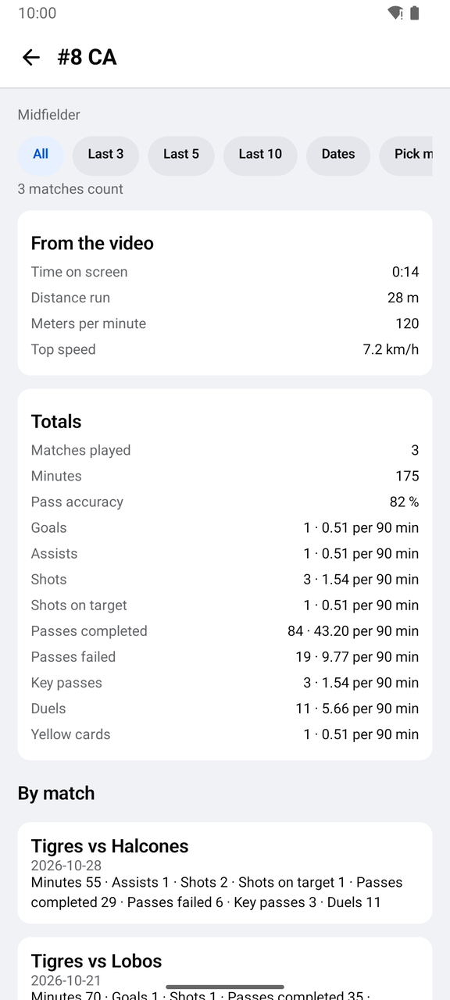 | 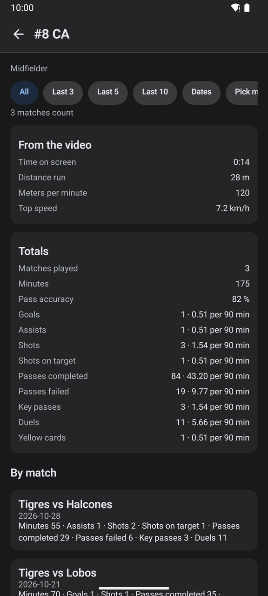 |
| Hoja del partido, con alineación y video | 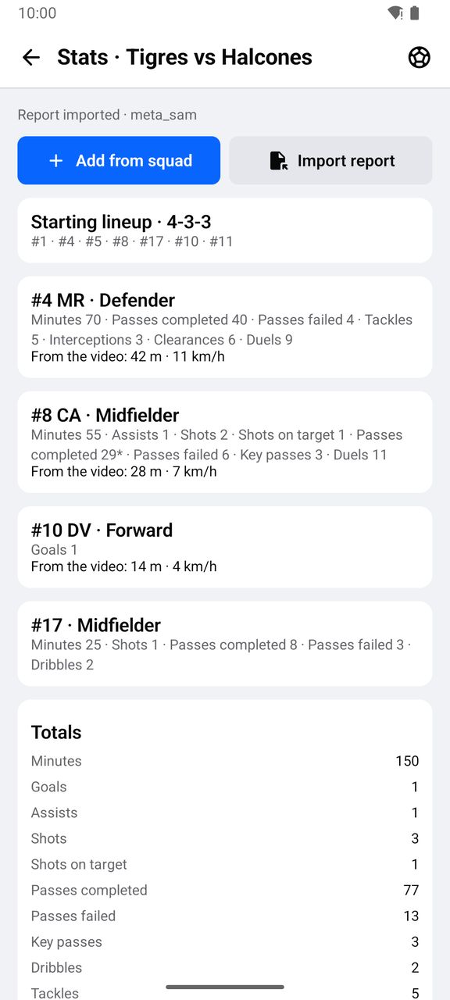 | 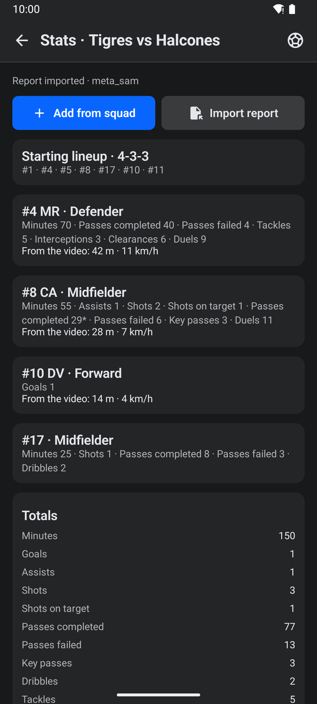 |
| Alineación inicial (4-3-3) | 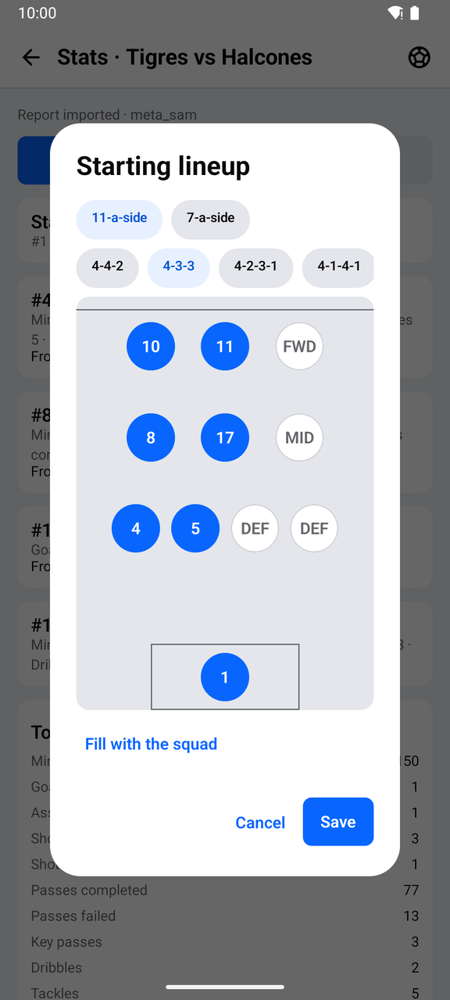 | 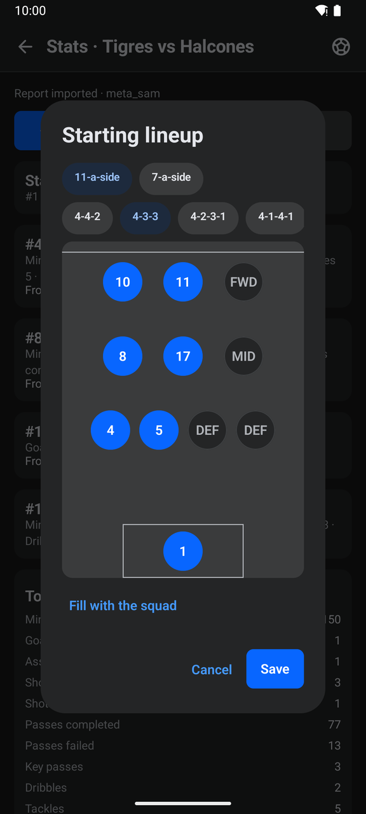 |

| Filtro por fechas | Elegir partidos | Alineación de 7 (2-3-1) | Video para el análisis |
|---|---|---|---|
| 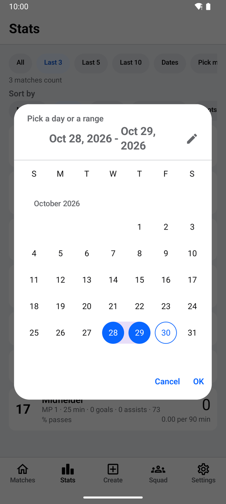 | 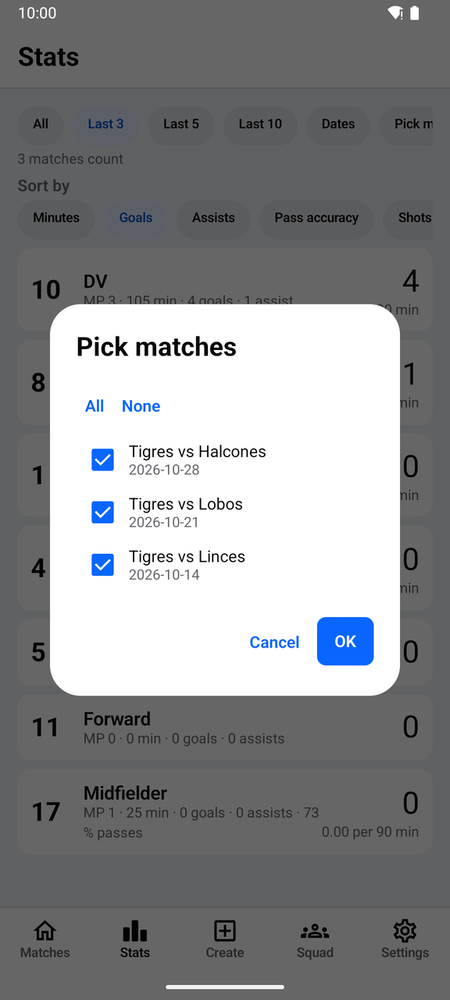 | 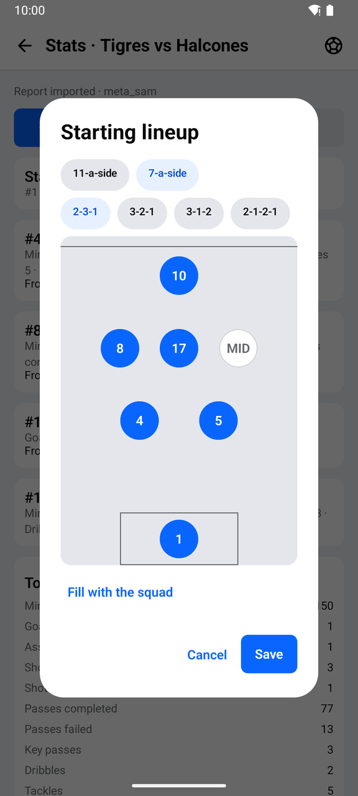 | 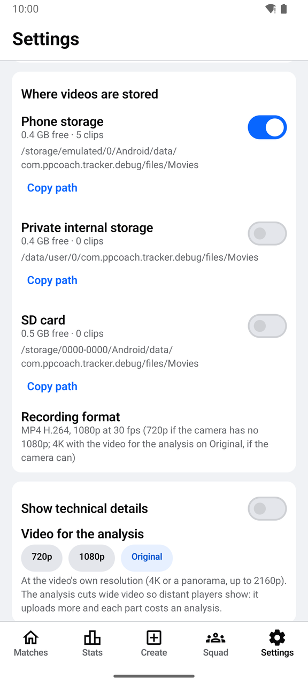 |

## Flujo probado en el emulador

1. Se instaló 0.3.0 sobre 0.2.0 y la biblioteca abrió con todo: plantel, estadísticas, dorsales de los tracks y canchas.
2. **Pestaña de estadísticas:** se ordenó por goles; el 10 da 4 goles en 105 minutos (2.57 por 90).
3. **Filtro:**
   - un solo día (28 de octubre) dejó 1 partido;
   - un día sin partidos mostró "No match fits this filter";
   - "Pick matches" muestra los tres con casillas, "All" y "None".
4. **Alineación:** en 4-4-2, "Fill with the squad" puso a cada jugador en su línea. Al pasar a fútbol 7 (2-3-1), el 1 siguió en la portería, el 4 y el 5 en la defensa, el 8 y el 17 en el medio y el 10 arriba, y el 11 quedó fuera. Se guardó y la hoja muestra "Starting lineup · 4-3-3" con sus dorsales.
5. **Video por jugador:** al pasar los minutos de un clip de 15 s, el 8 muestra 28 m, 120 m/min y 7.2 km/h en el video, y conserva sus 55 minutos y la marca "Report imported" del reporte.
6. **Ajustes:** se eligió Original y se volvió a 720p. El texto del formato de grabación menciona 4K.
7. **Modo oscuro:** los íconos de la barra de estado salen claros.

## Pruebas automáticas

App: 68 JVM. Incluyen el filtro (los últimos N por fecha, rangos en cualquier orden y de un solo día, elegidos), las formaciones (jugadores por formación, claves únicas, líneas), la alineación (un dorsal en un solo lugar, cambiar de formación, llenar con el plantel, lectura tolerante), la resolución original y el tope de los chunks, y los metros y la velocidad por jugador. Todas pasan.

## Notas

- La opción Original no se probó con un video 4K real: el emulador no graba en 4K.
- Pases, tiros y duelos por jugador siguen llegando solo con un reporte importado; el worker no los mide por jugador.
