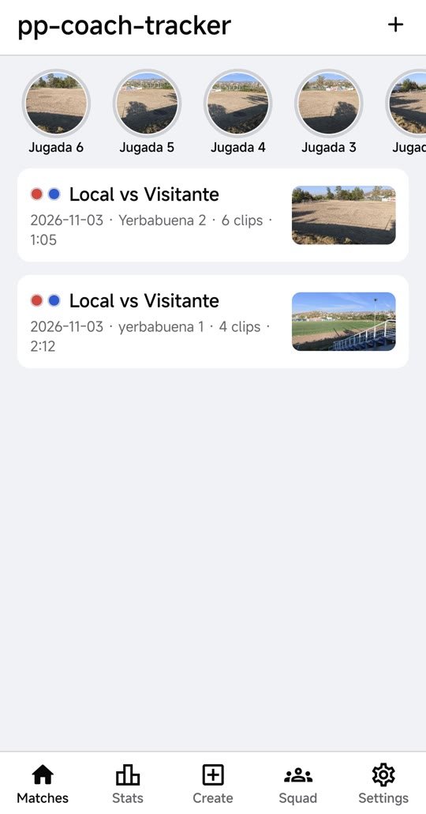
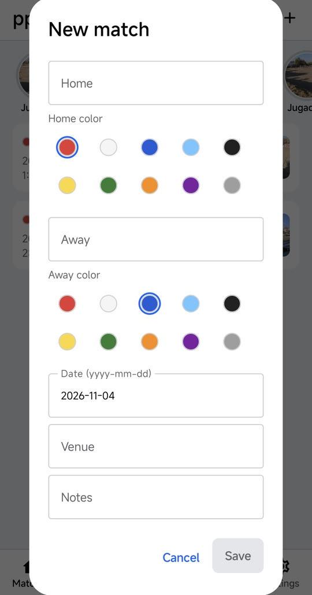
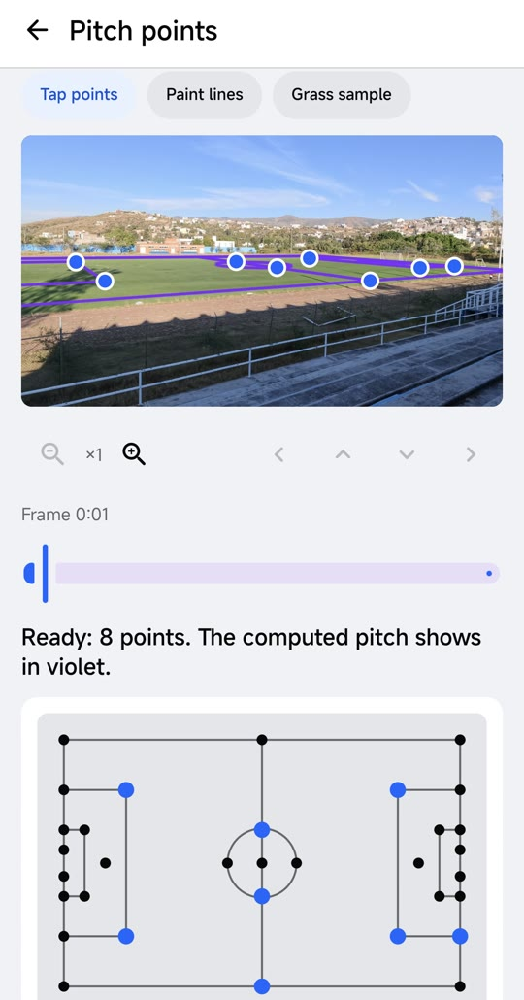
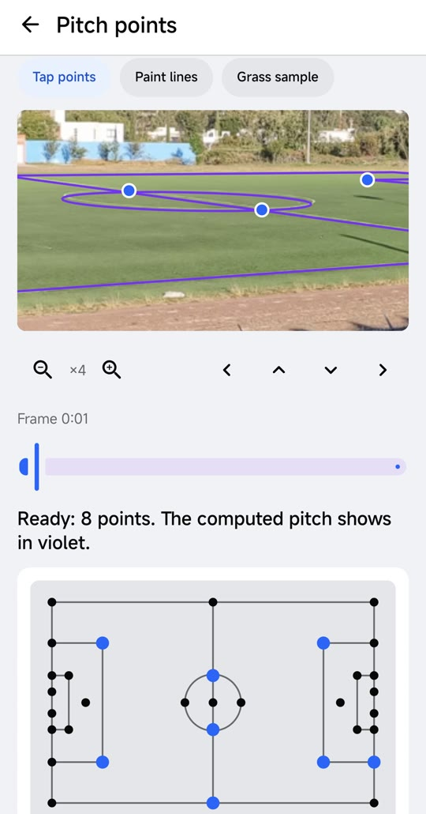
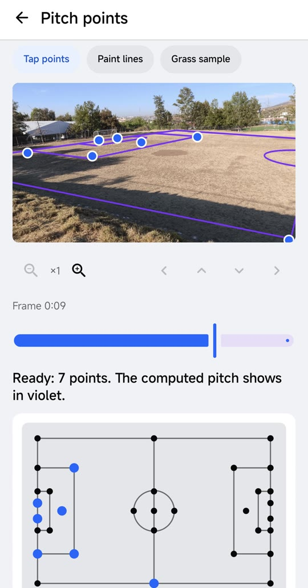
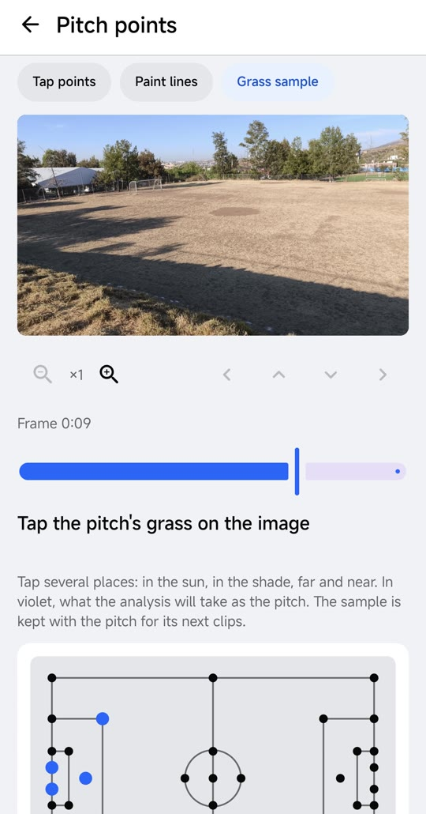

# pp-coach-tracker 0.4.4

- **Fecha:** 4 de noviembre de 2026.
- **Versión anterior:** [0.4.3](../0.4.3/README.md).
- **Probado en:** pruebas unitarias de la app y del worker, y un partido completo de 49 min (Test03) recalculado sin llamadas; el release se compiló y firmó con la misma llave que 0.4.3. En un teléfono real se usó para crear partidos y marcar la cancha con zoom en nuestras dos canchas ([capturas](#capturas-en-un-teléfono)).
- **Versiones:** app 0.4.4 (`versionCode` 8). La API sigue en 0.4.0, sin cambios en el contrato. El worker de producción ya corre los cambios de abajo.

## Qué cambió

- **Marcar la cancha:**
  - **Zoom:** botones para acercar y alejar la imagen (hasta 8×) y para moverla arriba, abajo, izquierda y derecha. Los toques siguen cayendo en el punto correcto con cualquier zoom.
  - **Líneas de dos puntos:** en el modo de líneas, "dos puntos" traza una línea recta con dos toques; "libre" sigue trazando con el dedo.
- **Pantallas internas:** el contenido, y con él el botón de guardar de los puntos de la cancha, ya no queda debajo de la barra de navegación de Android.
- **En el worker** (no requiere la app nueva):
  - **Mosaicos:** un jugador visto por los dos mosaicos de un video ancho queda en un solo track. En Test03, la mediana pasó de 50 s a 99 s de cajas por track, y los cuadros con cancha en metros de 40 % a 86 %.
  - **Balón:** se descarta el balón a más de 2 m fuera de las líneas cuando hay cancha en metros, y las líneas de SAM se piden en cuadros clave de todo el video.
  - **Posesión:**
    - un equipo gana el balón al sostenerlo 1 s;
    - se mide en metros donde hay cancha;
    - un pase no se le da a quien pasa cerca;
    - un pase entre compañeros no termina la posesión.

    En Test03, los cambios de posesión bajaron de 5.2 a 1.4 por minuto. Contra 4 min marcados a mano, coinciden en número (7 contra 9) y en el dueño cuadro a cuadro (95 %).
  - **Pausas:** 90 s o más con el balón quieto (la pausa de hidratación, una lesión larga) salen de las métricas, con una nota.

## Probado

- **Pruebas:** app (unitarias); worker, 132 pasan y 2 fallas esperadas.
- **Partido real:** Test03 (49 min), con las respuestas de SAM guardadas: la posesión contra marcas a mano y la pausa de hidratación revisada a ojo (24:09 a 27:16).
- **Segundo tiempo** (53 min, con SAM 3.1 real): la pausa de hidratación (23:16, 100 s) y una detención de 136 s a las 47:43, revisada a ojo, que parece un gol con su festejo ([results/07](../../results/07-partido-completo-dos-tiempos.md)).
- **Teléfono real:** crear un partido y marcar la cancha con zoom, en pasto sintético y en tierra ([capturas](#capturas-en-un-teléfono)).
- **Pendiente:** las líneas de dos puntos en un teléfono real.

## Capturas en un teléfono

Tomadas por el equipo el 4 de noviembre con la app 0.4.4 y nuestro propio video de las canchas de Yerbabuena, sin personas ([assets/aplicacion/](../../assets/aplicacion/README.md)).

| Inicio | Partido nuevo |
|---|---|
|  |  |

- **Inicio:** los clips recientes arriba y abajo los partidos, cada uno con los colores de sus equipos, la cancha, cuántos clips tiene y cuánto duran.
- **Partido nuevo:** lo primero que se configura son los dos equipos y el color de su camiseta. Ese color es el que el worker le pide a SAM 3.1 (`player in red jersey`) para seguir a cada equipo, sin entrenar nada.

| Marcar la cancha | Zoom ×4 | Cancha de tierra sin líneas | El mismo cuadro sin marcas |
|---|---|---|---|
|  |  |  |  |

Las de la cancha se explican en [results/04-hito-cancha-sin-lineas.md](../../results/04-hito-cancha-sin-lineas.md).

## Archivo

`android_native/dist/pp-coach-tracker-0.4.4-release.apk` (18.9 MB, no se versiona; lo deja ahí `make.bat release`).
